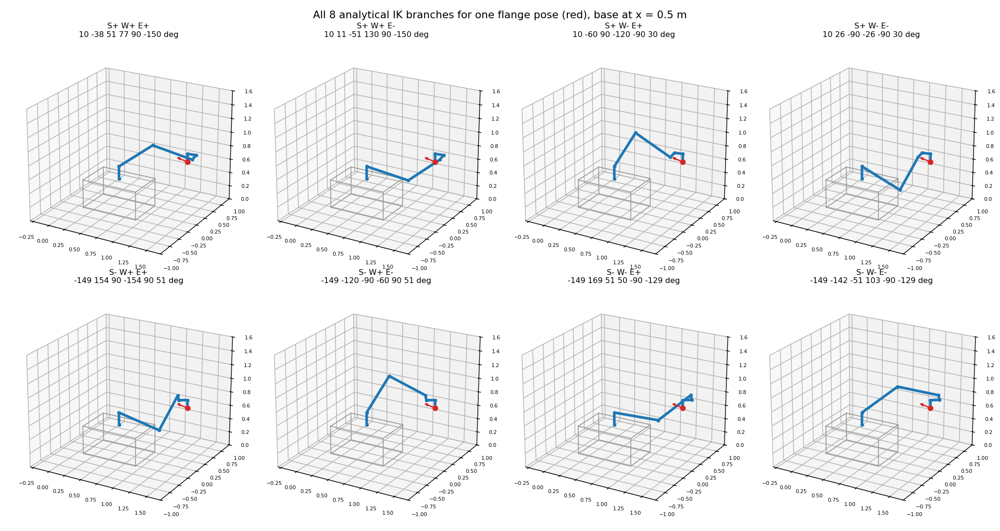
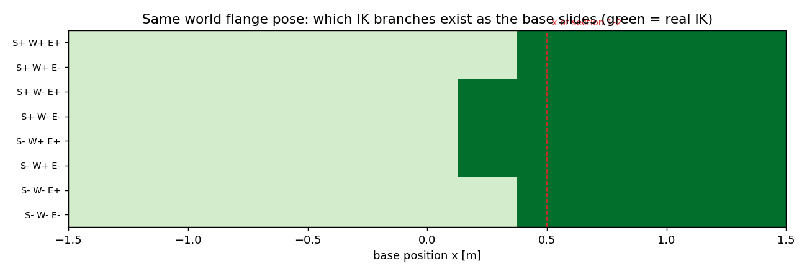

<!-- DRAFT of Report.md section 3, written to follow sections 1-2. Not merged into results/Report.md.
     Code: drafts/ik_ur12e_full.py (continues scripts/ik_ur12e.py), figures: drafts/ik_figures.py
     Figure paths below are relative to results/ (i.e. as they would appear once pasted into Report.md). -->

### 3. Analytical IK solver

For a fixed base position x the P6R is a UR12e whose target is shifted by -x along world X. The IK is
therefore solved on the 6R arm only, after moving the world flange target T* into DH frame 0:

$${}^{0}T_{6} = \big(\mathrm{Trans}_x(x)\,T_{\mathrm{mount}}\,T_{\mathrm{BASE}}\big)^{-1}\;T^{*}\;T_{\mathrm{TOOL}}^{-1}$$

(`T06_from_world` in `scripts/ik_ur12e.py`, checked against the DH rows over 100 random (x, q): 3.3e-16.)

#### 3.1 Why not Pieper

Pieper's split (position of the wrist centre -> q1..q3, then orientation -> q4..q6) needs the last three axes
to intersect. On the UR they do not: d5 = 0.11985 m and d6 = 0.11655 m separate them. This is the same fact
section 2.2 found in 3J5: the block C is not zero (column q4 moves O5 by d5). Instead the UR closed form uses
the one thing that *is* simple: axes 2, 3, 4 are parallel. They span a vertical "arm plane", offset by d4
from axis 1, and joints 2-3-4 form a planar 3R inside it.

#### 3.2 Derivation, five steps (8 = 2 x 2 x 2 branches)

Notation: ${}^{0}T_{6} = [R \mid p]$, columns $x_6, y_6, z_6$ of R; $c_i = \cos q_i$, $s_i = \sin q_i$.

**Step 1 - q1 from O5 (shoulder S±).** O5 is one flange offset behind the flange: $p_5 = p - d_6 z_6$.
O5 lies in the arm plane, and the arm plane is at distance d4 from axis 1. Seen from above, with
$r = \sqrt{p_{5x}^2 + p_{5y}^2}$:

$$q_1 = \operatorname{atan2}(p_{5y}, p_{5x}) \pm \arccos\!\left(\frac{d_4}{r}\right) + \frac{\pi}{2}, \qquad \text{real iff } r \ge d_4$$

The ± picks on which side of axis 1 the arm plane passes (shoulder left/right). $r = d_4$ is the
**shoulder singularity**: the two branches merge.

**Step 2 - q5 from the orientation (wrist W±).** The common axis of joints 2,3,4 is $z_1 = (s_1, -c_1, 0)$
in frame 0. Expressed in frame 6 it only depends on q5 and q6
(row 2 of $R_{34}$, then $R_{45}^T$, then $R_{56}^T$):

$$w = R^{T} z_1 = \begin{pmatrix} s_5 c_6 \\ -s_5 s_6 \\ c_5 \end{pmatrix}
\quad\Rightarrow\quad q_5 = \pm \arccos(w_z)$$

The sign of q5 is the wrist flip. $s_5 = 0$ is the **wrist singularity** (z6 parallel to the axes 2-3-4).

**Step 3 - q6 (unique).** From the first two components of the same vector:

$$q_6 = \operatorname{atan2}\!\left(\frac{-w_y}{s_5}, \frac{w_x}{s_5}\right)$$

At $s_5 = 0$ q6 is not determined (q4 and q6 rotate about the same axis); the solver then sets q6 = 0 and
lets q4 take the whole rotation.

**Step 4 - q2, q3 from a planar 2R (elbow E±).** With q1, q5, q6 known, peel them off:

$${}^{1}T_{4} = A_1^{-1}\;{}^{0}T_{6}\;A_6^{-1}A_5^{-1} = A_2A_3A_4$$

Its origin $(p_x, p_y, d_4)$ is O4 in frame 1, reached by the two links a2, a3 in the arm plane.
Law of cosines:

$$c_3 = \frac{p_x^2 + p_y^2 - a_2^2 - a_3^2}{2a_2a_3}, \qquad q_3 = \pm\arccos(c_3), \qquad
q_2 = \operatorname{atan2}(p_y, p_x) - \operatorname{atan2}(a_3 s_3,\; a_2 + a_3 c_3)$$

Real iff $|c_3| \le 1$ (O4 within reach of the 2R); $c_3 = \pm 1$ is the **elbow singularity**
(arm stretched or folded).

**Step 5 - q4 (unique).** The three parallel joints add their angles in the plane:

$$q_2 + q_3 + q_4 = \operatorname{atan2}\big({}^{1}R_{4}[1,0],\; {}^{1}R_{4}[0,0]\big)$$

Each step either has two roots or one, so a pose has at most **2 (S) x 2 (W) x 2 (E) = 8** branches.
A branch disappears only through step 1 (r < d4) or step 4 (|c3| > 1); q5 always has a root since |w_z| ≤ 1.
The three places where two branches meet (r = d4, s5 = 0, s3 = 0) are exactly the three singularity families of
section 2.3.

#### 3.3 Implementation

```python
SIGNS  = [[s, w, e] for s in (1, -1) for w in (1, -1) for e in (1, -1)]   # branch b = 4*iS + 2*iW + iE
LABELS = ["S+ W+ E+", "S+ W+ E-", ..., "S- W- E-"]

def ik_6r(T06):                                     # T06: (N,4,4) -> q (N,8,6), status (N,8)
    for b, (sS, sW, sE) in enumerate(SIGNS):
        t1, ok1      = theta1(T06, sS)              # step 1
        t5, t6       = theta5_6(T06, t1, sW)        # steps 2-3
        t2, t3, t4, ok3 = theta2_3_4(T06, t1, t5, t6, sE)   # steps 4-5
        q[:, b] = wrap([t1, ..., t6])               # wrap to (-pi, pi]
    status: 0 ok | 1 no real IK | 2 joint limit | 3 FK check failed
```

- **Vectorised** over N poses (all numpy, no loop over poses): ~59 000 poses/s, 8 branches each, on a laptop.
- **Wrapping and limits.** Every angle is wrapped to (-pi, pi]. With the project limits of ±pi on every arm
  joint, each geometric branch gives exactly one joint vector, so the joint-limit class is empty here; it is
  kept in the code so tighter limits (or the real ±2pi with its 2 representatives) can be plugged in.
- **Independent check.** Every kept root is pushed back through the DH forward model and rejected if
  position + rotation error > 1e-8.
- **Labels** are the signs used in the formulas: S = sign of the ± in q1, W = sign(q5), E = sign(q3).
  `branch_of(q)` recomputes the label of any joint vector from the same geometry.

#### 3.4 Validation

Round trip: 200 000 random q in [-pi, pi]^6 -> FK -> IK.

```text
original q recovered (|dq| < 1e-6)       : 100.000 %
worst recovery error                     : 2.4e-10 rad
every returned root reproduces the pose  : True
recovered root has q's own label         : 100.000 %
number of OK branches per pose (0..8)    : [0  0  5433  0  27066  0  10097  0  157404]
```

The branch count is always even: the elbow pair E+/E- appears and disappears together (same |c3| ≤ 1
condition), so x, the target, or the shoulder side can remove branches only two at a time.

Label persistence: 100 random straight joint-space paths, 300 steps each, solved pose by pose. At every step
we check that the nearest root to the previous root of branch b is again branch b.

```text
nearest root at the next step has the same label in 99.675 % of 194862 steps
the 634 label switches happen next to a singularity where two branches meet:
  shoulder  r < 1.05 d4   (S+ meets S-) :  67.2 %
  wrist     |sin q5| < 0.2 (W+ meets W-) :  24.3 %
  elbow     |sin q3| < 0.2 (E+ meets E-) :   8.5 %
  none of the three                      :   0.0 %
```

So labels are stable everywhere except at the branch-merging singularities, where by definition two
branches coincide and a label alone cannot tell them apart. This is why the path planner (section 5) must
track branches by continuity *and* monitor sigma_min, not only follow a fixed label.

#### 3.5 All solutions for one tool pose

Target = the flange pose of section 1.4 (x = 0.5 m, q = [10, -60, 90, -120, -90, 30] deg).

```text
branch     q1..q6 [deg]                                  |dp| vs URDF [m]  sig_min(J_red)  sig_min(J)
S+ W+ E+   [  10.0  -37.7   50.9   76.8   90.0 -150.0]          1.0e-15         0.2007      0.5406
S+ W+ E-   [  10.0   11.3  -50.9  129.6   90.0 -150.0]          5.1e-16         0.2036      0.5432
S+ W- E+   [  10.0  -60.0   90.0 -120.0  -90.0   30.0]          5.2e-16         0.3183      0.4837   <- original q
S+ W- E-   [  10.0   26.0  -90.0  -26.0  -90.0   30.0]          3.3e-16         0.3330      0.5164
S- W+ E+   [-148.6  154.0   90.0 -154.0   90.0   51.4]          5.6e-17         0.3330      0.5140
S- W+ E-   [-148.6 -120.0  -90.0  -60.0   90.0   51.4]          4.4e-16         0.3183      0.4757
S- W- E+   [-148.6  168.7   50.9   50.4  -90.0 -128.6]          5.6e-16         0.2036      0.5473
S- W- E-   [-148.6 -142.3  -50.9  103.2  -90.0 -128.6]          7.1e-16         0.2007      0.5381
```

All 8 exist, all reproduce the pose through the *independent* URDF chain, and the original configuration is
branch S+ W- E+. sigma_min(J) > sigma_min(J_red) for every branch: the slide always adds conditioning.



#### 3.6 First look at the redundancy: same pose, base slides

Keep the world target fixed and change only x:



```text
S+ W- E±, S- W+ E± : real IK for x >= +0.13 m
S+ W+ E±, S- W- E± : real IK for x >= +0.38 m
```

Between 0.13 m and 0.38 m only 4 of the 8 branches exist; below 0.13 m the target is out of reach. The base
position therefore does not just shift the arm, it **selects which branches are available**, and it does so
in elbow pairs. Sections 4 and 5 extend this from one pose to a grid of positions and to a path.
