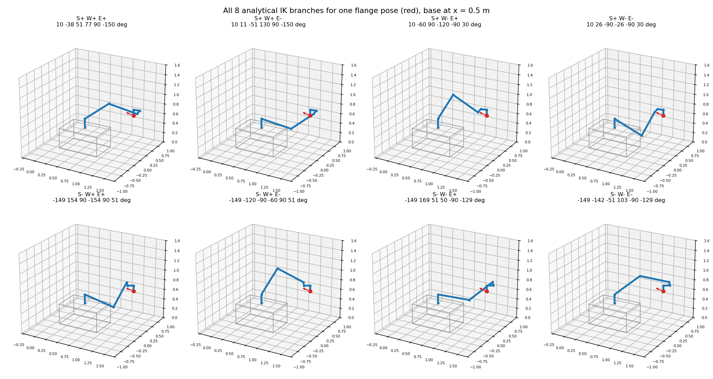
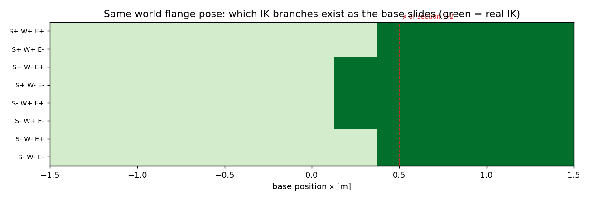

### 3. Analytical IK solver

Solver: `scripts/ik_ur12e.py`, validation: `scripts/step05_ik.py` (output in `results/step05_ik.md`).

#### 3.1 Problem: fixed x turns the P6R into a UR12e with a shifted target

With the base at x, the world flange target T* is moved into DH frame 0 of the arm:

$${}^{0}T_{6} = \big(\mathrm{Trans}_x(x)\; T_{\mathrm{mount}}\; T_{\mathrm{BASE}}\big)^{-1}\; T^{*}\; T_{\mathrm{TOOL}}^{-1}$$

From here on the problem is a pure 6R problem, and x no longer appears in the formulas: changing x only changes the
target that the arm sees.

#### 3.2 Plane split: three groups instead of a wrist split

The UR wrist is offset (d5, d6 ≠ 0), so axes 4, 5, 6 do not meet in one point and Pieper's position/orientation
split does not apply. Section 2.2 gives the decoupling that does apply. Axes 2, 3, 4 are parallel, so 3J5 is block
triangular, and its three blocks are the three groups of the IK:

```text
group  joints      quantity used                         2 roots    singular when (block of 2.2)
1      q1          position of O5 (wrist_2 origin)       S+ / S-    rho = 0        shoulder
2      q5, q6      orientation, given q1                 W+ / W-    sin q5 = 0     wrist
3      q2, q3, q4  planar 3R in the arm plane            E+ / E-    sin q3 = 0     elbow
```

Each group uses a quantity that depends only on the joints still unknown in that group. The groups are solved in
the order 1 -> 2 -> 3.

#### 3.3 Group 1: q1 from O5 (shoulder S±)

O5 is where the wrist_2 and wrist_3 axes cross, d6 behind the flange on the tool axis:
$p_5 = p - d_6 z_6$. It is fixed by the target alone. The upper arm and forearm move in a vertical plane through
axis 1. The wrist sits d4 to the side of that plane, and q2..q5 cannot change this offset. So the plane, turned by
q1, must leave O5 at distance d4. Seen from above, the plane is a tangent from axis 1 to a circle of radius d4
around O5, and there are two tangents:

$$q_1 = \mathrm{atan2}(p_{5y},\, p_{5x}) \pm \arccos\!\left(\frac{d_4}{r}\right) + \frac{\pi}{2},
\qquad r = \sqrt{p_{5x}^2 + p_{5y}^2} \;\ge\; d_4$$

- r < d4: no root (the inner hole of the maps in section 4).
- r = d4: the two tangents coincide (shoulder family, rho = 0).

Example (pose of 1.4): O5 = (-0.877, -0.332, 0.426) m in frame 0, r = 0.9375 m.
atan2 = -159.3°, arccos(d4/r) = 79.3°, so q1 = **10.0°** (S+) or **-148.6°** (S-).

#### 3.4 Group 2: q5, q6 from the orientation (wrist W±)

With q1 known, the common direction of axes 2-3-4 is $n = (\sin q_1, -\cos q_1, 0)$ in frame 0. Along n, O5 sits
at d4 (3.3), and the flange is O5 + d6 z6, so the tool axis has component $\cos q_5$ along n:

$$\cos q_5 = \frac{p \cdot n - d_4}{d_6}, \qquad q_5 = \pm \arccos(\cdot)$$

The sign of q5 is the wrist flip. q6 follows from the components of x6 and y6 along n:

$$q_6 = \mathrm{atan2}\!\big(-\mathrm{sgn}(\sin q_5)\,(y_6 \cdot n),\;\; \mathrm{sgn}(\sin q_5)\,(x_6 \cdot n)\big)$$

because, seen from the tool frame, n has the components $(\sin q_5 \cos q_6,\, -\sin q_5 \sin q_6,\, \cos q_5)$.

At sin q5 = 0 (wrist family) the tool axis is parallel to axes 2-3-4. Then q4 and q6 turn about the same axis,
only q4 + q6 is determined, and the solver sets q6 = 0.

#### 3.5 Group 3: q2, q3, q4 as a planar 3R (elbow E±)

With q1, q5, q6 known, the three outer transforms are peeled off:

$${}^{1}T_{4} = A_1^{-1}\; {}^{0}T_{6}\; A_6^{-1} A_5^{-1} = A_2 A_3 A_4$$

The point $p_{13}$ (O4 without its d4 offset, in frame 1) lies in the arm plane and is reached by the two links
a2, a3. The law of cosines gives

$$\cos q_3 = \frac{|p_{13}|^2 - a_2^2 - a_3^2}{2 a_2 a_3}, \qquad q_3 = \pm\arccos(\cdot), \qquad
q_2 = -\mathrm{atan2}(p_{13,y}, -p_{13,x}) + \arcsin\!\frac{a_3 \sin q_3}{|p_{13}|}$$

and q4 is the remaining in-plane rotation, read off ${}^{3}T_{4}$ (q2 + q3 + q4 = in-plane angle of the wrist).

- |cos q3| > 1: no root (outer reach of the maps).
- cos q3 = ±1: arm stretched or folded (elbow family).

#### 3.6 Branches, labels, angle wrapping

- Three groups with two roots each give at most 2 × 2 × 2 = **8 branches**. A branch is dropped when an acos
  argument leaves [-1, 1].
- Every angle is wrapped to (-π, π]. With the project limits of ±π on every joint, each geometric branch gives
  exactly one joint vector and no root is rejected by a limit. On a path, however, the ±π seam acts as a
  joint limit (section 5).
- **Label = sign triple** (sign rho, sign q5, sign q3). Each branch lies in its own aspect, the region cut out by
  the three singular surfaces det J_red = 0. `branch_of(q)` reads the label off any joint vector.

#### 3.7 Validation

From `results/step05_ik.md` (2000 random configurations, limits ±π):

```text
max |q_true - nearest branch|  = 6.4e-11 rad   (the input configuration is always recovered)
max |FK(branch) - T06|         = 3.4e-12       (every returned branch reaches the pose)
number of branches per pose    = {2: 51, 4: 268, 6: 98, 8: 1583}
label vs sign triple read from q: 14426 solutions, 0 mismatches
```

The count is always even, because roots appear and disappear in pairs at the singular surfaces.

**Label persistence along paths** (`drafts/ik_persistence_check.py`). We took 100 random straight joint-space
paths with 300 steps each and ran FK then IK at every step. For each label we checked whether the nearest root
at the next step carries the same label:

```text
same label in 99.72 % of 194256 steps;  the 545 switches, by closest singular family:
  shoulder (rho = 0) 68.4 %    wrist (sin q5 = 0) 23.9 %    elbow (sin q3 = 0) 7.7 %
```

Labels change only next to a singular surface, where two branches meet. A path planner therefore follows a
branch by continuity and monitors sigma_min; the label alone is not enough (section 5).

**Independent check in the course simulator (Module 3).** The 8 solutions of the pose of 1.4 were loaded into
Module 3, which computes forward kinematics with its own code. All 8 show 0.000 mm / 0.0000°. Files:
`drafts/sim/umr_ur12e_sim_report.urdf` and `drafts/sim/m3_section3_pose.csv`. The repo's
`sim/umr_ur12e_sim.urdf` mounts the arm 1 cm lower and rotated by π about axis 1, so it does not match this
report's model; the corrected copy matches the URDF chain to 6e-10.

<!-- TODO Megi: insert the Module 3 screenshot here -->

#### 3.8 All solutions of one tool pose

Target = flange pose of 1.4 (x = 0.5 m, q0 = [10, -60, 90, -120, -90, 30] deg):

```text
branch           q1       q2       q3       q4       q5       q6       rho  sin q3  sin q5   det J_red    |FK-T|
S+ W+ E+      10.00   -37.74    50.91    76.83    90.00  -150.00    -0.921   0.776   1.000  -2.504e-01   1.5e-15
S+ W+ E-      10.00    11.27   -50.91   129.64    90.00  -150.00    -0.921  -0.776   1.000   2.504e-01   1.9e-15
S+ W- E+      10.00   -60.00    90.00  -120.00   -90.00    30.00    -0.921   1.000  -1.000   3.226e-01   1.5e-15   <- q0
S+ W- E-      10.00    26.02   -90.00   -26.02   -90.00    30.00    -0.921  -1.000  -1.000  -3.226e-01   1.5e-15
S- W+ E+    -148.59   153.98    90.00  -153.98    90.00    51.41     0.921   1.000   1.000   3.226e-01   1.3e-15
S- W+ E-    -148.59  -120.00   -90.00   -60.00    90.00    51.41     0.921  -1.000   1.000  -3.226e-01   1.3e-15
S- W- E+    -148.59   168.73    50.91    50.36   -90.00  -128.59     0.921   0.776  -1.000  -2.504e-01   1.3e-15
S- W- E-    -148.59  -142.26   -50.91   103.17   -90.00  -128.59     0.921  -0.776  -1.000   2.504e-01   1.3e-15
```



The same tool pose is reached by 8 physically different postures. The two shoulder sides differ by about 159° in
q1, and within each side the wrist flips and the elbow goes up or down.

#### 3.9 The base position selects the branches

Same world target, base slid along x (`results/step05_ik.md` section 5, and a finer sweep):



```text
x <  0.13 m          0 branches  (target out of reach)
0.13 <= x < 0.38 m   4 branches  S+ W- E±, S- W+ E±
x >= 0.38 m          8 branches
```

Branches come and go in elbow pairs. Fixing x does not just shift the arm; it decides which branches exist.
Sections 4 and 5 extend this from one pose to a grid of positions and to a path.
