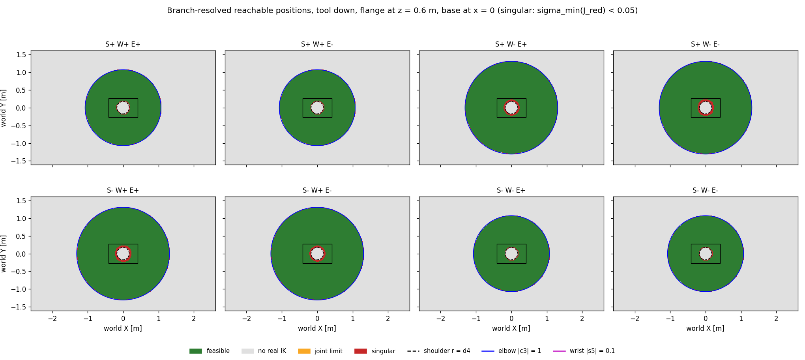
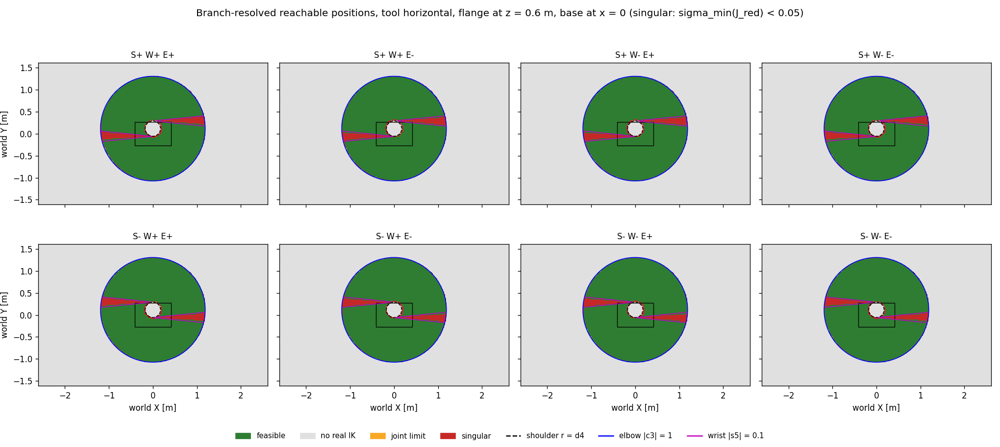
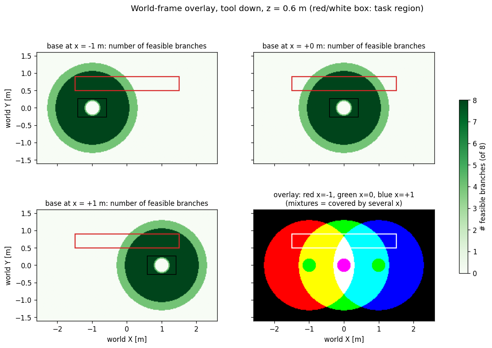
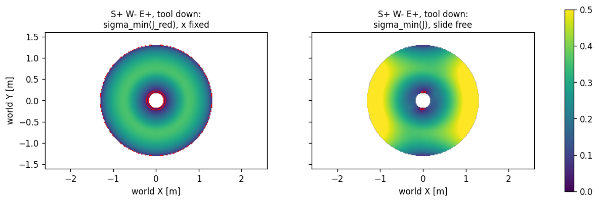
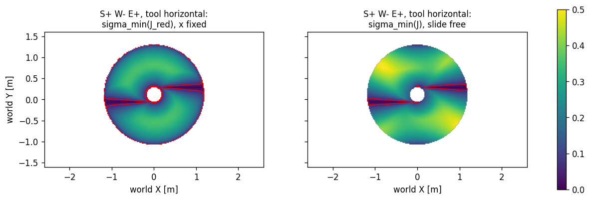

#### 4.4 Per-branch outcome classes, two flange orientations

Code: `drafts/maps_section4.py` (z = 0.9 m as in 4.1; output `drafts/maps_section4_output_z09.txt`). The IK and
the Jacobian are vectorised; the singular values agree with `scripts/jacobian_p6r.py` to 1.8e-15.

Each branch gets one of four outcomes per grid cell: feasible / no real IK / joint limit / singular
(sigma_min(J_red) < 0.05). The two orientations are:

```text
tool down        flange x = -Z world   R = [[0,0,1],[0,1,0],[-1,0,0]]   (as in 4.1)
tool horizontal  flange x = +Y world   R = [[0,-1,0],[1,0,0],[0,0,1]]   (facing the task side)
```

(In our chain the end frame is the ROS `flange` frame, whose x axis points out of the tool.)




```text
area per class at x = 0 [m^2]      feasible  no real IK  joint limit  singular
tool down        S+W+E±, S-W-E±       3.01      13.74        0.00       0.06
                 S+W-E±, S-W+E±       4.67      12.07        0.00       0.07
tool horizontal  every branch         3.81      12.73        0.00       0.26-0.27
```

- **Tool down:** each branch map is an annulus. The inner hole is the shoulder family (r < d4) and the outer edge
  the elbow family (|cos q3| = 1). There is **no wrist singularity**: the tool axis is vertical and n is
  horizontal, so cos q5 = 0 and q5 = ±90° everywhere. The two reach classes differ by about 2·d5, because with
  q5 = ±90° the wrist link points away from or toward axis 1. This is the 4-branch ring of 4.2.
- **Tool horizontal:** the wrist family appears as two thin wedges along ±X, where the tool axis (+Y) is
  parallel to axes 2-3-4, i.e. where the arm plane runs along world X. The singular area is about 4× larger.
- **Joint-limit class:** empty in every map. With ±π limits and wrapped angles no root can leave the limits
  (see 3.6).

#### 4.5 World overlay on a task region

Task region: a 3 m strip beside the path, x ∈ [-1.5, 1.5] m, y ∈ [0.5, 0.9] m.



```text
covered by >= 1 feasible branch     tool down   tool horizontal
base at x = -1 m                       50.8 %          51.0 %
base at x =  0 m                       67.5 %          67.9 %
base at x = +1 m                       50.1 %          50.3 %
union of the three                    100.0 %         100.0 %
only one x works on                    34.3 %          33.5 %
```

No single base position covers the strip. The three together do, but a third of the strip is covered by **one
x only**. There the base position is forced, and that is where a path has to move the base (section 5).

#### 4.6 Which singular cells the slide rescues (J_red vs J on the maps)

Each singular cell is assigned to the det J_red factor of 2.2 that is closest to 0 (the factor with the smallest
normalised value), and we check whether the whole body is regular there (sigma_min(J) ≥ 0.05):

```text
                tool down                      tool horizontal
shoulder     416 cells, rescued 93.3 %       438 cells, rescued 90.0 %
elbow        960 cells, rescued 88.3 %       992 cells, rescued 95.6 %
wrist          0 cells                      3960 cells, rescued 12.5 %
```




This is the map-level version of the type A / type B result of 2.3:
- The **elbow** boundary loses a radial translation. The slide supplies it along ±X (bright lobes) but not along
  ±Y, where the radial direction is perpendicular to the slide.
- The **wrist** family mostly loses a rotation, which a prismatic joint cannot supply, so only 12.5 % of those
  cells are rescued.

The singular class is a thin band around the critical curves whatever the threshold: 0.0 / 0.3 / 1.8 / 6.9 % of
the reachable cells for 0.01 / 0.02 / 0.05 / 0.10.
