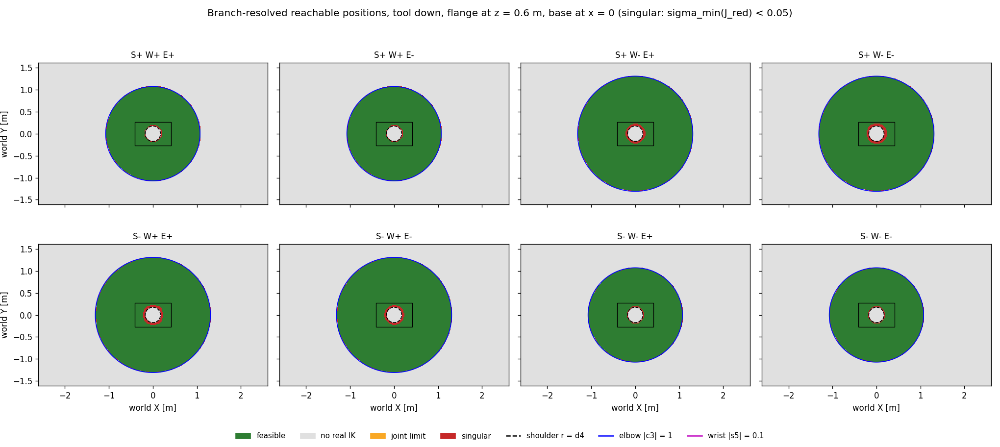
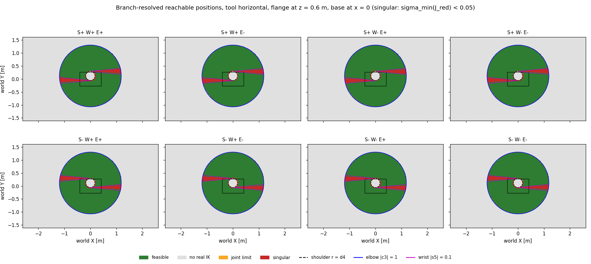
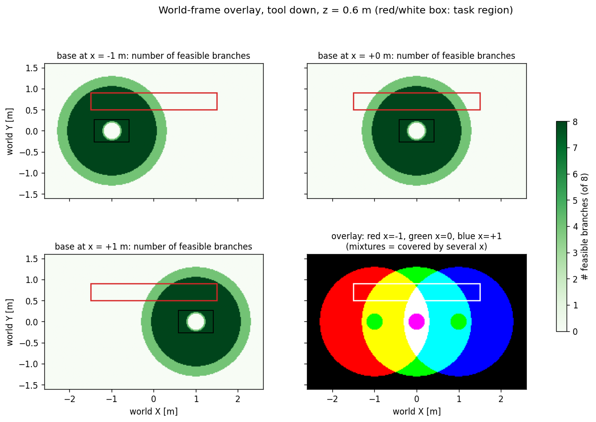
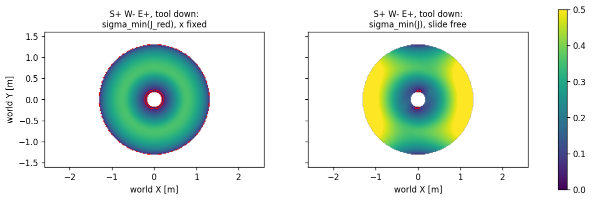
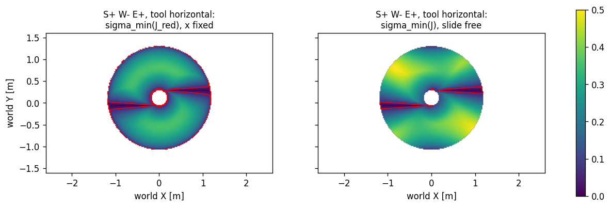

<!-- DRAFT of Report.md section 4. Not merged into results/Report.md.
     Code: drafts/maps_section4.py (uses drafts/ik_ur12e_full.py), raw output: drafts/maps_section4_output.txt
     Figure paths are relative to results/. -->

### 4. Reachable-position maps over discrete base positions

#### 4.1 Set-up

The flange orientation is fixed and the flange position is swept over a horizontal grid in the world frame
(z = 0.60 m, about shoulder height; X in [-2.6, 2.6] m, Y in [-1.6, 1.6] m, step 2 cm, 42 000 cells).
At each cell the IK of section 3 is evaluated, and **every branch** is given one of four outcomes:

| class | condition |
|---|---|
| feasible | real IK, within limits, sigma_min(J_red) ≥ 0.05 |
| no real IK | r < d4 (step 1) or \|c3\| > 1 (step 4) |
| joint limit | real IK, outside the ±pi limits |
| singular | real IK, sigma_min(J_red) < 0.05 |

Two orientations. Note that the end frame of our chain is the ROS-Industrial `flange` frame, whose
**x-axis** points out of the tool (DH z6), so the approach direction is the first column of R:

```python
R_DOWN = [[0, 0, 1], [0, 1, 0], [-1, 0, 0]]   # flange x = -Z world: picking from above
R_SIDE = [[0, -1, 0], [1, 0, 0], [0, 0, 1]]   # flange x = +Y world: tool horizontal, facing the task side
```

All maps run in ~7 s in total (vectorised IK + batched SVD). The vectorised Jacobian was checked
against `scripts/jacobian_p6r.py`: singular values agree to 1.8e-15 (J_red) and 1.3e-15 (J).

#### 4.2 Where the boundaries come from: det J_red factorises

The critical curves are not found numerically, they come out of the IK formulas. Numerically verified on
200 random configurations (error 2.5e-16):

$$\det J_{red} = a_2 a_3\; \underbrace{s_3}_{\text{elbow}}\; \underbrace{s_5}_{\text{wrist}}\;
\underbrace{\left(a_2 c_2 + a_3 c_{23} + d_5 s_{234}\right)}_{\text{shoulder}}$$

and the shoulder factor satisfies $f_{sh}^2 + d_4^2 = r^2$ with $r = |O_{5,xy}|$ (error 6.7e-16), so

| family | det factor = 0 | in the IK | effect on the map |
|---|---|---|---|
| shoulder | $f_{sh} = 0$ | $r = d_4$: the two q1 roots of step 1 merge | inner hole (no IK inside), singular ring around it |
| elbow | $s_3 = 0$ | $\|c_3\| = 1$: the two q3 roots of step 4 merge | outer reach boundary |
| wrist | $s_5 = 0$ | $w_z = \pm1$: the two q5 roots of step 2 merge | singular curve *inside* the feasible region |

So every boundary of "no real IK" is a singular curve (two branches merge there, J_red loses rank), and the
wrist singularity is the only family that cuts through the interior of the workspace. These are the
critical curves of the IKS-distribution lecture, drawn as contours on the maps below.

#### 4.3 Branch maps at x = 0

Tool down:



```text
area per class at x = 0 [m^2]    feasible   no real IK   joint limit   singular
S+ W+ E±                             3.46        13.29          0.00       0.06
S+ W- E±                             5.17        11.51          0.00       0.12
S- W+ E±                             5.17        11.51          0.00       0.12
S- W- E±                             3.46        13.29          0.00       0.06
```

- Each map is an annulus around axis 1: inner hole r < d4 (shoulder), outer circle |c3| = 1 (elbow).
- **No wrist singularity** for tool down: z1 is horizontal and the approach axis is vertical, so
  $w_z = z_1 \cdot z_6 = 0$ and q5 = ±90° everywhere.
- Two reach classes: S+W- / S-W+ reach 1.31 m, S+W+ / S-W- only 1.08 m. The difference 0.23 m ≈ 2 d5:
  with q5 = ±90° the wrist link d5 lies in the horizontal plane and points either away from or toward
  axis 1.
- E+ and E- always have the same map (same |c3| ≤ 1 condition), and (S, W) ↔ (-S, -W) give the same
  area (the UR "shoulder flip" symmetry).

Tool horizontal:



- The annulus is shifted by about d6 along +Y: the IK reasons about O5 = p - d6·(approach) and the approach
  is +Y.
- The **wrist singularity appears**: two thin red wedges along ±X, where the approach direction (+Y) is
  parallel to the axes 2-3-4, i.e. where the arm plane runs along world X. The singular area grows from
  0.06–0.12 m² (down) to 0.29 m² per branch.
- All 8 branches have the same area here (4.07 m²), and this does not depend on the map height
  (checked at z = 0.3 and 0.9 m).

**Joint-limit class.** It is empty in every map. With limits of ±pi and every angle wrapped to (-pi, pi],
no root can be outside the limits. The class is kept in the code for tighter limits; with the real UR
limits (±2pi) each branch would instead have two representatives.

#### 4.4 Maps at x = -1, 0, +1 and the world overlay

Check: map(x = +1) equals map(x = 0) shifted by +1 m on **100 %** of the overlapping cells, as expected
from fixing x = translating the arm. The content is in the overlaps.



Task region: a 3 m long strip at y ∈ [0.5, 0.9] m, x ∈ [-1.5, 1.5] m (e.g. a shelf alongside the path).
Share of the strip covered by at least one feasible branch:

```text
                      tool down   tool horizontal
base at x = -1 m         53.5 %          51.3 %
base at x =  0 m         73.1 %          68.6 %
base at x = +1 m         52.9 %          50.6 %
union of the three      100.0 %         100.0 %
only one x works on      27.2 %          32.5 %
```

No single base position covers the task. Together the three do, but more than a quarter of the strip is
covered by **one x only**. That is exactly where the choice of x is forced, and it is where the path of
section 5 will have to move the base.

#### 4.5 Reduced vs full Jacobian on the maps: which singular cells the slide rescues

Same branch (S+ W- E+, the configuration of sections 1-2), sigma_min with x fixed vs with the slide free:




Singular cells (sigma_min(J_red) < 0.05, all branches, x = 0), classified by the det factor closest to 0,
and whether the whole body is regular there (sigma_min(J) ≥ 0.05):

```text
                     tool down                     tool horizontal
shoulder     904 cells, rescued  87.2 %      606 cells, rescued  86.1 %
elbow        928 cells, rescued 100.0 %      988 cells, rescued 100.0 %
wrist          0 cells                      4222 cells, rescued  11.4 %
```

This is the map-level version of section 2.3:
- **Elbow** (outer boundary): the lost direction is radial. The slide supplies it, most strongly along
  ±X (yellow lobes on the right panel), and least along ±Y, where the radial direction is perpendicular to
  the slide (darker band at the top and bottom: type A turning into type B).
- **Shoulder**: mostly rescued, again depending on the direction.
- **Wrist**: mostly *not* rescued. The lost direction is a rotation, and a prismatic joint cannot supply a
  rotation. This confirms the expected result of the proposal.

Threshold sensitivity (tool down, x = 0): sigma_min < 0.01 / 0.02 / 0.05 / 0.10 marks 0.0 / 0.2 / 2.1 /
7.4 % of the reachable cells. The singular class is a thin band around the critical curves whatever the
threshold, so the conclusions do not depend on the choice of 0.05.
