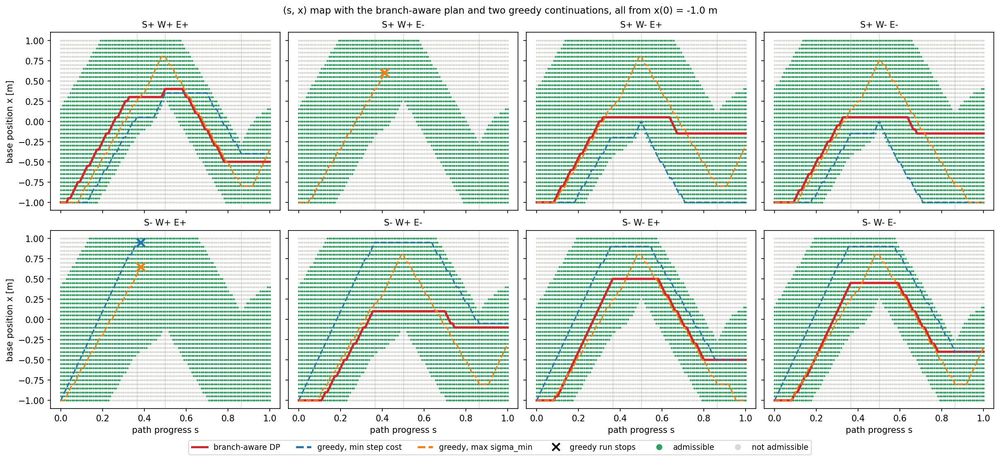
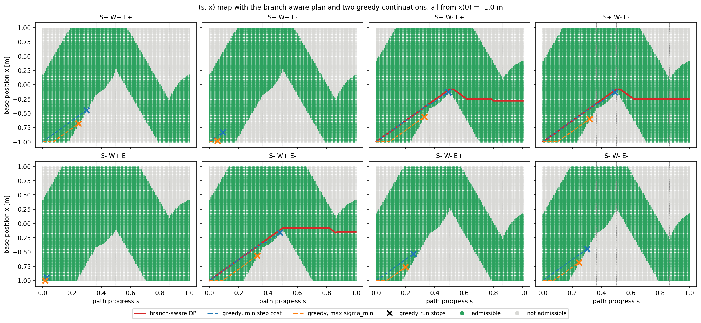
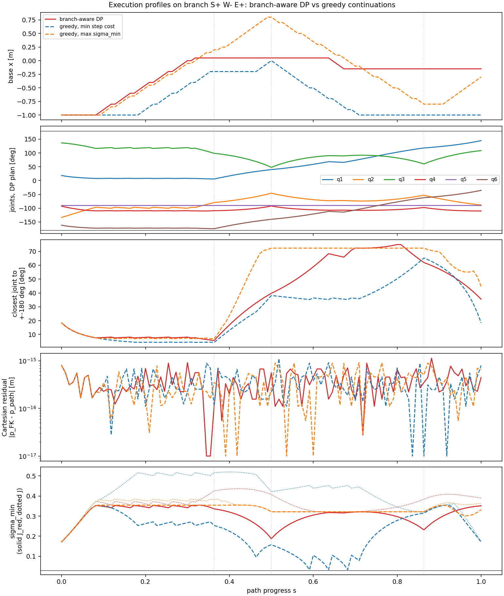

<!-- DRAFT additions to section 5 (wyang's 5.1-5.5 on origin/main stay as they are). Not merged into results/Report.md.
     Code: drafts/section5_planning.py (same path, grid, thresholds and DP as scripts/step07_sx_map.py)
     Raw output: drafts/section5_output.txt (base speed <= 1.25 x tool speed, the step-07 setting)
                 drafts/section5_output_slow.txt (base speed <= 0.42 x tool speed)
     Figure paths are relative to results/. -->

#### Suggested change to 5.3 (one sentence)

The sentence *"No horizontal line stays green in any panel, so a parked base cannot execute this path"* is not quite
true. A parked base at **x ∈ [-0.10, +0.10] m** completes the whole rectangle on three branches (S+ W- E±, S- W+ E-).
The horizontal line passes through a 20 cm corridor between the two grey wedges. What forces the base to move is the
**start position x(0) = -1 m**: parked there, every branch stops by s = 0.24. Suggested wording:

> Only a narrow corridor, x ∈ [-0.10, 0.10] m on three branches, lets a parked base execute the path. From the start
> position x(0) = -1 m no horizontal line stays green, so the base must move.

#### 5.6 Fixed-x baseline: one continuation per branch

With the base parked, each admissible root at s = 0 is followed along the path (step rule as in 5.4:
|dq| ≤ 0.5 rad per step on the wrapped angles, so a jump across ±π counts as reaching the joint limit).

```text
branch     | base parked at x = 0 m                          | base parked at x = -1 m
S+ W+ E+   |  44 % done, s = 0.45: no root (out of reach)    |  17 % done, s = 0.18: no root (out of reach)
S+ W+ E-   |   8 % done, s = 0.09: q4 reaches +-pi seam      |   5 % done, s = 0.05: q4 reaches +-pi seam
S+ W- E+   | completes                                       |  23 % done, s = 0.24: no root (out of reach)
S+ W- E-   | completes                                       |  23 % done, s = 0.24: no root (out of reach)
S- W+ E+   |   2 % done, s = 0.03: q4 reaches +-pi seam      |   2 % done, s = 0.03: q2 reaches +-pi seam
S- W+ E-   | completes                                       |  23 % done, s = 0.24: no root (out of reach)
S- W- E+   |  40 % done, s = 0.41: q2 reaches +-pi seam      |  15 % done, s = 0.15: q2 reaches +-pi seam
S- W- E-   |  44 % done, s = 0.45: no root (out of reach)    |  17 % done, s = 0.18: no root (out of reach)

label persistence on these runs: the nearest root has the same label in 100 % of 1164 steps
```

There are only two failure causes on this path: the tool leaves the reach band (elbow family, the root
disappears), or a joint reaches the ±π seam. No branch stops on a singularity, because tool-down keeps q5 at ±90°
and the rectangle stays outside the shoulder hole (see 5.2). Since no branches merge, the analytical labels
are also the continuation labels: the nearest root at the next step always has the same label.

#### 5.7 Greedy continuation vs branch-aware planning

The proposal's greedy planner chooses x **locally**. At every step it takes one admissible neighbour (same branch,
|dx| ≤ 0.05 m, |dq| ≤ 0.5 rad, the same constraints as the DP) and never looks ahead. We use two local rules:

- **greedy, min step cost**: the neighbour with the smallest |dq| + 2|dx|. This is the DP cost, minimised one step at a time.
- **greedy, max sigma_min**: the neighbour with the largest sigma_min(J_red), i.e. the safest-looking step.

All runs start at x(0) = -1 m on the given branch. The DP of 5.4 is reproduced exactly (costs agree within 0.005).

**At the step-07 base-speed bound (|dx/ds| ≤ 1.25):**

```text
branch     | branch-aware DP | greedy, min step cost | greedy, max sigma_min
S+ W+ E+   | cost 11.79      | completes, cost 13.03 | completes, cost 15.31
S+ W+ E-   | no schedule     | fails s=0.42, q4 seam | fails s=0.42, q4 seam
S+ W- E+   | cost 10.31      | completes, cost 15.02 | completes, cost 14.99
S+ W- E-   | cost 10.51      | completes, cost 15.00 | completes, cost 14.42
S- W+ E+   | no schedule     | fails s=0.39, q2 seam | fails s=0.39, q2 seam
S- W+ E-   | cost 11.04      | completes, cost 13.95 | completes, cost 15.70
S- W- E+   | cost 12.97      | completes, cost 14.56 | completes, cost 15.04
S- W- E-   | cost 12.76      | completes, cost 14.98 | completes, cost 16.08
```



With a fast base, all three planners complete the same 6 branches. Greedy is 10–46 % more expensive, and the two
greedy rules fail differently:
- **min step cost** keeps the base still as long as it can, because base motion costs. It rides the lower edge
  of the green band, which is the reach boundary (elbow family). Its sigma_min(J_red) drops to **0.033**, just
  above the 0.03 threshold, against 0.172 for the DP.
- **max sigma_min** chases the middle of the band and moves the base **3.9 m**, against 1.25 m for the DP.

**Slower base.** The slope bound is the base speed relative to the tool speed. Tightening it separates the planners:

```text
base speed <= k x tool speed     1.25   0.94   0.62   0.50   0.42   0.31
branch-aware DP                   6/8    6/8    5/8    3/8    3/8    0/8
greedy, min step cost             6/8    6/8    3/8    3/8    0/8    0/8
greedy, max sigma_min             6/8    6/8    3/8    2/8    0/8    0/8
```
(complete executions out of 8 branches; the x grid step equals the base step in each column)



At k = 0.42 the DP still finds three schedules, and both greedy planners fail on every branch, each time for the
same reason: *"green band moved out of reach"*. The figure shows the mechanism. On the first long side the green
band climbs with the tool, and a slow base can only just keep up if it starts climbing **immediately** and keeps
to the upper part of the band, so that it passes **above** the tip of the grey wedge at s ≈ 0.5.
- **min step cost** follows almost the same line as the DP but hesitates for a step. It arrives a few
  centimetres too low at s = 0.49 and meets the tip of the wedge.
- **max sigma_min** first waits where the arm is best conditioned and is too late by s = 0.33.

No local rule can see the wedge coming. The DP sees the whole (s, x) plane and commits early.

#### 5.8 Execution profiles

Best DP branch (S+ W- E+) with its two greedy runs, step-07 base speed:



```text
run                    s reached  base travel  max |dx/ds|  min seam margin  max pos residual  min sig(J_red)  min sig(J)
branch-aware DP             1.00      1.25 m        1.25         5.7 deg          1.1e-15           0.172        0.173
greedy, min step cost       1.00      2.00 m        1.25         4.3 deg          1.1e-15           0.033        0.173
greedy, max sigma_min       1.00      3.90 m        1.25         7.0 deg          9.2e-16           0.172        0.173
```

- **Cartesian residual** ~1e-15 m everywhere. Every executed configuration is a closed-form IK root, re-checked
  through the independent URDF chain. Only the motion between samples is unchecked; the IK itself adds no error.
- **Joint-limit margin.** On the first long side q6 sits within 4–7° of -180° on every run. This branch is close to
  the seam that eliminated S+ W+ E- and S- W+ E+. With the real UR limits of ±2π the seam disappears, so the two
  "no schedule" branches could become feasible (not checked). The ±π convention is a design choice that shapes the result.
- **Singularity margin.** sigma_min(J) (dotted) stays ≥ 0.17 for every run, even where the greedy-cost run takes
  sigma_min(J_red) down to 0.033. The arm alone is close to the elbow singularity, but the whole body is not:
  the slide supplies the lost radial direction (type A, section 2.3).

#### 5.9 Findings (additions)

- A parked base executes the rectangle only inside a 20 cm corridor around x = 0, on three branches. From the
  start x(0) = -1 m the base has to move.
- Two things kill a branch on this path: leaving the reach band (elbow family) and the ±π seam. Singularities
  play no role, because tool-down removes the wrist family and the path avoids the shoulder hole.
- Greedy vs branch-aware: with a fast base, both complete the same branches, but greedy is 10–46 % more
  expensive and either rides the reach boundary or wanders. With a base slower than about 0.6× the tool speed,
  greedy fails where the DP succeeds. The reason is visible in the (s, x) map: the base must commit early to pass
  above a grey wedge, and no one-step rule can see the wedge.
