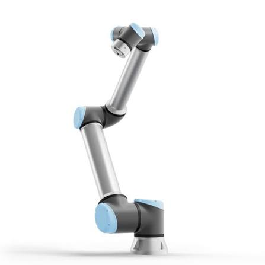
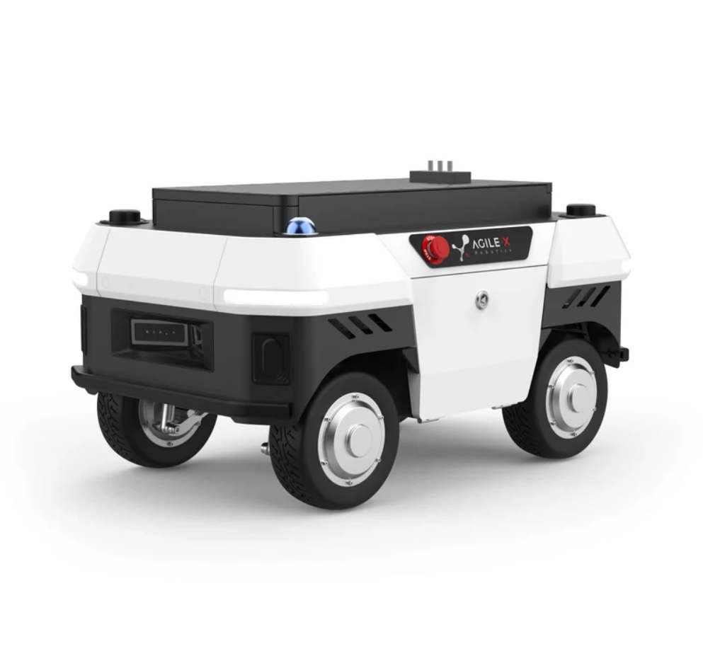
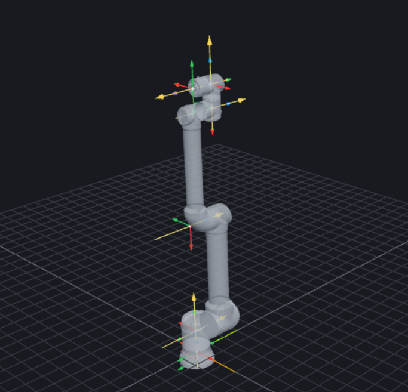
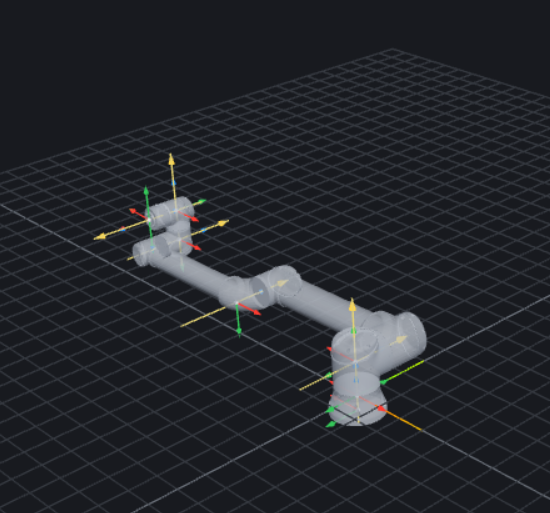
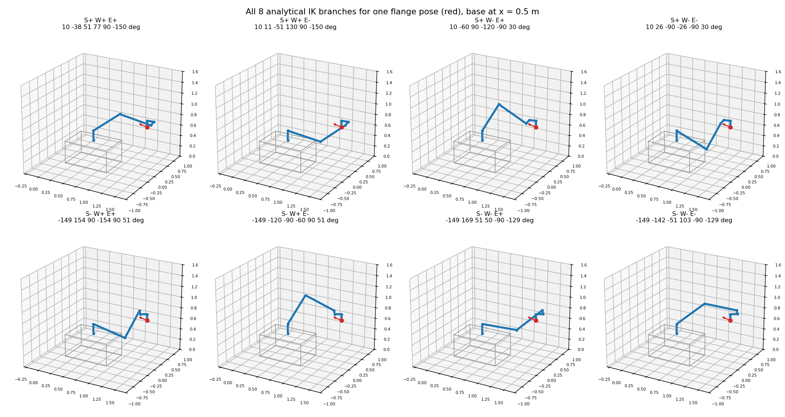
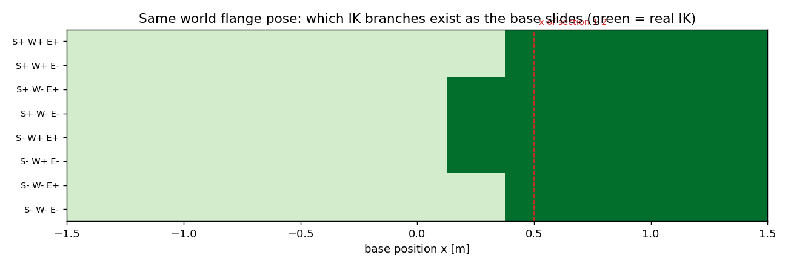

# Base Position as a Redundancy Parameter: Branch-Resolved IK, Workspace Structure and Path Planning for a Mobile Base + UR12e

ENG-654 | Kinematics-Grounded Motion Planning for Robots | Project 1G Report




## Motivation
An AgileX UMR omnidirectional base can translate in X and Y and rotate in yaw. It carries a
6R UR12e arm performing a full six-dimensional Cartesian task. Taken as one system the robot
is redundant: a single tool pose is realised by a continuous family of configurations rather
than a discrete set.

For this project the base is restricted to translation along the world X axis and treated as a
prismatic joint. The result is a P6R robot (one prismatic joint followed by six revolute
joints) with seven degrees of freedom and a one-dimensional self-motion for every reachable
tool pose. Fixing the base position x = a reduces the robot to a UR12e whose target has been
shifted by -a along X. Every value of a therefore produces the same finite set of IK branches,
but applied to a different target. The redundancy becomes visible only when x is allowed to
vary while the task stays fixed: the base position then decides which branches exist, how far
each is from a joint limit or a singularity, and whether a continuous execution is possible.

The central question of this project is:

> **How does the base position x select among the IK branches and reachable regions of the
> UR12e, and how can x and the branch be planned jointly so that a Cartesian task is executed
> continuously?**

## Methods

### 1. Forward Kinematic models of P6R
First step, 3 models: URDF chain, DH table, PoE from screws are built with the UR12e URDF sheet. Secondly, the base UMR data is added to each model. 

#### 1.1 URDF chain from URDF sheet and AgileX UMR product sheet:
```python 
UR_CHAIN = [
    ("base_link -> base_link_inertia", [0, 0, 0],              [0, 0, pi],        None),
    ("1 shoulder_pan",                 [0, 0, 0.1807],         [0, 0, 0],         [0, 0, 1]),
    ("2 shoulder_lift",                [0, 0, 0],              [pi/2, 0, 0],      [0, 0, 1]),
    ("3 elbow",                        [-0.6127, 0, 0],        [0, 0, 0],         [0, 0, 1]),
    ("4 wrist_1",                      [-0.57155, 0, 0.17415], [0, 0, 0],         [0, 0, 1]),
    ("5 wrist_2",                      [0, -0.11985, 0],       [pi/2, 0, 0],      [0, 0, 1]),
    ("6 wrist_3",                      [0, 0.11655, 0],        [pi/2, pi, pi],    [0, 0, 1]),
    ("wrist_3 -> flange",              [0, 0, 0],              [0, -pi/2, -pi/2], None),
]
P6R_CHAIN = [
    ("0 base_x  world -> umr_base",   [0, 0, 0],      [0, 0, 0],  "P",  [1, 0, 0]),
    ("mount    umr_base -> base_link", [0.0, 0.0, 0.42], [0.0, 0.0, 0.0], None, None),
] + [(name, xyz, rpy, "R" if axis is not None else None, axis) for name, xyz, rpy, axis in UR_CHAIN]
```

#### 1.2 DH table (vendor values, validated against the URDF chain):
```python
DH_UR = [                     
    (0.1807,  0.0,      pi/2),
    (0.0,    -0.6127,   0.0), 
    (0.0,    -0.57155,  0.0), 
    (0.17415, 0.0,      pi/2),   
    (0.11985, 0.0,     -pi/2),   
    (0.11655, 0.0,      0.0), 
]
T_BASE_UR = origin([0, 0, 0], [0, 0, pi])          # base_link -> DH frame 0 (yaw pi)
T_TOOL    = origin([0, 0, 0], [0, -pi/2, -pi/2])   # DH frame 6 -> flange

P6R_DH = [("P", 0.0,   0.0, 0.0, -pi/2)]           # row 0: slide along z_0 = world x
P6R_DH += [("R", pi/2, *DH_UR[0])]                 # row 1: UR row 1 with +pi/2 theta offset
P6R_DH += [("R", 0.0,  *row) for row in DH_UR[1:]] # rows 2..6: UR rows unchanged
T_BASE_P6R = np.eye(4)                             # world -> DH frame 0 at the mount height,
T_BASE_P6R[:3, :3] = [[0, 0, 1],                   # columns (x0, y0, z0) = (world y, world z, world x)
                      [1, 0, 0],
                      [0, 1, 0]]
T_BASE_P6R[:3, 3] = [0, 0, 0.42]
```

#### 1.3 Screw & PoE
```python
UR_AXES = [
    ("1 shoulder_pan",  [0, 0,  1], [0,       0,       0.1807 ]),
    ("2 shoulder_lift", [0, 1,  0], [0,       0,       0.1807 ]),
    ("3 elbow",         [0, 1,  0], [0.6127,  0,       0.1807 ]),
    ("4 wrist_1",       [0, 1,  0], [1.18425, 0.17415, 0.1807 ]),
    ("5 wrist_2",       [0, 0, -1], [1.18425, 0.17415, 0.06085]),
    ("6 wrist_3",       [0, 1,  0], [1.18425, 0.2907,  0.06085]),
]
P6R_SCREWS = [(np.zeros(3), np.array([1.0, 0, 0]))]                       
P6R_SCREWS += [screw(w, np.asarray(r, float) + mount) for _, w, r in UR_AXES] 
```

#### 1.4 Validating 3 models

The three models implement the following equations respectively (URDF chain, DH, PoE): 

$${}^{0}T_{n}(q) = {}^{0}T_{1}(q_1)\,{}^{1}T_{2}(q_2)\cdots{}^{n-1}T_{n}(q_n)$$

$${}^{i-1}T_{i} = R_{z}(\theta_i)\,T_{z}(d_i)\,T_{x}(a_i)\,R_{x}(\alpha_i)$$

$${}^{W}T_{E}(q) = e^{\widehat{{}^{W}\boldsymbol{\xi}_1}\,q_1}\cdots e^{\widehat{{}^{W}\boldsymbol{\xi}_n}\,q_n}\,M$$

Input: x = 0.5 m, q1..q6 = [10, -60, 90, -120, -90, 30] deg

1.4.1 T_world_flange, URDF chain

```text
-0.000000  -0.342020  -0.939693  1.376941
-0.000000  -0.939693   0.342020  0.331465
-1.000000   0.000000   0.000000  0.728989
 0.000000   0.000000   0.000000  1.000000
```

1.4.2 T_world_flange, DH table

```text
-0.000000  -0.342020  -0.939693  1.376941
 0.000000  -0.939693   0.342020  0.331465
-1.000000   0.000000   0.000000  0.728989
 0.000000   0.000000   0.000000  1.000000
```

1.4.3 T_world_flange, PoE

```text
-0.000000  -0.342020  -0.939693  1.376941
 0.000000  -0.939693   0.342020  0.331465
-1.000000  -0.000000   0.000000  0.728989
 0.000000   0.000000   0.000000  1.000000
```

1.4.4 Pairwise errors at the input q

```text
pair                    position [m]  orientation [deg]
URDF chain vs DH table      2.54e-16           1.14e-14
URDF chain vs PoE           2.78e-16           1.44e-14
DH table vs PoE             2.72e-16           3.17e-15
```

1.4.5 Worst errors over 1000 random q  (x in [-1.5, 1.5] m, angles in [-pi, pi])

```text
pair                    max position [m]  max orientation [deg]
URDF chain vs DH table          6.66e-16               3.03e-14
URDF chain vs PoE               1.28e-15               2.87e-14
DH table vs PoE                 1.22e-15               2.51e-14
```

Verdict: the three models agree (tolerance 1e-09 m, 1e-06 deg).

### 2. Jacobians
#### 2.1 Full 6 x 7 Jacobian J and Reduced 6 x 6 Jacobian J_red
With a given posture, a full 6 x 7 Jacobian (J) and a reduced 6 x 6 Jacobian (J_red) are built.

Full 6 x 7 Jacobian at x = 0.5 m, q = [10, -60, 90, -120, -90, 30] deg

```text
         x       q1       q2       q3       q4       q5       q6
vx  1.0000  -0.3315   0.1263  -0.3962  -0.1148  -0.0202   0.0000
vy  0.0000   0.8769   0.0223  -0.0699  -0.0202   0.1148   0.0000
vz  0.0000   0.0000  -0.9212  -0.6148  -0.1198   0.0000  -0.0000
wx  0.0000   0.0000  -0.1736  -0.1736  -0.1736   0.9848  -0.0000
wy  0.0000   0.0000   0.9848   0.9848   0.9848   0.1736   0.0000
wz  0.0000   1.0000   0.0000   0.0000   0.0000  -0.0000  -1.0000
```

Reduced 6 x 6 Jacobian, x fixed, q = [10, -60, 90, -120, -90, 30] deg

```text
         q1       q2       q3       q4       q5       q6
vx  -0.3315   0.1263  -0.3962  -0.1148  -0.0202   0.0000
vy   0.8769   0.0223  -0.0699  -0.0202   0.1148   0.0000
vz   0.0000  -0.9212  -0.6148  -0.1198   0.0000  -0.0000
wx   0.0000  -0.1736  -0.1736  -0.1736   0.9848  -0.0000
wy   0.0000   0.9848   0.9848   0.9848   0.1736   0.0000
wz   1.0000   0.0000   0.0000   0.0000  -0.0000  -1.0000
```

#### 2.2 Subchain Jacobian 3J5 of the arm (x fixed)

```text
x = 0.5 m,  arm q = [10, -60, 90, -120, -90, 30] deg,  velocity point O5,  frame = UR DH frame 3

3J5 =
               q1       q2       q3   |       q4       q5       q6
  vx       0.1508  -0.6726  -0.0599   |  -0.0599   0.0000  -0.0000
  vy      -0.0871  -0.6753  -0.6753   |  -0.1038   0.0000   0.0000
  vz       0.9212  -0.0000   0.0000   |  -0.0000   0.0000  -0.0000
       -----------------------------+---------------------------
  wx       0.5000  -0.0000  -0.0000   |  -0.0000  -0.8660  -0.5000
  wy       0.8660   0.0000   0.0000   |   0.0000   0.5000  -0.8660
  wz       0.0000   1.0000   1.0000   |   1.0000  -0.0000  -0.0000

           [   A   |   C   ]
           [   B   |   W   ]

det A           =    0.3812      (A = 3J5[0:3, 0:3], how q1..q3 move O5)
det W           =    1.0000      (W = 3J5[3:6, 3:6], how q4..q6 rotate the tool)
det A * det W   =    0.3812
det 3J5         =    0.3226
det 0J_red      =    0.3226      (same as det 3J5: point shift and rotation have unit det)

C = 3J5[0:3, 3:6] column norms = [0.1199 0.     0.    ]
C is not 0: column q4 still moves O5 by 0.1199 m per rad (= d5, the wrist offset).
So 3J5 is NOT block triangular and det 3J5 = det A * det(W - B A^-1 C), not det A * det W.
check:  det A * det(W - B A^-1 C) =    0.3226
```

#### 2.3 Reduced J_red vs full J at representative configurations

For the UR12e there are 3 singularity families: shoulder, elbow, wrist. At a singular configuration the arm loses one task direction u (the left null vector of J_red). Every singular configuration falls into one of two types: 
- Type A: u has an x component, so the slide can supply the lost direction and the whole body keeps rank J = 6. 
- Type B: u has no x component, so the whole body is singular too, rank J = 5. 

Which type occurs depends on the configuration (in particular the base yaw q1), not on the family: the same family is type A at some yaws and type B at others.

Elbow Example



Elbow yaw 0 (type A):  x = 0.5 m,  q = [  0 -45   0 -45 -90   0] deg
```text
  sigma_min(J_red) = 3.72e-18     sigma_min(J) = 0.4472
  lost direction u = [ 0.6918  0.1259  0.6918 -0.0147  0.1635 -0.    ]  |u_x| = 0.6918

  test 1  produce the task velocity u (|u| = 1):
          arm alone  (J_red qd = u):  best residual = 1.0000
          whole body (J qd = u)    :  best residual = 0.0000,   base speed xdot = 1.4455 m/s
          -> the slide supplies what the arm cannot

  test 2  hold the tool pose, slide the base, re-solve the arm (IK, start nudged by 0.01 rad on q3)
           x - x0 [m]  pose error  held?  sigma_min(J_red)     q3 [deg]   q [deg]
               -0.300    7.67e-01     no            0.0636     -15.4446   [-162.6 -169.   -15.4  -85.6   90.    17.4]
               -0.250    2.84e-01     no            0.1873     -46.3608   [ -0.  -15.  -46.4 -28.6 -90.   -0. ]
               -0.200    3.56e-01     no            0.2584      68.8312   [ -0.  -72.1  68.8 -86.8 -90.   -0. ]
               -0.150    3.43e-01     no            0.2826     -73.1703   [ -0.   -5.  -73.2 -11.9 -90.   -0. ]
               -0.100    7.89e-02     no            0.0483     -11.6948   [ -0.  -36.  -11.7 -42.3 -90.   -0. ]
               -0.050    3.59e-02     no            0.0021       0.5076   [ -0.  -43.6   0.5 -46.9 -90.   -0. ]
                0.000    4.83e-07    yes            0.0004       0.1047   [ -0.  -45.1   0.1 -45.1 -90.   -0. ]
                0.050    3.29e-11    yes            0.1126      27.8705   [ -0.  -60.2  27.9 -57.7 -90.   -0. ]
                0.100    1.86e-11    yes            0.1560      39.1812   [ -0.  -67.5  39.2 -61.7 -90.   -0. ]
                0.150    4.25e-10    yes            0.1873      47.6671   [ -0.  -73.6  47.7 -64.1 -90.   -0. ]
                0.200    9.69e-11    yes            0.2119      54.6296   [ -0.  -79.   54.6 -65.6 -90.   -0. ]
                0.250    3.68e-11    yes            0.2320      60.5658   [ -0.  -84.1  60.6 -66.5 -90.   -0. ]
                0.300    1.83e-11    yes            0.2488      65.7245   [ -0.  -88.9  65.7 -66.8 -90.   -0. ]
          -> rescued for x - x0 in {+0.05 .. +0.30} m: pose held and the arm is regular
```


Elbow vertical (type B):   x = 0.5 m,  q = [  0 -90   0   0 -90   0] deg
```text
  sigma_min(J_red) = 7.82e-17     sigma_min(J) = 0.0000
  lost direction u = [ 0.      0.      0.9929  0.      0.119  -0.    ] |u_x| = 0.0000

  test 1  produce the task velocity u (|u| = 1):
          arm alone  (J_red qd = u):  best residual = 1.0000
          whole body (J qd = u)    :  best residual = 1.0000,   base speed xdot = 0.0000 m/s
          -> the slide cannot help either

  test 2  hold the tool pose, slide the base, re-solve the arm (IK, start nudged by 0.01 rad on q3)
           x - x0 [m]  pose error  held?  sigma_min(J_red)     q3 [deg]   q [deg]
               -0.300    7.24e-02     no            0.1135      27.9070   [  0.  -89.4  27.9 -28.5 -90.    0. ]
               -0.250    4.98e-02     no            0.0951     -22.9849   [  0.  -66.9 -23.   -0.1 -90.    0. ]
               -0.200    5.80e-02     no            0.1252     -30.3800   [ -0.1 -65.8 -30.4   6.1 -90.   -0.1]
               -0.150    1.03e-02     no            0.0182       4.3886   [ -0.  -84.9   4.4  -9.5 -90.   -0. ]
               -0.100    6.57e-03     no            0.0305      -7.3154   [ -0.1 -81.7  -7.3  -1.1 -90.   -0.1]
               -0.050    1.05e-03     no            0.0017      -0.4076   [ -0.  -87.4  -0.4  -2.2 -90.   -0. ]
                0.000    4.76e-07    yes            0.0004       0.1032   [  0.  -90.    0.1  -0.1 -90.    0. ]
                0.050    1.05e-03     no            0.0014      -0.3392   [  0.1 -92.2  -0.3   2.6 -90.    0.1]
                0.100    5.61e-03     no            0.0179      -6.5850   [  2.6 -91.3  -6.6   7.8 -90.    2.6]
                0.150    3.50e-03     no            0.0088      -2.3017   [ 20.3 -93.1  -2.3   5.4 -90.   20.3]
                0.200    6.59e-04     no            0.0000       0.0000   [ 49.5 -91.9   0.    1.9 -90.   49.5]
                0.250    4.45e-05     no            0.0000       0.0000   [ 73.5 -89.5   0.   -0.5 -90.   73.5]
                0.300    1.69e-03     no            0.0080       1.9263   [ 91.9 -88.    1.9  -3.9 -90.   91.9]
          -> no x holds the pose: reach boundary in a direction the slide cannot fix
```

### 3. Analytical IK solver

For a fixed base position x the P6R is a UR12e whose target is shifted by -x along world X. The IK is
therefore solved on the 6R arm only, after moving the world flange target T* into DH frame 0:

$${}^{0}T_{6} = \big(\mathrm{Trans}_x(x)\,T_{\mathrm{mount}}\,T_{\mathrm{BASE}}\big)^{-1}\;T^{*}\;T_{\mathrm{TOOL}}^{-1}$$

(`T06_from_world` in `scripts/ik_ur12e.py`, checked against the DH rows over 100 random (x, q): 3.3e-16.)

#### 3.1 Why not Pieper

Pieper's split (position of the wrist centre -> q1..q3, then orientation -> q4..q6) needs the last three axes
to intersect. On the UR they do not: d5 = 0.11985 m and d6 = 0.11655 m separate them. This is the same fact
section 2.2 found in 3J5: the block C is not zero (column q4 moves O5 by d5). Instead the UR closed form uses
the one thing that *is* simple: axes 2, 3, 4 are parallel. They span a vertical "arm plane", offset by d4
from axis 1, and joints 2-3-4 form a planar 3R inside it.

#### 3.2 Derivation, five steps (8 = 2 x 2 x 2 branches)

Notation: ${}^{0}T_{6} = [R \mid p]$, columns $x_6, y_6, z_6$ of R; $c_i = \cos q_i$, $s_i = \sin q_i$.

**Step 1 - q1 from O5 (shoulder S±).** O5 is one flange offset behind the flange: $p_5 = p - d_6 z_6$.
O5 lies in the arm plane, and the arm plane is at distance d4 from axis 1. Seen from above, with
$r = \sqrt{p_{5x}^2 + p_{5y}^2}$:

$$q_1 = \mathrm{atan2}(p_{5y}, p_{5x}) \pm \arccos\!\left(\frac{d_4}{r}\right) + \frac{\pi}{2}, \qquad \text{real iff } r \ge d_4$$

The ± picks on which side of axis 1 the arm plane passes (shoulder left/right). $r = d_4$ is the
**shoulder singularity**: the two branches merge.

**Step 2 - q5 from the orientation (wrist W±).** The common axis of joints 2,3,4 is $z_1 = (s_1, -c_1, 0)$
in frame 0. Expressed in frame 6 it only depends on q5 and q6
(row 2 of $R_{34}$, then $R_{45}^T$, then $R_{56}^T$):

$$w = R^{T} z_1 = \begin{pmatrix} s_5 c_6 \\ -s_5 s_6 \\ c_5 \end{pmatrix}
\quad\Rightarrow\quad q_5 = \pm \arccos(w_z)$$

The sign of q5 is the wrist flip. $s_5 = 0$ is the **wrist singularity** (z6 parallel to the axes 2-3-4).

**Step 3 - q6 (unique).** From the first two components of the same vector:

$$q_6 = \mathrm{atan2}\!\left(\frac{-w_y}{s_5}, \frac{w_x}{s_5}\right)$$

At $s_5 = 0$ q6 is not determined (q4 and q6 rotate about the same axis); the solver then sets q6 = 0 and
lets q4 take the whole rotation.

**Step 4 - q2, q3 from a planar 2R (elbow E±).** With q1, q5, q6 known, peel them off:

$${}^{1}T_{4} = A_1^{-1}\;{}^{0}T_{6}\;A_6^{-1}A_5^{-1} = A_2A_3A_4$$

Its origin $(p_x, p_y, d_4)$ is O4 in frame 1, reached by the two links a2, a3 in the arm plane.
Law of cosines:

$$c_3 = \frac{p_x^2 + p_y^2 - a_2^2 - a_3^2}{2a_2a_3}, \qquad q_3 = \pm\arccos(c_3), \qquad
q_2 = \mathrm{atan2}(p_y, p_x) - \mathrm{atan2}(a_3 s_3,\; a_2 + a_3 c_3)$$

Real iff $|c_3| \le 1$ (O4 within reach of the 2R); $c_3 = \pm 1$ is the **elbow singularity**
(arm stretched or folded).

**Step 5 - q4 (unique).** The three parallel joints add their angles in the plane:

$$q_2 + q_3 + q_4 = \mathrm{atan2}\big({}^{1}R_{4}[1,0],\; {}^{1}R_{4}[0,0]\big)$$

Each step either has two roots or one, so a pose has at most **2 (S) x 2 (W) x 2 (E) = 8** branches.
A branch disappears only through step 1 (r < d4) or step 4 (|c3| > 1); q5 always has a root since |w_z| ≤ 1.
The three places where two branches meet (r = d4, s5 = 0, s3 = 0) are exactly the three singularity families of
section 2.3.

#### 3.3 Implementation

```python
SIGNS  = [[s, w, e] for s in (1, -1) for w in (1, -1) for e in (1, -1)]   # branch b = 4*iS + 2*iW + iE
LABELS = ["S+ W+ E+", "S+ W+ E-", ..., "S- W- E-"]

def ik_6r(T06):                                     # T06: (N,4,4) -> q (N,8,6), status (N,8)
    for b, (sS, sW, sE) in enumerate(SIGNS):
        t1, ok1      = theta1(T06, sS)              # step 1
        t5, t6       = theta5_6(T06, t1, sW)        # steps 2-3
        t2, t3, t4, ok3 = theta2_3_4(T06, t1, t5, t6, sE)   # steps 4-5
        q[:, b] = wrap([t1, ..., t6])               # wrap to (-pi, pi]
    status: 0 ok | 1 no real IK | 2 joint limit | 3 FK check failed
```

- **Vectorised** over N poses (all numpy, no loop over poses): ~59 000 poses/s, 8 branches each, on a laptop.
- **Wrapping and limits.** Every angle is wrapped to (-pi, pi]. With the project limits of ±pi on every arm
  joint, each geometric branch gives exactly one joint vector, so the joint-limit class is empty here; it is
  kept in the code so tighter limits (or the real ±2pi with its 2 representatives) can be plugged in.
- **Independent check.** Every kept root is pushed back through the DH forward model and rejected if
  position + rotation error > 1e-8.
- **Labels** are the signs used in the formulas: S = sign of the ± in q1, W = sign(q5), E = sign(q3).
  `branch_of(q)` recomputes the label of any joint vector from the same geometry.

#### 3.4 Validation

Round trip: 200 000 random q in [-pi, pi]^6 -> FK -> IK.

```text
original q recovered (|dq| < 1e-6)       : 100.000 %
worst recovery error                     : 2.4e-10 rad
every returned root reproduces the pose  : True
recovered root has q's own label         : 100.000 %
number of OK branches per pose (0..8)    : [0  0  5433  0  27066  0  10097  0  157404]
```

The branch count is always even: the elbow pair E+/E- appears and disappears together (same |c3| ≤ 1
condition), so x, the target, or the shoulder side can remove branches only two at a time.

Label persistence: 100 random straight joint-space paths, 300 steps each, solved pose by pose. At every step
we check that the nearest root to the previous root of branch b is again branch b.

```text
nearest root at the next step has the same label in 99.675 % of 194862 steps
the 634 label switches happen next to a singularity where two branches meet:
  shoulder  r < 1.05 d4   (S+ meets S-) :  67.2 %
  wrist     |sin q5| < 0.2 (W+ meets W-) :  24.3 %
  elbow     |sin q3| < 0.2 (E+ meets E-) :   8.5 %
  none of the three                      :   0.0 %
```

So labels are stable everywhere except at the branch-merging singularities, where by definition two
branches coincide and a label alone cannot tell them apart. This is why the path planner (section 5) must
track branches by continuity *and* monitor sigma_min, not only follow a fixed label.

#### 3.5 All solutions for one tool pose

Target = the flange pose of section 1.4 (x = 0.5 m, q = [10, -60, 90, -120, -90, 30] deg).

```text
branch     q1..q6 [deg]                                  |dp| vs URDF [m]  sig_min(J_red)  sig_min(J)
S+ W+ E+   [  10.0  -37.7   50.9   76.8   90.0 -150.0]          1.0e-15         0.2007      0.5406
S+ W+ E-   [  10.0   11.3  -50.9  129.6   90.0 -150.0]          5.1e-16         0.2036      0.5432
S+ W- E+   [  10.0  -60.0   90.0 -120.0  -90.0   30.0]          5.2e-16         0.3183      0.4837   <- original q
S+ W- E-   [  10.0   26.0  -90.0  -26.0  -90.0   30.0]          3.3e-16         0.3330      0.5164
S- W+ E+   [-148.6  154.0   90.0 -154.0   90.0   51.4]          5.6e-17         0.3330      0.5140
S- W+ E-   [-148.6 -120.0  -90.0  -60.0   90.0   51.4]          4.4e-16         0.3183      0.4757
S- W- E+   [-148.6  168.7   50.9   50.4  -90.0 -128.6]          5.6e-16         0.2036      0.5473
S- W- E-   [-148.6 -142.3  -50.9  103.2  -90.0 -128.6]          7.1e-16         0.2007      0.5381
```

All 8 exist, all reproduce the pose through the *independent* URDF chain, and the original configuration is
branch S+ W- E+. sigma_min(J) > sigma_min(J_red) for every branch: the slide always adds conditioning.



#### 3.6 First look at the redundancy: same pose, base slides

Keep the world target fixed and change only x:



```text
S+ W- E±, S- W+ E± : real IK for x >= +0.13 m
S+ W+ E±, S- W- E± : real IK for x >= +0.38 m
```

Between 0.13 m and 0.38 m only 4 of the 8 branches exist; below 0.13 m the target is out of reach. The base
position therefore does not just shift the arm, it **selects which branches are available**, and it does so
in elbow pairs. Sections 4 and 5 extend this from one pose to a grid of positions and to a path.

### 4. Reachable-position maps over discrete base positions

### 5. Cartesian path and the (s, x) redundancy plane
