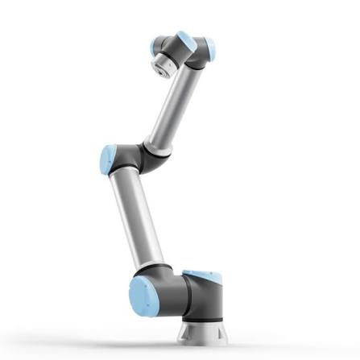
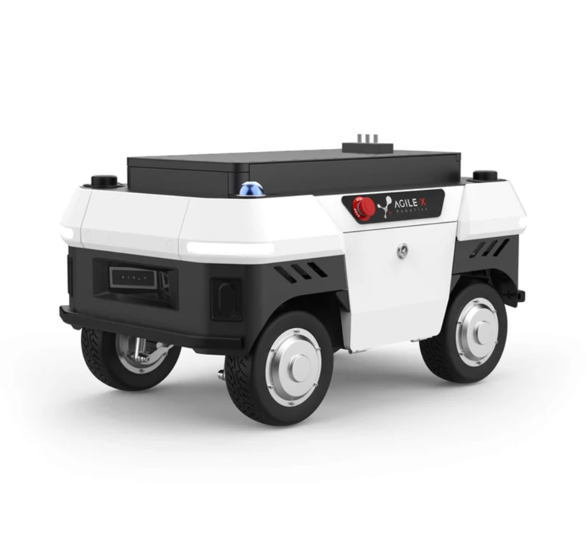
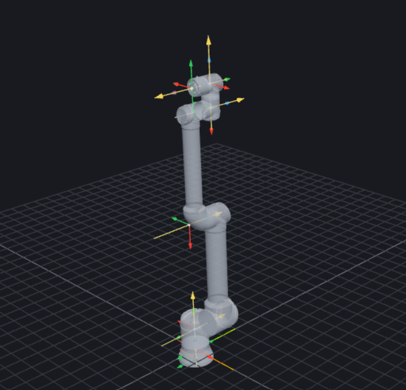
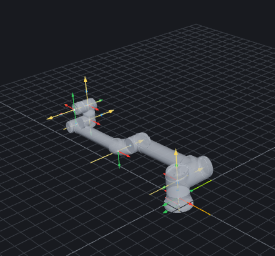

# Base Position as a Redundancy Parameter: Branch-Resolved IK, Workspace Structure and Path Planning for a Mobile Base + UR12e

ENG-654 | Kinematics-Grounded Motion Planning for Robots | Project 1G Report




## Motivation
An AgileX UMR omnidirectional base can translate in X and Y and rotate in yaw. It carries a
6R UR12e arm performing a full six-dimensional Cartesian task. Taken as one system the robot
is redundant: a single tool pose is realised by a continuous family of configurations rather
than a discrete set.

For this project the base is restricted to translation along the world X axis and treated as a
prismatic joint. The result is a P6R robot (one prismatic joint followed by six revolute
joints) with seven degrees of freedom and a one-dimensional self-motion for every reachable
tool pose. Fixing the base position x = a reduces the robot to a UR12e whose target has been
shifted by -a along X. Every value of a therefore produces the same finite set of IK branches,
but applied to a different target. The redundancy becomes visible only when x is allowed to
vary while the task stays fixed: the base position then decides which branches exist, how far
each is from a joint limit or a singularity, and whether a continuous execution is possible.

The central question of this project is:

> **How does the base position x select among the IK branches and reachable regions of the
> UR12e, and how can x and the branch be planned jointly so that a Cartesian task is executed
> continuously?**

## Methods

### 1. Forward Kinematic models of P6R
First step, 3 models: URDF chain, DH table, PoE from screws are built with the UR12e URDF sheet. Secondly, the base UMR data is added to each model. 

#### 1.1 URDF chain from URDF sheet and AgileX UMR product sheet:
```python 
UR_CHAIN = [
    ("base_link -> base_link_inertia", [0, 0, 0],              [0, 0, pi],        None),
    ("1 shoulder_pan",                 [0, 0, 0.1807],         [0, 0, 0],         [0, 0, 1]),
    ("2 shoulder_lift",                [0, 0, 0],              [pi/2, 0, 0],      [0, 0, 1]),
    ("3 elbow",                        [-0.6127, 0, 0],        [0, 0, 0],         [0, 0, 1]),
    ("4 wrist_1",                      [-0.57155, 0, 0.17415], [0, 0, 0],         [0, 0, 1]),
    ("5 wrist_2",                      [0, -0.11985, 0],       [pi/2, 0, 0],      [0, 0, 1]),
    ("6 wrist_3",                      [0, 0.11655, 0],        [pi/2, pi, pi],    [0, 0, 1]),
    ("wrist_3 -> flange",              [0, 0, 0],              [0, -pi/2, -pi/2], None),
]
P6R_CHAIN = [
    ("0 base_x  world -> umr_base",   [0, 0, 0],      [0, 0, 0],  "P",  [1, 0, 0]),
    ("mount    umr_base -> base_link", [0.0, 0.0, 0.42], [0.0, 0.0, 0.0], None, None),
] + [(name, xyz, rpy, "R" if axis is not None else None, axis) for name, xyz, rpy, axis in UR_CHAIN]
```

#### 1.2 DH table (vendor values, validated against the URDF chain):
```python
DH_UR = [                     
    (0.1807,  0.0,      pi/2),
    (0.0,    -0.6127,   0.0), 
    (0.0,    -0.57155,  0.0), 
    (0.17415, 0.0,      pi/2),   
    (0.11985, 0.0,     -pi/2),   
    (0.11655, 0.0,      0.0), 
]
T_BASE_UR = origin([0, 0, 0], [0, 0, pi])          # base_link -> DH frame 0 (yaw pi)
T_TOOL    = origin([0, 0, 0], [0, -pi/2, -pi/2])   # DH frame 6 -> flange

P6R_DH = [("P", 0.0,   0.0, 0.0, -pi/2)]           # row 0: slide along z_0 = world x
P6R_DH += [("R", pi/2, *DH_UR[0])]                 # row 1: UR row 1 with +pi/2 theta offset
P6R_DH += [("R", 0.0,  *row) for row in DH_UR[1:]] # rows 2..6: UR rows unchanged
T_BASE_P6R = np.eye(4)                             # world -> DH frame 0 at the mount height,
T_BASE_P6R[:3, :3] = [[0, 0, 1],                   # columns (x0, y0, z0) = (world y, world z, world x)
                      [1, 0, 0],
                      [0, 1, 0]]
T_BASE_P6R[:3, 3] = [0, 0, 0.42]
```

#### 1.3 Screw & PoE
```python
UR_AXES = [
    ("1 shoulder_pan",  [0, 0,  1], [0,       0,       0.1807 ]),
    ("2 shoulder_lift", [0, 1,  0], [0,       0,       0.1807 ]),
    ("3 elbow",         [0, 1,  0], [0.6127,  0,       0.1807 ]),
    ("4 wrist_1",       [0, 1,  0], [1.18425, 0.17415, 0.1807 ]),
    ("5 wrist_2",       [0, 0, -1], [1.18425, 0.17415, 0.06085]),
    ("6 wrist_3",       [0, 1,  0], [1.18425, 0.2907,  0.06085]),
]
P6R_SCREWS = [(np.zeros(3), np.array([1.0, 0, 0]))]                       
P6R_SCREWS += [screw(w, np.asarray(r, float) + mount) for _, w, r in UR_AXES] 
```

#### 1.4 Validating 3 models

The three models implement the following equations respectively (URDF chain, DH, PoE): 

$${}^{0}T_{n}(q) = {}^{0}T_{1}(q_1)\,{}^{1}T_{2}(q_2)\cdots{}^{n-1}T_{n}(q_n)$$

$${}^{i-1}T_{i} = R_{z}(\theta_i)\,T_{z}(d_i)\,T_{x}(a_i)\,R_{x}(\alpha_i)$$

$${}^{W}T_{E}(q) = e^{\widehat{{}^{W}\boldsymbol{\xi}_1}\,q_1}\cdots e^{\widehat{{}^{W}\boldsymbol{\xi}_n}\,q_n}\,M$$

Input: x = 0.5 m, q1..q6 = [10, -60, 90, -120, -90, 30] deg

1.4.1 T_world_flange, URDF chain

```text
-0.000000  -0.342020  -0.939693  1.376941
-0.000000  -0.939693   0.342020  0.331465
-1.000000   0.000000   0.000000  0.728989
 0.000000   0.000000   0.000000  1.000000
```

1.4.2 T_world_flange, DH table

```text
-0.000000  -0.342020  -0.939693  1.376941
 0.000000  -0.939693   0.342020  0.331465
-1.000000   0.000000   0.000000  0.728989
 0.000000   0.000000   0.000000  1.000000
```

1.4.3 T_world_flange, PoE

```text
-0.000000  -0.342020  -0.939693  1.376941
 0.000000  -0.939693   0.342020  0.331465
-1.000000  -0.000000   0.000000  0.728989
 0.000000   0.000000   0.000000  1.000000
```

1.4.4 Pairwise errors at the input q

```text
pair                    position [m]  orientation [deg]
URDF chain vs DH table      2.54e-16           1.14e-14
URDF chain vs PoE           2.78e-16           1.44e-14
DH table vs PoE             2.72e-16           3.17e-15
```

1.4.5 Worst errors over 1000 random q  (x in [-1.5, 1.5] m, angles in [-pi, pi])

```text
pair                    max position [m]  max orientation [deg]
URDF chain vs DH table          6.66e-16               3.03e-14
URDF chain vs PoE               1.28e-15               2.87e-14
DH table vs PoE                 1.22e-15               2.51e-14
```

Verdict: the three models agree (tolerance 1e-09 m, 1e-06 deg).

### 2. Jacobians
#### 2.1 Full 6 x 7 Jacobian J and Reduced 6 x 6 Jacobian J_red
With a given posture, a full 6 x 7 Jacobian (J) and a reduced 6 x 6 Jacobian (J_red) are built.

Full 6 x 7 Jacobian at x = 0.5 m, q = [10, -60, 90, -120, -90, 30] deg

```text
         x       q1       q2       q3       q4       q5       q6
vx  1.0000  -0.3315   0.1263  -0.3962  -0.1148  -0.0202   0.0000
vy  0.0000   0.8769   0.0223  -0.0699  -0.0202   0.1148   0.0000
vz  0.0000   0.0000  -0.9212  -0.6148  -0.1198   0.0000  -0.0000
wx  0.0000   0.0000  -0.1736  -0.1736  -0.1736   0.9848  -0.0000
wy  0.0000   0.0000   0.9848   0.9848   0.9848   0.1736   0.0000
wz  0.0000   1.0000   0.0000   0.0000   0.0000  -0.0000  -1.0000
```

Reduced 6 x 6 Jacobian, x fixed, q = [10, -60, 90, -120, -90, 30] deg

```text
         q1       q2       q3       q4       q5       q6
vx  -0.3315   0.1263  -0.3962  -0.1148  -0.0202   0.0000
vy   0.8769   0.0223  -0.0699  -0.0202   0.1148   0.0000
vz   0.0000  -0.9212  -0.6148  -0.1198   0.0000  -0.0000
wx   0.0000  -0.1736  -0.1736  -0.1736   0.9848  -0.0000
wy   0.0000   0.9848   0.9848   0.9848   0.1736   0.0000
wz   1.0000   0.0000   0.0000   0.0000  -0.0000  -1.0000
```

#### 2.2 Subchain Jacobian 3J5 of the arm (x fixed)

```text
x = 0.5 m,  arm q = [10, -60, 90, -120, -90, 30] deg,  velocity point O5,  frame = UR DH frame 3

3J5 =
               q1       q2       q3   |       q4       q5       q6
  vx       0.1508  -0.6726  -0.0599   |  -0.0599   0.0000  -0.0000
  vy      -0.0871  -0.6753  -0.6753   |  -0.1038   0.0000   0.0000
  vz       0.9212  -0.0000   0.0000   |  -0.0000   0.0000  -0.0000
       -----------------------------+---------------------------
  wx       0.5000  -0.0000  -0.0000   |  -0.0000  -0.8660  -0.5000
  wy       0.8660   0.0000   0.0000   |   0.0000   0.5000  -0.8660
  wz       0.0000   1.0000   1.0000   |   1.0000  -0.0000  -0.0000

           [   A   |   C   ]
           [   B   |   W   ]

det A           =    0.3812      (A = 3J5[0:3, 0:3], how q1..q3 move O5)
det W           =    1.0000      (W = 3J5[3:6, 3:6], how q4..q6 rotate the tool)
det A * det W   =    0.3812
det 3J5         =    0.3226
det 0J_red      =    0.3226      (same as det 3J5: point shift and rotation have unit det)

C = 3J5[0:3, 3:6] column norms = [0.1199 0.     0.    ]
C is not 0: column q4 still moves O5 by 0.1199 m per rad (= d5, the wrist offset).
So 3J5 is NOT block triangular and det 3J5 = det A * det(W - B A^-1 C), not det A * det W.
check:  det A * det(W - B A^-1 C) =    0.3226
```

#### 2.3 Reduced J_red vs full J at representative configurations

For the UR12e there are 3 singularity families: shoulder, elbow, wrist. At a singular configuration the arm loses one task direction u (the left null vector of J_red). Every singular configuration falls into one of two types: 
- Type A: u has an x component, so the slide can supply the lost direction and the whole body keeps rank J = 6. 
- Type B: u has no x component, so the whole body is singular too, rank J = 5. 

Which type occurs depends on the configuration (in particular the base yaw q1), not on the family: the same family is type A at some yaws and type B at others.

Elbow Example



Elbow yaw 0 (type A):  x = 0.5 m,  q = [  0 -45   0 -45 -90   0] deg
```text
  sigma_min(J_red) = 3.72e-18     sigma_min(J) = 0.4472
  lost direction u = [ 0.6918  0.1259  0.6918 -0.0147  0.1635 -0.    ]  |u_x| = 0.6918

  test 1  produce the task velocity u (|u| = 1):
          arm alone  (J_red qd = u):  best residual = 1.0000
          whole body (J qd = u)    :  best residual = 0.0000,   base speed xdot = 1.4455 m/s
          -> the slide supplies what the arm cannot

  test 2  hold the tool pose, slide the base, re-solve the arm (IK, start nudged by 0.01 rad on q3)
           x - x0 [m]  pose error  held?  sigma_min(J_red)     q3 [deg]   q [deg]
               -0.300    7.67e-01     no            0.0636     -15.4446   [-162.6 -169.   -15.4  -85.6   90.    17.4]
               -0.250    2.84e-01     no            0.1873     -46.3608   [ -0.  -15.  -46.4 -28.6 -90.   -0. ]
               -0.200    3.56e-01     no            0.2584      68.8312   [ -0.  -72.1  68.8 -86.8 -90.   -0. ]
               -0.150    3.43e-01     no            0.2826     -73.1703   [ -0.   -5.  -73.2 -11.9 -90.   -0. ]
               -0.100    7.89e-02     no            0.0483     -11.6948   [ -0.  -36.  -11.7 -42.3 -90.   -0. ]
               -0.050    3.59e-02     no            0.0021       0.5076   [ -0.  -43.6   0.5 -46.9 -90.   -0. ]
                0.000    4.83e-07    yes            0.0004       0.1047   [ -0.  -45.1   0.1 -45.1 -90.   -0. ]
                0.050    3.29e-11    yes            0.1126      27.8705   [ -0.  -60.2  27.9 -57.7 -90.   -0. ]
                0.100    1.86e-11    yes            0.1560      39.1812   [ -0.  -67.5  39.2 -61.7 -90.   -0. ]
                0.150    4.25e-10    yes            0.1873      47.6671   [ -0.  -73.6  47.7 -64.1 -90.   -0. ]
                0.200    9.69e-11    yes            0.2119      54.6296   [ -0.  -79.   54.6 -65.6 -90.   -0. ]
                0.250    3.68e-11    yes            0.2320      60.5658   [ -0.  -84.1  60.6 -66.5 -90.   -0. ]
                0.300    1.83e-11    yes            0.2488      65.7245   [ -0.  -88.9  65.7 -66.8 -90.   -0. ]
          -> rescued for x - x0 in {+0.05 .. +0.30} m: pose held and the arm is regular
```


Elbow vertical (type B):   x = 0.5 m,  q = [  0 -90   0   0 -90   0] deg
```text
  sigma_min(J_red) = 7.82e-17     sigma_min(J) = 0.0000
  lost direction u = [ 0.      0.      0.9929  0.      0.119  -0.    ] |u_x| = 0.0000

  test 1  produce the task velocity u (|u| = 1):
          arm alone  (J_red qd = u):  best residual = 1.0000
          whole body (J qd = u)    :  best residual = 1.0000,   base speed xdot = 0.0000 m/s
          -> the slide cannot help either

  test 2  hold the tool pose, slide the base, re-solve the arm (IK, start nudged by 0.01 rad on q3)
           x - x0 [m]  pose error  held?  sigma_min(J_red)     q3 [deg]   q [deg]
               -0.300    7.24e-02     no            0.1135      27.9070   [  0.  -89.4  27.9 -28.5 -90.    0. ]
               -0.250    4.98e-02     no            0.0951     -22.9849   [  0.  -66.9 -23.   -0.1 -90.    0. ]
               -0.200    5.80e-02     no            0.1252     -30.3800   [ -0.1 -65.8 -30.4   6.1 -90.   -0.1]
               -0.150    1.03e-02     no            0.0182       4.3886   [ -0.  -84.9   4.4  -9.5 -90.   -0. ]
               -0.100    6.57e-03     no            0.0305      -7.3154   [ -0.1 -81.7  -7.3  -1.1 -90.   -0.1]
               -0.050    1.05e-03     no            0.0017      -0.4076   [ -0.  -87.4  -0.4  -2.2 -90.   -0. ]
                0.000    4.76e-07    yes            0.0004       0.1032   [  0.  -90.    0.1  -0.1 -90.    0. ]
                0.050    1.05e-03     no            0.0014      -0.3392   [  0.1 -92.2  -0.3   2.6 -90.    0.1]
                0.100    5.61e-03     no            0.0179      -6.5850   [  2.6 -91.3  -6.6   7.8 -90.    2.6]
                0.150    3.50e-03     no            0.0088      -2.3017   [ 20.3 -93.1  -2.3   5.4 -90.   20.3]
                0.200    6.59e-04     no            0.0000       0.0000   [ 49.5 -91.9   0.    1.9 -90.   49.5]
                0.250    4.45e-05     no            0.0000       0.0000   [ 73.5 -89.5   0.   -0.5 -90.   73.5]
                0.300    1.69e-03     no            0.0080       1.9263   [ 91.9 -88.    1.9  -3.9 -90.   91.9]
          -> no x holds the pose: reach boundary in a direction the slide cannot fix
```

### 3. Analytical IK solver


### 4. Reachable-position maps over discrete base positions


### 5. Cartesian path and the (s, x) redundancy plane

