## Motivation

An AgileX UMR omnidirectional base carries a 6R UR12e arm performing a six-dimensional Cartesian task. We restrict
the base to translation along world X and treat it as a prismatic joint, which gives a P6R robot with seven
degrees of freedom and a one-dimensional self-motion for every reachable tool pose. Fixing the base at x reduces
the robot to a UR12e whose target is shifted by -x: every x gives the same finite set of IK branches, applied to a
different target. The redundancy becomes visible only when x varies while the task stays fixed. The base position
then decides which branches exist, how close each is to a singularity or joint limit, and whether a continuous
execution exists. Our question:

> **How does the base position x select among the IK branches and reachable regions of the UR12e, and how can x
> and the branch be planned jointly so that a Cartesian task is executed continuously?**

Code and full outputs: repository `p6r_planner` (`scripts/`, `results/`). Joint limits are ±π on every joint, a project choice agreed with the TA.

## 1. Forward kinematics

Three models were built from the UR12e URDF and the UMR datasheet (arm mounted at z = 0.42 m on the base): the URDF
chain, a DH table and a product of exponentials (PoE) from the seven screw axes.

| row | joint | θ offset | d [m] | a [m] | α |
|---|---|---|---|---|---|
| 0 | x (prismatic, along world X) | 0 | x | 0 | -π/2 |
| 1 | q1 shoulder pan | π/2 | 0.1807 | 0 | π/2 |
| 2 | q2 shoulder lift | 0 | 0 | -0.6127 | 0 |
| 3 | q3 elbow | 0 | 0 | -0.57155 | 0 |
| 4 | q4 wrist 1 | 0 | 0.17415 | 0 | π/2 |
| 5 | q5 wrist 2 | 0 | 0.11985 | 0 | -π/2 |
| 6 | q6 wrist 3 | 0 | 0.11655 | 0 | 0 |

Below, a2, a3 are the two link lengths and d4, d5, d6 the wrist offsets of rows 2–6. The three models agree to
1.3e-15 m and 3e-14 deg over 1000 random configurations (x in [-1.5, 1.5] m), well inside the 1e-9 m tolerance.

## 2. Jacobians and singularities

**Notation.** J is the whole-body 6×7 Jacobian in the world frame, J = [e | J_red], where e = (1,0,0,0,0,0) is the
slide column and J_red is the 6×6 arm Jacobian with x fixed. **σ_min** is the smallest singular value of a
Jacobian: the tool speed obtained per unit joint speed in the worst direction. σ_min = 0 is a singularity; we use
it as the distance to a singularity.

**Decoupling.** Axes 2, 3, 4 of the UR are parallel, so q2, q3, q4 form a planar 3R in the arm plane. With the
velocity point at O5 (where the wrist-2 and wrist-3 axes meet) and rows and columns grouped as in-plane motion /
out-of-plane translation / out-of-plane rotation, the subchain Jacobian ³J₅ is block triangular:

$$\det {}^{3}J_{5} = \det P \cdot (-\rho) \cdot \det W_2 = a_2 a_3 \sin q_3 \,\sin q_5\, \rho,
\qquad \rho = a_2 c_2 + a_3 c_{23} + d_5 s_{234}$$

| block | joints | zero when | family |
|---|---|---|---|
| P (3×3, planar 3R) | q2 q3 q4 | sin q3 = 0 (arm stretched or folded) | elbow (E) |
| ρ (1×1) | q1 | ρ = 0 (O5 above the shoulder axis) | shoulder (S) |
| W2 (2×2) | q5 q6 | sin q5 = 0 (tool axis parallel to axes 2–4) | wrist (W) |

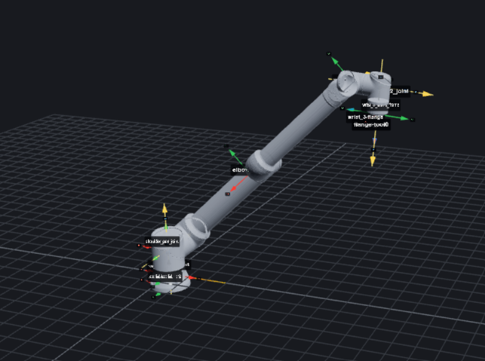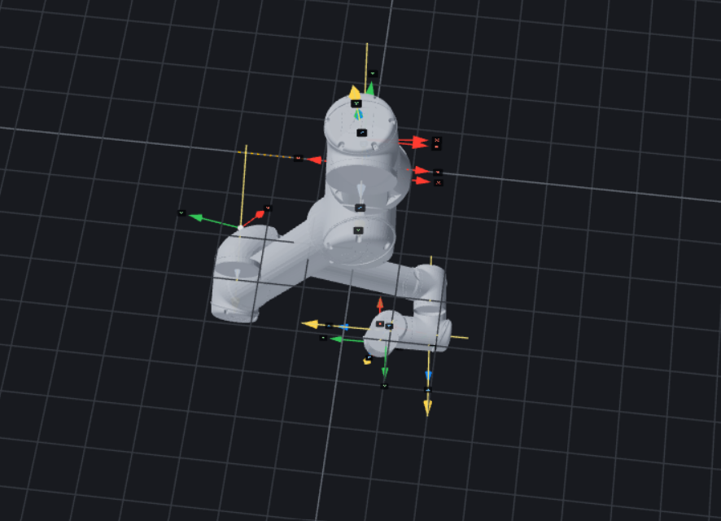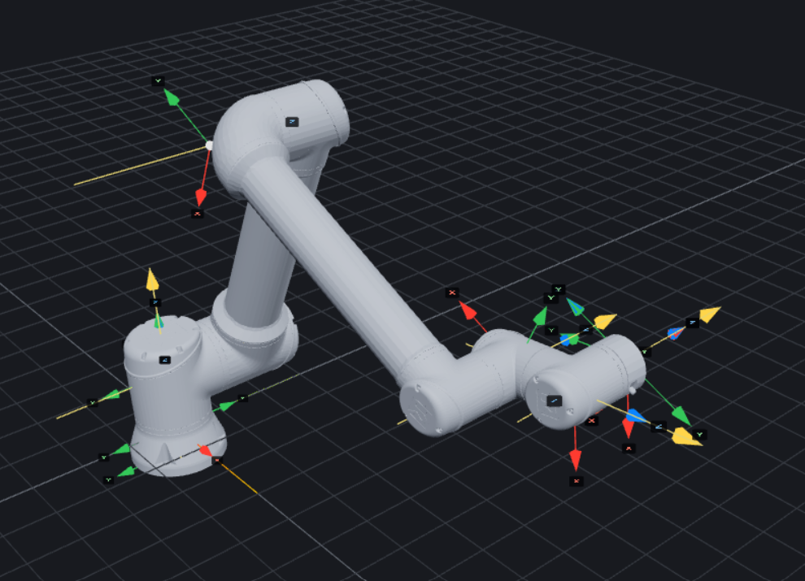

Figure 1. The three singular families: elbow, shoulder, wrist.

**Does the slide help?** At a singular configuration the arm loses one task direction u. If u has an x component,
the slide supplies it and the whole body stays regular (rank J = 6, type A). If not, the whole body is singular too
(type B). Two elbow singularities at x = 0.5 m show both types:

| configuration q [deg] | σ_min(J_red) | σ_min(J) | lost direction u | type |
|---|---|---|---|---|
| [0, -45, 0, -45, -90, 0], arm stretched sideways | 4e-18 | 0.447 | mostly along x (u_x = 0.69) | A: slide rescues |
| [0, -90, 0, 0, -90, 0], arm stretched upwards | 8e-17 | 0.000 | vertical (u_x = 0) | B: slide cannot help |

In the type A case the whole body produces the lost velocity exactly (residual 0, with base speed 1.45 m/s per unit
task speed), and sliding the base by +0.05 to +0.30 m holds the tool pose with a regular arm. In the type B case no
base position holds the pose. The type depends on the configuration, not on the family. A prismatic joint can only
supply a translation, so a lost rotation is never rescued.

## 3. Analytical IK solver

With the base at x the world target T\* is moved into DH frame 0 of the arm,
⁰T₆ = (Trans_x(x) T_mount T_base)⁻¹ T\* T_tool⁻¹, and the problem is a pure 6R problem. The UR wrist is offset
(d5, d6 ≠ 0), so the classic position/orientation split of a spherical wrist does not apply. Instead the IK follows
the three blocks of section 2, solved in order:

**Group 1, q1 (shoulder S±).** O5 = p - d6 z6 is fixed by the target. The arm plane must pass at distance d4 from O5,
i.e. it is a tangent from axis 1 to a circle of radius d4 around O5:
$q_1 = \mathrm{atan2}(p_{5y}, p_{5x}) \pm \arccos(d_4/r) + \pi/2$, with $r = \sqrt{p_{5x}^2+p_{5y}^2}$.
No root if r < d4.

**Group 2, q5 and q6 (wrist W±).** With q1 known, n = (sin q1, -cos q1, 0) is the normal of the arm plane and
$\cos q_5 = (p\cdot n - d_4)/d_6$, $q_5 = \pm\arccos(\cdot)$. q6 follows from the components of x6 and y6 along n. At
sin q5 = 0 only q4 + q6 is defined and the solver sets q6 = 0.

**Group 3, q2, q3, q4 (elbow E±).** Peeling off A1, A5, A6 leaves a planar 2R to the point p13:
$\cos q_3 = (|p_{13}|^2 - a_2^2 - a_3^2)/(2 a_2 a_3)$, $q_3 = \pm\arccos(\cdot)$; q2 follows, and q4 is the
remaining in-plane angle. No root if |cos q3| > 1.

**Branches and labels.** Three binary choices give at most 8 branches. Each branch is labelled by the signs
(sign ρ, sign sin q5, sign sin q3) = (S, W, E), i.e. by the signs of the three factors of det J_red.

**The IK and det J_red are the same three conditions.** Each group has exactly one arccos, and its two roots merge
exactly where one factor of det J_red vanishes:

| group | roots merge when | factor = 0 | family |
|---|---|---|---|
| 1: q1 = … ± arccos(d4/r) | r = d4 | ρ | shoulder |
| 2: q5 = ± arccos(…) | cos q5 = ±1 | sin q5 | wrist |
| 3: q3 = ± arccos(…) | cos q3 = ±1 | sin q3 | elbow |

So branches appear and disappear in pairs on det J_red = 0, and every branch count is even.

**Not cuspidal.** A cuspidal robot can change IK solution without crossing a singularity, i.e. it has several
solutions in one aspect (region between singular surfaces). Here each of the 8 aspects holds exactly one solution:
the sign label read from q matched the IK branch in all 14 426 solutions tested. A solution can only change label by
crossing det J_red = 0; along 100 random joint-space paths the label was kept in 99.7 % of 194 256 steps, and
every switch happened next to a singular surface. A path planner can therefore fix the branch at the start and
keep it until the path meets a singularity.

**Validation.** 2000 random configurations: the input is always recovered (max error 6.4e-11 rad) and every
returned branch reaches the pose (max FK error 3.4e-12). The 8 solutions of one pose were also loaded into the course
simulator (Module 3), which shows 0.000 mm / 0.0000° for all eight. A vectorised version solves about 59 000
poses/s. Collisions are not part of the IK: two of the eight solutions in Figure 2 pass through the base.

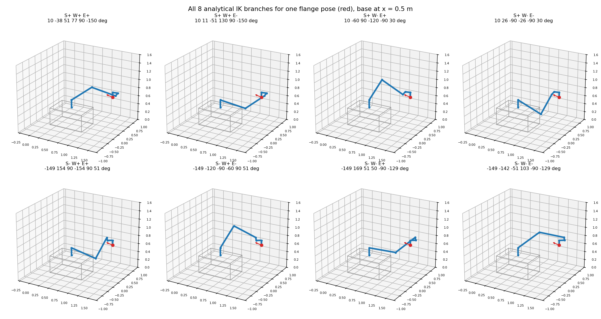

Figure 2. The 8 IK solutions of one tool pose (x = 0.5 m).

**The base position selects the branches.** Sliding the base under a fixed world target: below x = 0.13 m there
is no branch, from 0.13 to 0.38 m four (S+ W- E±, S- W+ E±), above 0.38 m all eight (Figure 3). Branches come and go
in elbow pairs.

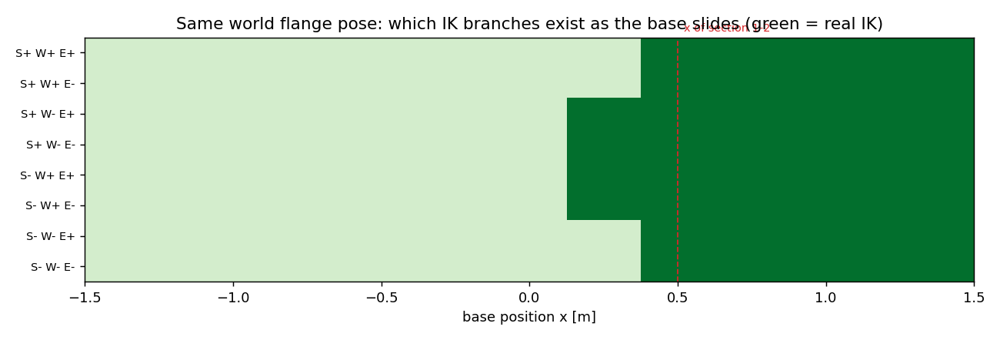

Figure 3. Which IK branches exist (dark green) for one world target as the base slides along x.

## 4. Reachable-position maps

For every point of a grid at flange height z = 0.9 m, with the tool pointing down, the IK is run once and the
number of branches is counted (Figure 5). The regions are bounded by the singular families:

- **Inner hole, radius d4 = 0.174 m (0 branches):** shoulder family, no q1 root (r < d4).
- **Outer edge, 1.24 m (0 branches):** elbow family, the arm is stretched (|cos q3| > 1).
- **Disc r < 1.0 m (8) and ring 1.0–1.24 m (4):** with the tool vertical q5 = ±90°, so the wrist link d5 points
  away from or towards axis 1. Only the outward wrist reaches the ring (difference ≈ 2 d5 = 0.24 m).
- **No wrist family:** with the tool vertical, cos q5 = 0 everywhere.

Split by branch (Figure 4), each branch is an annulus between the shoulder hole and its elbow edge, and the two
reach classes are visible directly: the outward-wrist branches S+ W- E± and S- W+ E± reach 1.24 m, the others 1.0 m.

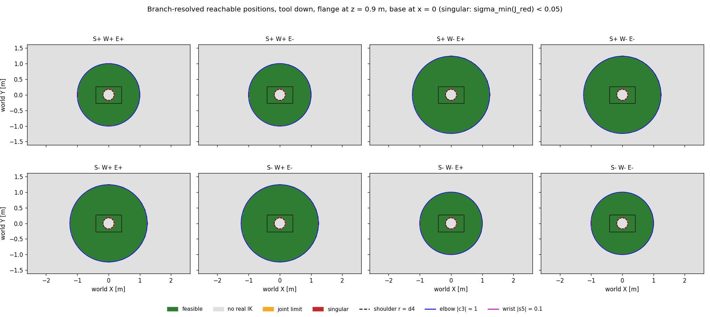

Figure 4. Per-branch reachable positions, tool down, base at x = 0 (green: feasible; red: singular,
σ_min(J_red) < 0.05; box: UMR footprint).

**Moving the base translates the map** without changing its shape: the slide adds reach along x only. Overlaid on a
generic 3 m task strip (x in [-1.5, 1.5] m, y in [0.5, 0.9] m), no single base position covers it (x = 0 covers
67.5 %), the three positions x = -1, 0, +1 m together cover 100 %, and 34 % is reachable from one x only: there the
base position is forced.

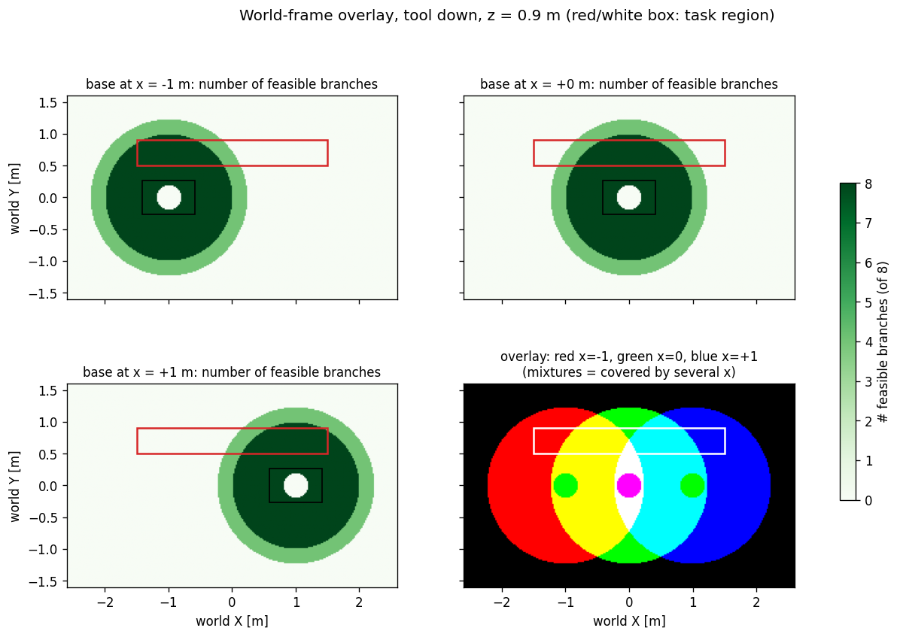

Figure 5. Feasible-branch count for base at x = -1, 0, +1 m and their overlay on a task strip (box).

**Orientation.** Tilting the tool away from vertical breaks the symmetry and shrinks the 4-branch ring (Figure 6).
With a horizontal tool the wrist family appears, as thin wedges where the tool axis is parallel to axes 2–4.
Counting the singular cells (σ_min(J_red) < 0.05) and checking the whole body there: the slide restores rank for
88–96 % of the shoulder and elbow cells, but only for 12.5 % of the wrist cells, because the wrist loses a rotation
(type B of section 2).

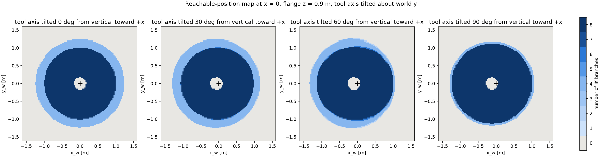

Figure 6. Branch count at x = 0 with the tool tilted 0, 30, 60, 90° from vertical towards +x.

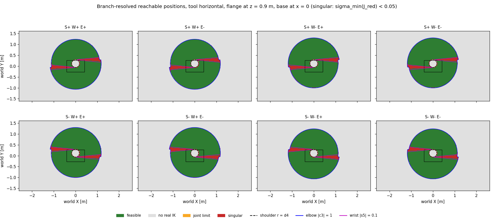

Figure 7. Per-branch map with the tool horizontal (along +Y): the wrist family appears as thin red
wedges along ±X.

## 5. Path planning in the (s, x) plane

**Path.** A closed rectangle at z = 0.9 m with the tool pointing down, corners (-0.8, 0.25), (0.8, 0.25),
(0.8, 0.85), (-0.8, 0.85) m, perimeter 4.4 m. s ∈ [0, 1] is the arc length (111 samples) and the base position x
ranges over [-1, 1] m in 0.05 m steps. The start is fixed at x(0) = -1 m. The second path (end of this section) is
the same rectangle on a tilted plane.

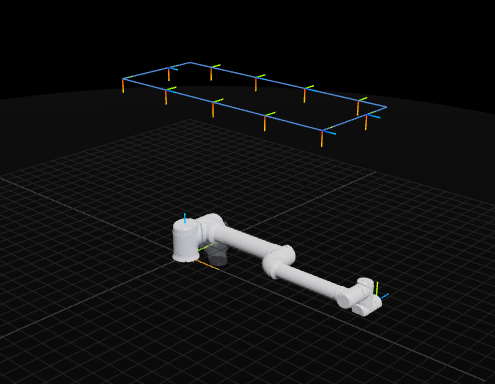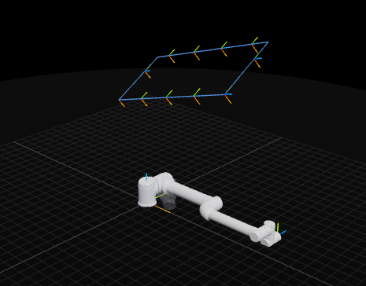

Figure 8. The flat rectangle (left) and the tilted rectangle (right).

**The map.** For each branch and each (s, x) the IK is run with the base at x. The dot is green if the branch has a
root and σ_min(J_red) ≥ 0.03, grey otherwise. A parked base is a horizontal line; a moving base is any curve whose
slope dx/ds is bounded by the base speed. Neighbouring dots are connected only if the base moves ≤ 0.05 m and each
joint ≤ 0.5 rad.

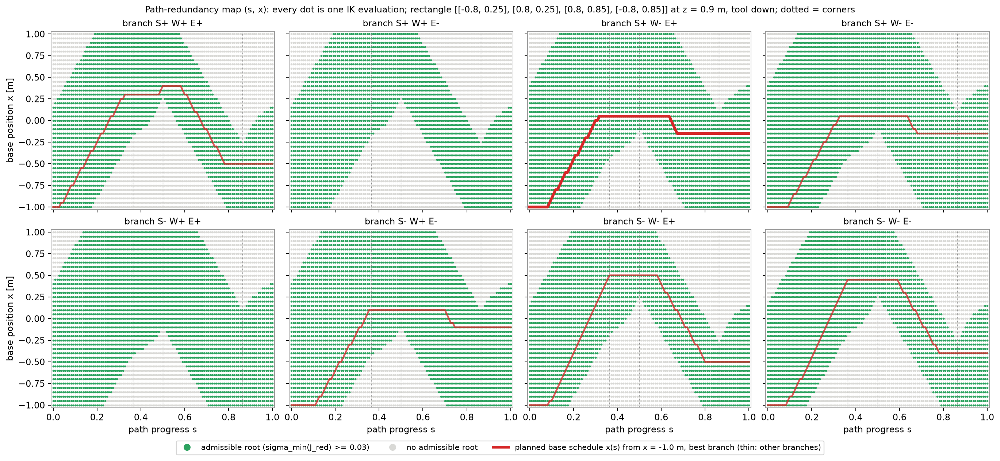

Figure 9. (s, x) map per branch; red: planned base schedule (thick: best branch).

**What the map shows.** The green band follows the tool along the rectangle. From the start position x = -1 m, a
parked base loses the pose by s = 0.24 on every branch. A parked base completes the path only for x within
±0.10 m and only on three branches (S+ W- E±, S- W+ E-). Two failure causes exist on this path: the tool leaves
the reach band (elbow family), or a joint must cross the ±π limit. The second is why S+ W+ E- and S- W+ E+ have no
plan although they are mostly green: each dot is fine, but between dots one joint must pass 180°. The real UR12e
allows ±2π on all joints except the elbow, so on the real robot these two branches may be feasible (not checked).

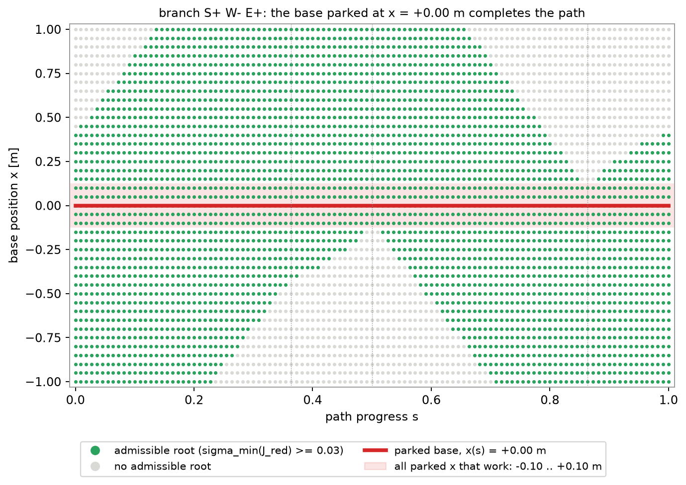

Figure 10. Parked base on branch S+ W- E+: only x within ±0.10 m (shaded) stays green over the whole path.

Following every branch from s = 0 with the base parked (Figure 11) shows where and why each one stops. From x = 0,
three branches complete; the others stop when the tool leaves the reach band or a joint reaches ±π. From x = -1 m
every branch stops by s = 0.24. No branch stops on a singularity, and the nearest root at the next step always keeps
the same label (100 % of 1164 steps), as expected for a non-cuspidal arm.

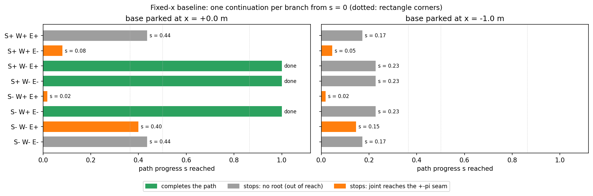

Figure 11. Fixed-base continuation of every branch, base parked at x = 0 m and x = -1 m.

**Branch-aware planning.** Within one branch the green dots form a layered graph over s. Dynamic programming (DP)
finds the cheapest complete curve from x(0) = -1 m with cost Σ (|Δq| + 2|Δx|), i.e. joint travel plus a penalty on
base travel. Six of eight branches have a plan; the best (S+ W- E+, cost 10.31) moves the base 1.25 m and keeps
σ_min(J_red) ≥ 0.172. Compared with parking at x = 0 on the same branch, joint travel drops from 11.7 to 7.8 rad and
the minimum σ_min rises from 0.115 to 0.172. Every configuration on the plan is a closed-form IK root (Cartesian
residual ~1e-15 m). The threshold does not drive the result: the best plans stay at σ_min ≥ 0.145, above both 0.03
and the 0.05 used in section 4.

**Greedy vs branch-aware.** *Hypothesis:* looking one step ahead is enough when the base is fast, but not when it
is slow, because the base then has to commit early to obstacles a local rule cannot see. The greedy planner of the
proposal takes, at every step, the admissible neighbour with the smallest step cost |Δq| + 2|Δx|: the same cost and
constraints as the DP, without lookahead. We vary k, the maximum base speed relative to the tool speed:

| k | 1.25 | 0.94 | 0.62 | 0.50 | 0.42 | 0.31 |
|---|---|---|---|---|---|---|
| branch-aware DP | 6/8 | 6/8 | 5/8 | 3/8 | 3/8 | 0/8 |
| greedy | 6/8 | 6/8 | 3/8 | 3/8 | 0/8 | 0/8 |

With a fast base greedy completes the same six branches but costs 10–46 % more; on the best branch it rides the
reach boundary and σ_min(J_red) drops to 0.033. With a slow base (k = 0.42) greedy fails on every branch while the
DP still finds three plans (Figure 12). On the first side the green band climbs with the tool. A slow base can only
climb at its maximum speed, and it passes above the grey wedge at s ≈ 0.5 only if it starts climbing immediately
and stays at the top of what it can reach. The DP (red) does exactly that. Greedy (blue) follows almost the same
line, but its cheapest step is sometimes a slightly smaller base move; it arrives a few centimetres too low and
stops at the tip of the wedge. It cannot see the wedge coming. A second local rule that maximises σ_min at each step
fails in the same way, so the failure comes from the missing lookahead, not from the choice of rule. This is where the analytical IK matters: it gives all branches at every dot,
so the planner sees the whole map; a numerical IK returns one root near its seed and behaves like a local rule.

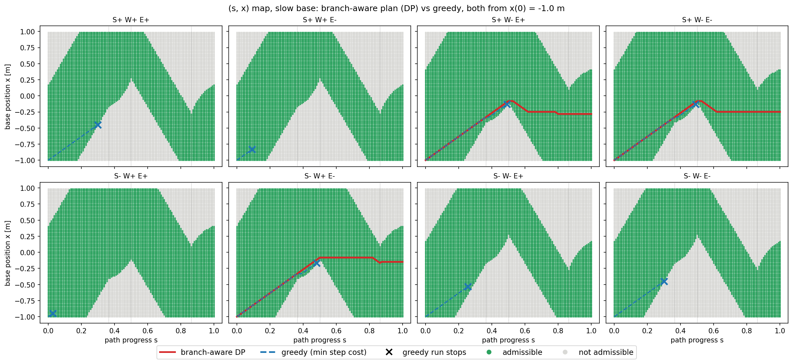

Figure 12. Slow base (k = 0.42): branch-aware DP (red) and greedy (blue dashed, × = where it stops).

**Tilted path.** The same rectangle on a plane tilted 30° about x and 20° about y, with the tool normal to the
plane (Figure 13). The bands become lopsided, and a diagonal grey slit appears: there O5 comes within d4 of axis 1,
the shoulder group of the IK has no root, and the slit cuts S+ W+ E+ in two. Orange dots are singular roots (112 at
the band edges, elbow; 73 along the slit, shoulder); only 8 of them are singular for the whole body, so the slide
rescues the rest. Only three branches keep a plan (best: S+ W- E-, cost 11.75), and a parked base works at x = 0
only. The best branch depends on the task.

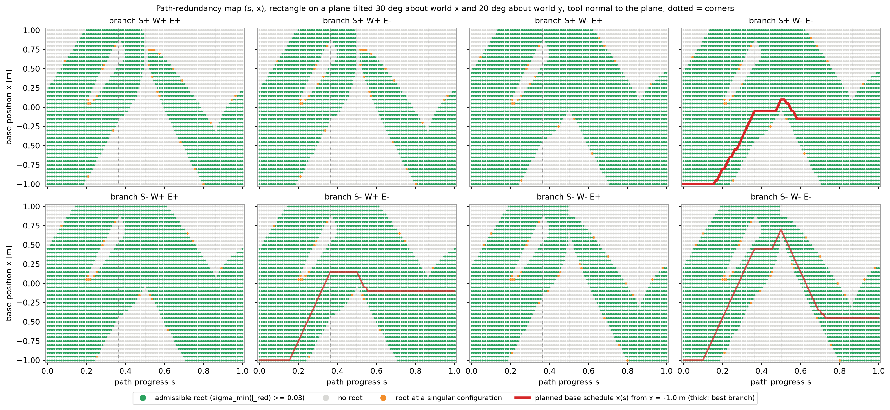

Figure 13. (s, x) map for the tilted rectangle; orange: singular roots.

## Conclusion

**How does x select the branches?** With x fixed the P6R is a UR12e with a shifted target. The analytical IK splits
into three groups, which are the three blocks of ³J₅; each group has two roots, which merge exactly on one factor of
det J_red = a2 a3 sin q3 sin q5 ρ. Moving the base translates these critical surfaces in the world, so a target gains
or loses branches in pairs as x changes (0, 4 or 8 for the pose of Figure 3). Each aspect holds one solution, so the
UR12e is not cuspidal and a branch label stays valid until a singularity. The slide rescues most shoulder and elbow
singularities, but almost no wrist singularities, because it cannot supply a rotation.

**How can x and the branch be planned jointly?** Each branch defines its own admissible region in the (s, x) plane,
and an execution is a curve through it with slope bounded by the base speed. Reach limits, the shoulder hole and the
±π joint limits are the obstacles. Dynamic programming over this plane, possible because the analytical IK gives all
branches at every point, finds plans on 6 of 8 branches of the flat path. A greedy planner with the same cost
completes the same branches when the base is fast, at 10–46 % higher cost, and fails on every branch when the base
speed drops to 0.42× the tool speed, where the DP still finds three plans. On a tilted path the feasible branches drop to three and the best
branch changes, so x(s) and the branch must be planned together, per task.

## Limitations

- **No collision model:** two of the eight solutions in Figure 2 pass through the base.
- **Base along X only:** the real UMR is omnidirectional (x, y, yaw), and we do not model its nonholonomic aspects.
- **Mount geometry** is a placeholder until measured.
- **σ_min mixes metres and radians**, so any threshold is partly a convention; the singular band stays thin for
  thresholds from 0.01 to 0.10 (0–7 % of the reachable cells).
- **Discretisation:** the path is sampled every 4 cm and x every 5 cm; motion between samples is not checked. The
  cost is a distance, not a time.

## Use of AI

AI assistants were used for drafting and debugging code, writing figure scripts, and editing and merging the
report text. All results were run and checked by us.

## References

1. ENG-654 Kinematics-Grounded Motion Planning for Robots, EPFL LASA, lecture notes and simulators.
   https://epfl-lasa.github.io/eng-654/
2. K. P. Hawkins, *Analytic Inverse Kinematics for the Universal Robots UR-5/UR-10 Arms*, Georgia Tech, 2013.
3. D. L. Pieper, *The Kinematics of Manipulators under Computer Control*, PhD thesis, Stanford University, 1968.
4. K. M. Lynch and F. C. Park, *Modern Robotics*, Cambridge University Press, 2017.
5. Universal Robots, UR12e kinematic parameters and ROS description package.
6. AgileX Robotics, UMR datasheet and product pages.
