# Base Position as a Redundancy Parameter: Branch-Resolved IK, Workspace Structure and Path Planning for a Mobile Base + UR12e

ENG-654 | Kinematics-Grounded Motion Planning for Robots | Project 1G Report

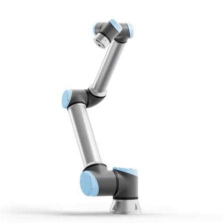
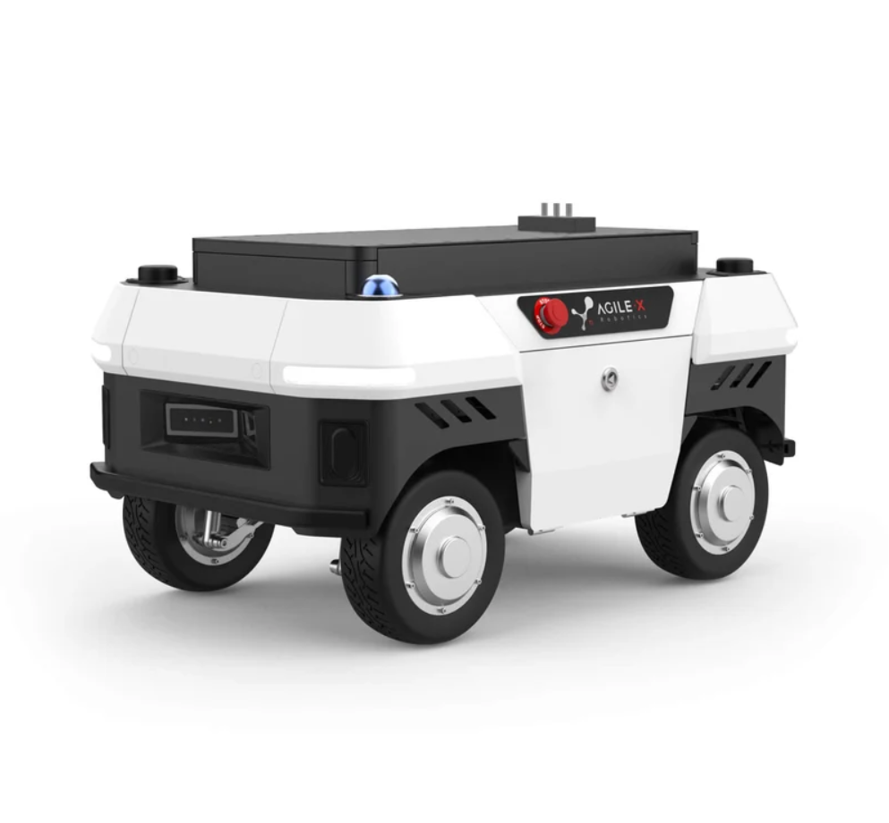

## Motivation
An AgileX UMR omnidirectional base can translate in X and Y and rotate in yaw. It carries a
6R UR12e arm performing a full six-dimensional Cartesian task. Taken as one system the robot
is redundant: a single tool pose is realised by a continuous family of configurations rather
than a discrete set.

For this project the base is restricted to translation along the world X axis and treated as a
prismatic joint. The result is a P6R robot (one prismatic joint followed by six revolute
joints) with seven degrees of freedom and a one-dimensional self-motion for every reachable
tool pose. Fixing the base position x = a reduces the robot to a UR12e whose target has been
shifted by -a along X. Every value of a therefore produces the same finite set of IK branches,
but applied to a different target. The redundancy becomes visible only when x is allowed to
vary while the task stays fixed: the base position then decides which branches exist, how far
each is from a joint limit or a singularity, and whether a continuous execution is possible.

The central question of this project is:

> **How does the base position x select among the IK branches and reachable regions of the
> UR12e, and how can x and the branch be planned jointly so that a Cartesian task is executed
> continuously?**

## Methods

### 1. Forward Kinematic models of P6R
First step, 3 models: URDF chain, DH table, PoE from screws are built with the UR12e URDF sheet. Secondly, the base UMR data is added to each model. 

#### 1.1 URDF chain from URDF sheet and AgileX UMR product sheet:
```python 
UR_CHAIN = [
    ("base_link -> base_link_inertia", [0, 0, 0],              [0, 0, pi],        None),
    ("1 shoulder_pan",                 [0, 0, 0.1807],         [0, 0, 0],         [0, 0, 1]),
    ("2 shoulder_lift",                [0, 0, 0],              [pi/2, 0, 0],      [0, 0, 1]),
    ("3 elbow",                        [-0.6127, 0, 0],        [0, 0, 0],         [0, 0, 1]),
    ("4 wrist_1",                      [-0.57155, 0, 0.17415], [0, 0, 0],         [0, 0, 1]),
    ("5 wrist_2",                      [0, -0.11985, 0],       [pi/2, 0, 0],      [0, 0, 1]),
    ("6 wrist_3",                      [0, 0.11655, 0],        [pi/2, pi, pi],    [0, 0, 1]),
    ("wrist_3 -> flange",              [0, 0, 0],              [0, -pi/2, -pi/2], None),
]
P6R_CHAIN = [
    ("0 base_x  world -> umr_base",   [0, 0, 0],      [0, 0, 0],  "P",  [1, 0, 0]),
    ("mount    umr_base -> base_link", [0.0, 0.0, 0.42], [0.0, 0.0, 0.0], None, None),
] + [(name, xyz, rpy, "R" if axis is not None else None, axis) for name, xyz, rpy, axis in UR_CHAIN]
```

#### 1.2 DH table (vendor values, validated against the URDF chain):
```python
DH_UR = [                     
    (0.1807,  0.0,      pi/2),
    (0.0,    -0.6127,   0.0), 
    (0.0,    -0.57155,  0.0), 
    (0.17415, 0.0,      pi/2),   
    (0.11985, 0.0,     -pi/2),   
    (0.11655, 0.0,      0.0), 
]
T_BASE_UR = origin([0, 0, 0], [0, 0, pi])          # base_link -> DH frame 0 (yaw pi)
T_TOOL    = origin([0, 0, 0], [0, -pi/2, -pi/2])   # DH frame 6 -> flange

P6R_DH = [("P", 0.0,   0.0, 0.0, -pi/2)]           # row 0: slide along z_0 = world x
P6R_DH += [("R", pi/2, *DH_UR[0])]                 # row 1: UR row 1 with +pi/2 theta offset
P6R_DH += [("R", 0.0,  *row) for row in DH_UR[1:]] # rows 2..6: UR rows unchanged
T_BASE_P6R = np.eye(4)                             # world -> DH frame 0 at the mount height,
T_BASE_P6R[:3, :3] = [[0, 0, 1],                   # columns (x0, y0, z0) = (world y, world z, world x)
                      [1, 0, 0],
                      [0, 1, 0]]
T_BASE_P6R[:3, 3] = [0, 0, 0.42]
```

#### 1.3 Screw & PoE
```python
UR_AXES = [
    ("1 shoulder_pan",  [0, 0,  1], [0,       0,       0.1807 ]),
    ("2 shoulder_lift", [0, 1,  0], [0,       0,       0.1807 ]),
    ("3 elbow",         [0, 1,  0], [0.6127,  0,       0.1807 ]),
    ("4 wrist_1",       [0, 1,  0], [1.18425, 0.17415, 0.1807 ]),
    ("5 wrist_2",       [0, 0, -1], [1.18425, 0.17415, 0.06085]),
    ("6 wrist_3",       [0, 1,  0], [1.18425, 0.2907,  0.06085]),
]
P6R_SCREWS = [(np.zeros(3), np.array([1.0, 0, 0]))]                       
P6R_SCREWS += [screw(w, np.asarray(r, float) + mount) for _, w, r in UR_AXES] 
```

#### 1.4 Validating 3 models

The three models implement the following equations respectively (URDF chain, DH, PoE): 

$${}^{0}T_{n}(q) = {}^{0}T_{1}(q_1)\,{}^{1}T_{2}(q_2)\cdots{}^{n-1}T_{n}(q_n)$$

$${}^{i-1}T_{i} = R_{z}(\theta_i)\,T_{z}(d_i)\,T_{x}(a_i)\,R_{x}(\alpha_i)$$

$${}^{W}T_{E}(q) = e^{\widehat{{}^{W}\boldsymbol{\xi}_1}\,q_1}\cdots e^{\widehat{{}^{W}\boldsymbol{\xi}_n}\,q_n}\,M$$

Input: x = 0.5 m, q1..q6 = [10, -60, 90, -120, -90, 30] deg

1.4.1 T_world_flange, URDF chain

```text
-0.000000  -0.342020  -0.939693  1.376941
-0.000000  -0.939693   0.342020  0.331465
-1.000000   0.000000   0.000000  0.728989
 0.000000   0.000000   0.000000  1.000000
```

1.4.2 T_world_flange, DH table

```text
-0.000000  -0.342020  -0.939693  1.376941
 0.000000  -0.939693   0.342020  0.331465
-1.000000   0.000000   0.000000  0.728989
 0.000000   0.000000   0.000000  1.000000
```

1.4.3 T_world_flange, PoE

```text
-0.000000  -0.342020  -0.939693  1.376941
 0.000000  -0.939693   0.342020  0.331465
-1.000000  -0.000000   0.000000  0.728989
 0.000000   0.000000   0.000000  1.000000
```

1.4.4 Pairwise errors at the input q

```text
pair                    position [m]  orientation [deg]
URDF chain vs DH table      2.54e-16           1.14e-14
URDF chain vs PoE           2.78e-16           1.44e-14
DH table vs PoE             2.72e-16           3.17e-15
```

1.4.5 Worst errors over 1000 random q  (x in [-1.5, 1.5] m, angles in [-pi, pi])

```text
pair                    max position [m]  max orientation [deg]
URDF chain vs DH table          6.66e-16               3.03e-14
URDF chain vs PoE               1.28e-15               2.87e-14
DH table vs PoE                 1.22e-15               2.51e-14
```

Verdict: the three models agree (tolerance 1e-09 m, 1e-06 deg).

### 2. Jacobians
#### Symbolic Jacobians of the P6R: 0J6 (J_red) and the full 6 x 7 J

```text
1. 0J6: arm Jacobian in DH frame 0 of the arm
  column q1:
     vx: -a2*sin(q1)*cos(q2) - a3*sin(q1)*cos(q2 + q3) + d4*cos(q1) - d5*sin(q1)*sin(q2 + q3 + q4) + d6*sin(q1)*sin(q5)*cos(q2 + q3 + q4) + d6*cos(q1)*cos(q5)
     vy: a2*cos(q1)*cos(q2) + a3*cos(q1)*cos(q2 + q3) + d4*sin(q1) + d5*sin(q2 + q3 + q4)*cos(q1) + d6*sin(q1)*cos(q5) - d6*sin(q5)*cos(q1)*cos(q2 + q3 + q4)
     vz: 0
     wx: 0
     wy: 0
     wz: 1
  column q2:
     vx: (-a2*sin(q2) - a3*sin(q2 + q3) + d5*cos(q2 + q3 + q4) + d6*sin(q5)*sin(q2 + q3 + q4))*cos(q1)
     vy: (-a2*sin(q2) - a3*sin(q2 + q3) + d5*cos(q2 + q3 + q4) + d6*sin(q5)*sin(q2 + q3 + q4))*sin(q1)
     vz: a2*cos(q2) + a3*cos(q2 + q3) + d5*sin(q2 + q3 + q4) - d6*sin(q5)*cos(q2 + q3 + q4)
     wx: sin(q1)
     wy: -cos(q1)
     wz: 0
  column q3:
     vx: (-a3*sin(q2 + q3) + d5*cos(q2 + q3 + q4) + d6*sin(q5)*sin(q2 + q3 + q4))*cos(q1)
     vy: (-a3*sin(q2 + q3) + d5*cos(q2 + q3 + q4) + d6*sin(q5)*sin(q2 + q3 + q4))*sin(q1)
     vz: a3*cos(q2 + q3) + d5*sin(q2 + q3 + q4) - d6*sin(q5)*cos(q2 + q3 + q4)
     wx: sin(q1)
     wy: -cos(q1)
     wz: 0
  column q4:
     vx: (d5*cos(q2 + q3 + q4) + d6*sin(q5)*sin(q2 + q3 + q4))*cos(q1)
     vy: (d5*cos(q2 + q3 + q4) + d6*sin(q5)*sin(q2 + q3 + q4))*sin(q1)
     vz: d5*sin(q2 + q3 + q4) - d6*sin(q5)*cos(q2 + q3 + q4)
     wx: sin(q1)
     wy: -cos(q1)
     wz: 0
  column q5:
     vx: -d6*(sin(q1)*sin(q5) + cos(q1)*cos(q5)*cos(q2 + q3 + q4))
     vy: d6*(-sin(q1)*cos(q5)*cos(q2 + q3 + q4) + sin(q5)*cos(q1))
     vz: -d6*sin(q2 + q3 + q4)*cos(q5)
     wx: sin(q2 + q3 + q4)*cos(q1)
     wy: sin(q1)*sin(q2 + q3 + q4)
     wz: -cos(q2 + q3 + q4)
  column q6:
     vx: 0
     vy: 0
     vz: 0
     wx: sin(q1)*cos(q5) - sin(q5)*cos(q1)*cos(q2 + q3 + q4)
     wy: -sin(q1)*sin(q5)*cos(q2 + q3 + q4) - cos(q1)*cos(q5)
     wz: -sin(q5)*sin(q2 + q3 + q4)
```
```text
2. WJ6 = J_red: the same arm Jacobian in the world frame

  WJ6 = blockdiag(R0, R0) 0J6,  R0 = Rz(pi) = rotation of DH frame 0 in the world (base_link_inertia yaw)
  -> every column has its rows vx, vy, wx, wy negated; vz, wz unchanged.
  column q1:
     vx: a2*sin(q1)*cos(q2) + a3*sin(q1)*cos(q2 + q3) - d4*cos(q1) + d5*sin(q1)*sin(q2 + q3 + q4) - d6*sin(q1)*sin(q5)*cos(q2 + q3 + q4) - d6*cos(q1)*cos(q5)
     vy: -a2*cos(q1)*cos(q2) - a3*cos(q1)*cos(q2 + q3) - d4*sin(q1) - d5*sin(q2 + q3 + q4)*cos(q1) - d6*sin(q1)*cos(q5) + d6*sin(q5)*cos(q1)*cos(q2 + q3 + q4)
     vz: 0
     wx: 0
     wy: 0
     wz: 1
  column q2:
     vx: -(-a2*sin(q2) - a3*sin(q2 + q3) + d5*cos(q2 + q3 + q4) + d6*sin(q5)*sin(q2 + q3 + q4))*cos(q1)
     vy: -(-a2*sin(q2) - a3*sin(q2 + q3) + d5*cos(q2 + q3 + q4) + d6*sin(q5)*sin(q2 + q3 + q4))*sin(q1)
     vz: a2*cos(q2) + a3*cos(q2 + q3) + d5*sin(q2 + q3 + q4) - d6*sin(q5)*cos(q2 + q3 + q4)
     wx: -sin(q1)
     wy: cos(q1)
     wz: 0
  column q3:
     vx: -(-a3*sin(q2 + q3) + d5*cos(q2 + q3 + q4) + d6*sin(q5)*sin(q2 + q3 + q4))*cos(q1)
     vy: -(-a3*sin(q2 + q3) + d5*cos(q2 + q3 + q4) + d6*sin(q5)*sin(q2 + q3 + q4))*sin(q1)
     vz: a3*cos(q2 + q3) + d5*sin(q2 + q3 + q4) - d6*sin(q5)*cos(q2 + q3 + q4)
     wx: -sin(q1)
     wy: cos(q1)
     wz: 0
  column q4:
     vx: -(d5*cos(q2 + q3 + q4) + d6*sin(q5)*sin(q2 + q3 + q4))*cos(q1)
     vy: -(d5*cos(q2 + q3 + q4) + d6*sin(q5)*sin(q2 + q3 + q4))*sin(q1)
     vz: d5*sin(q2 + q3 + q4) - d6*sin(q5)*cos(q2 + q3 + q4)
     wx: -sin(q1)
     wy: cos(q1)
     wz: 0
  column q5:
     vx: d6*(sin(q1)*sin(q5) + cos(q1)*cos(q5)*cos(q2 + q3 + q4))
     vy: -d6*(-sin(q1)*cos(q5)*cos(q2 + q3 + q4) + sin(q5)*cos(q1))
     vz: -d6*sin(q2 + q3 + q4)*cos(q5)
     wx: -sin(q2 + q3 + q4)*cos(q1)
     wy: -sin(q1)*sin(q2 + q3 + q4)
     wz: -cos(q2 + q3 + q4)
  column q6:
     vx: 0
     vy: 0
     vz: 0
     wx: -sin(q1)*cos(q5) + sin(q5)*cos(q1)*cos(q2 + q3 + q4)
     wy: sin(q1)*sin(q5)*cos(q2 + q3 + q4) + cos(q1)*cos(q5)
     wz: -sin(q5)*sin(q2 + q3 + q4)
```
```text
3. WJ: whole-body Jacobian (6 x 7) in the world frame, columns (x, q1..q6) 
  WJ = [ e | WJ6 ],   e = [1 0 0 0 0 0]^T: the slide column is pure x translation and contains no q.
  J_red = WJ[:, 1:] = WJ6 (x fixed).

```


#### 2.2 Decoupling 3J5 of the UR12e: 1 + 3 + 2: plane split instead of wrist split (x fixed)
```text

Axes 2, 3, 4 are parallel, so joints q2, q3, q4 form a planar 3R inside the arm plane: they slide O5 within the plane and rotate about its normal, nothing else. Joint q1 turns the plane about the vertical, joints q5, q6 tilt the tool out of the plane and meet at O5. With the velocity point at O5 and the components expressed in frame 3 (x, y in the plane, z along its normal), reorder rows and columns:

   rows:     in-plane motion (vx, vy, wz) | out-of-plane translation (vz) | out-of-plane rotation (wx, wy)
   columns:  planar group (q2, q3, q4)    | shoulder (q1)                 | wrist (q5, q6)

                     q2 q3 q4   |   q1   |  q5  q6
   vx vy wz      [     P        |   *    |    *     ]
   vz            [     0        |  -rho  |    0     ]
   wz wy ->      [     0        |   *    |    W2    ]
   (wx wy)

   P  = [ a2 s3 + d5 c4       d5 c4       d5 c4 ]        planar 3R at O5
        [ a2 c3 + a3 + d5 s4  a3 + d5 s4  d5 s4 ]
        [ 1                   1           1     ]

   rho = a2 c2 + a3 c23 + d5 s234                        in-plane radial coordinate of O5

   W2 = [  s4   -s5 c4 ]                                 out-of-plane rotations from q5, q6
        [ -c4   -s5 s4 ]

The zeros: the parallel joints produce no vz, wx, wy; the wrist joints do not move O5.  The matrix is block
triangular, so

   det 3J5 = det P * (-rho) * det W2 = (a2 a3 sin q3) * (-rho) * (-sin q5)
           = a2 a3 sin q3 sin q5 (a2 c2 + a3 c23 + d5 s234)

Three blocks, three families, and the three groups of the analytical IK:

   block  size  joints      vanishes when                family     IK group
   P      3x3   q2 q3 q4    sin q3 = 0                   elbow      planar 3R, elbow up/down
   rho    1x1   q1          a2 c2 + a3 c23 + d5 s234 = 0 shoulder   q1 from O5, left/right
   W2     2x2   q5 q6       sin q5 = 0                   wrist      q5, q6 from orientation, flip
```
```text
Three families, one block each:
   - planar arm block P         sin q3 = 0     elbow family
   - shoulder entry rho         rho = 0        shoulder family: the only entry that moves O5 out of the
                                               plane direction vanishes (O5 above the shoulder line)
   - wrist 2x2 in Q             sin q5 = 0     wrist family: out-of-plane rotations from q5, q6 collapse
```
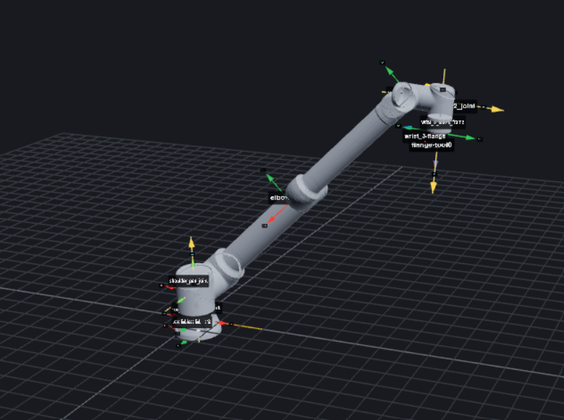
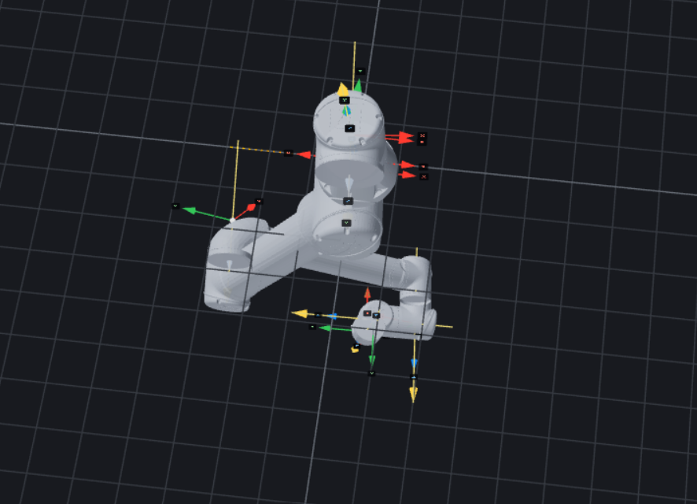
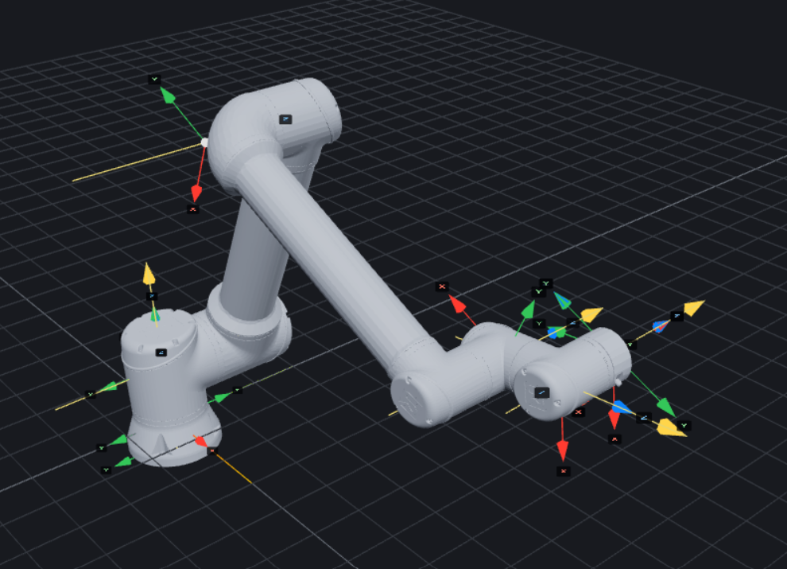


#### 2.3 Reduced J_red vs full J at representative configurations

For the UR12e there are 3 singularity families: shoulder, elbow, wrist. At a singular configuration the arm loses one task direction u (the left null vector of J_red). Every singular configuration falls into one of two types: 
- Type A: u has an x component, so the slide can supply the lost direction and the whole body keeps rank J = 6. 
- Type B: u has no x component, so the whole body is singular too, rank J = 5. 

Which type occurs depends on the configuration (in particular the base yaw q1), not on the family: the same family is type A at some yaws and type B at others.

Elbow Example

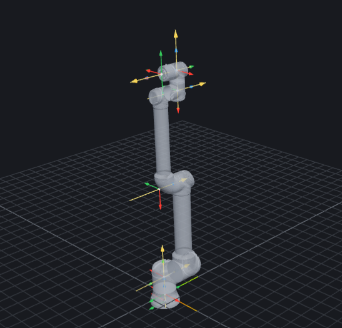

Elbow yaw 0 (type A):  x = 0.5 m,  q = [  0 -45   0 -45 -90   0] deg
```text
  sigma_min(J_red) = 3.72e-18     sigma_min(J) = 0.4472
  lost direction u = [ 0.6918  0.1259  0.6918 -0.0147  0.1635 -0.    ]  |u_x| = 0.6918

  test 1  produce the task velocity u (|u| = 1):
          arm alone  (J_red qd = u):  best residual = 1.0000
          whole body (J qd = u)    :  best residual = 0.0000,   base speed xdot = 1.4455 m/s
          -> the slide supplies what the arm cannot

  test 2  hold the tool pose, slide the base, re-solve the arm (IK, start nudged by 0.01 rad on q3)
           x - x0 [m]  pose error  held?  sigma_min(J_red)     q3 [deg]   q [deg]
               -0.300    7.67e-01     no            0.0636     -15.4446   [-162.6 -169.   -15.4  -85.6   90.    17.4]
               -0.250    2.84e-01     no            0.1873     -46.3608   [ -0.  -15.  -46.4 -28.6 -90.   -0. ]
               -0.200    3.56e-01     no            0.2584      68.8312   [ -0.  -72.1  68.8 -86.8 -90.   -0. ]
               -0.150    3.43e-01     no            0.2826     -73.1703   [ -0.   -5.  -73.2 -11.9 -90.   -0. ]
               -0.100    7.89e-02     no            0.0483     -11.6948   [ -0.  -36.  -11.7 -42.3 -90.   -0. ]
               -0.050    3.59e-02     no            0.0021       0.5076   [ -0.  -43.6   0.5 -46.9 -90.   -0. ]
                0.000    4.83e-07    yes            0.0004       0.1047   [ -0.  -45.1   0.1 -45.1 -90.   -0. ]
                0.050    3.29e-11    yes            0.1126      27.8705   [ -0.  -60.2  27.9 -57.7 -90.   -0. ]
                0.100    1.86e-11    yes            0.1560      39.1812   [ -0.  -67.5  39.2 -61.7 -90.   -0. ]
                0.150    4.25e-10    yes            0.1873      47.6671   [ -0.  -73.6  47.7 -64.1 -90.   -0. ]
                0.200    9.69e-11    yes            0.2119      54.6296   [ -0.  -79.   54.6 -65.6 -90.   -0. ]
                0.250    3.68e-11    yes            0.2320      60.5658   [ -0.  -84.1  60.6 -66.5 -90.   -0. ]
                0.300    1.83e-11    yes            0.2488      65.7245   [ -0.  -88.9  65.7 -66.8 -90.   -0. ]
          -> rescued for x - x0 in {+0.05 .. +0.30} m: pose held and the arm is regular
```
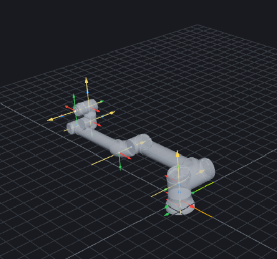

Elbow vertical (type B):   x = 0.5 m,  q = [  0 -90   0   0 -90   0] deg
```text
  sigma_min(J_red) = 7.82e-17     sigma_min(J) = 0.0000
  lost direction u = [ 0.      0.      0.9929  0.      0.119  -0.    ] |u_x| = 0.0000

  test 1  produce the task velocity u (|u| = 1):
          arm alone  (J_red qd = u):  best residual = 1.0000
          whole body (J qd = u)    :  best residual = 1.0000,   base speed xdot = 0.0000 m/s
          -> the slide cannot help either

  test 2  hold the tool pose, slide the base, re-solve the arm (IK, start nudged by 0.01 rad on q3)
           x - x0 [m]  pose error  held?  sigma_min(J_red)     q3 [deg]   q [deg]
               -0.300    7.24e-02     no            0.1135      27.9070   [  0.  -89.4  27.9 -28.5 -90.    0. ]
               -0.250    4.98e-02     no            0.0951     -22.9849   [  0.  -66.9 -23.   -0.1 -90.    0. ]
               -0.200    5.80e-02     no            0.1252     -30.3800   [ -0.1 -65.8 -30.4   6.1 -90.   -0.1]
               -0.150    1.03e-02     no            0.0182       4.3886   [ -0.  -84.9   4.4  -9.5 -90.   -0. ]
               -0.100    6.57e-03     no            0.0305      -7.3154   [ -0.1 -81.7  -7.3  -1.1 -90.   -0.1]
               -0.050    1.05e-03     no            0.0017      -0.4076   [ -0.  -87.4  -0.4  -2.2 -90.   -0. ]
                0.000    4.76e-07    yes            0.0004       0.1032   [  0.  -90.    0.1  -0.1 -90.    0. ]
                0.050    1.05e-03     no            0.0014      -0.3392   [  0.1 -92.2  -0.3   2.6 -90.    0.1]
                0.100    5.61e-03     no            0.0179      -6.5850   [  2.6 -91.3  -6.6   7.8 -90.    2.6]
                0.150    3.50e-03     no            0.0088      -2.3017   [ 20.3 -93.1  -2.3   5.4 -90.   20.3]
                0.200    6.59e-04     no            0.0000       0.0000   [ 49.5 -91.9   0.    1.9 -90.   49.5]
                0.250    4.45e-05     no            0.0000       0.0000   [ 73.5 -89.5   0.   -0.5 -90.   73.5]
                0.300    1.69e-03     no            0.0080       1.9263   [ 91.9 -88.    1.9  -3.9 -90.   91.9]
          -> no x holds the pose: reach boundary in a direction the slide cannot fix
```

### 3. Analytical IK solver

Solver: `scripts/ik_ur12e.py`, validation: `scripts/step05_ik.py` (output in `results/step05_ik.md`).

#### 3.1 Problem: fixed x turns the P6R into a UR12e with a shifted target

With the base at x, the world flange target T* is moved into DH frame 0 of the arm:

$${}^{0}T_{6} = \big(\mathrm{Trans}_x(x)\; T_{\mathrm{mount}}\; T_{\mathrm{BASE}}\big)^{-1}\; T^{*}\; T_{\mathrm{TOOL}}^{-1}$$

From here on the problem is a pure 6R problem, and x no longer appears in the formulas: changing x only changes the
target that the arm sees.

#### 3.2 Plane split: three groups instead of a wrist split

The UR wrist is offset (d5, d6 ≠ 0), so axes 4, 5, 6 do not meet in one point and Pieper's position/orientation
split does not apply. Section 2.2 gives the decoupling that does apply. Axes 2, 3, 4 are parallel, so 3J5 is block
triangular, and its three blocks are the three groups of the IK:

```text
group  joints      quantity used                         2 roots    singular when (block of 2.2)
1      q1          position of O5 (wrist_2 origin)       S+ / S-    rho = 0        shoulder
2      q5, q6      orientation, given q1                 W+ / W-    sin q5 = 0     wrist
3      q2, q3, q4  planar 3R in the arm plane            E+ / E-    sin q3 = 0     elbow
```

Each group uses a quantity that depends only on the joints still unknown in that group. The groups are solved in
the order 1 -> 2 -> 3.

#### 3.3 Group 1: q1 from O5 (shoulder S±)

O5 is where the wrist_2 and wrist_3 axes cross, d6 behind the flange on the tool axis:
$p_5 = p - d_6 z_6$. It is fixed by the target alone. The upper arm and forearm move in a vertical plane through
axis 1. The wrist sits d4 to the side of that plane, and q2..q5 cannot change this offset. So the plane, turned by
q1, must leave O5 at distance d4. Seen from above, the plane is a tangent from axis 1 to a circle of radius d4
around O5, and there are two tangents:

$$q_1 = \mathrm{atan2}(p_{5y},\, p_{5x}) \pm \arccos\!\left(\frac{d_4}{r}\right) + \frac{\pi}{2},
\qquad r = \sqrt{p_{5x}^2 + p_{5y}^2} \;\ge\; d_4$$

- r < d4: no root (the inner hole of the maps in section 4).
- r = d4: the two tangents coincide (shoulder family, rho = 0).

Example (pose of 1.4): O5 = (-0.877, -0.332, 0.426) m in frame 0, r = 0.9375 m.
atan2 = -159.3°, arccos(d4/r) = 79.3°, so q1 = **10.0°** (S+) or **-148.6°** (S-).

#### 3.4 Group 2: q5, q6 from the orientation (wrist W±)

With q1 known, the common direction of axes 2-3-4 is $n = (\sin q_1, -\cos q_1, 0)$ in frame 0. Along n, O5 sits
at d4 (3.3), and the flange is O5 + d6 z6, so the tool axis has component $\cos q_5$ along n:

$$\cos q_5 = \frac{p \cdot n - d_4}{d_6}, \qquad q_5 = \pm \arccos(\cdot)$$

The sign of q5 is the wrist flip. q6 follows from the components of x6 and y6 along n:

$$q_6 = \mathrm{atan2}\!\big(-\mathrm{sgn}(\sin q_5)\,(y_6 \cdot n),\;\; \mathrm{sgn}(\sin q_5)\,(x_6 \cdot n)\big)$$

because, seen from the tool frame, n has the components $(\sin q_5 \cos q_6,\, -\sin q_5 \sin q_6,\, \cos q_5)$.

At sin q5 = 0 (wrist family) the tool axis is parallel to axes 2-3-4. Then q4 and q6 turn about the same axis,
only q4 + q6 is determined, and the solver sets q6 = 0.

#### 3.5 Group 3: q2, q3, q4 as a planar 3R (elbow E±)

With q1, q5, q6 known, the three outer transforms are peeled off:

$${}^{1}T_{4} = A_1^{-1}\; {}^{0}T_{6}\; A_6^{-1} A_5^{-1} = A_2 A_3 A_4$$

The point $p_{13}$ (O4 without its d4 offset, in frame 1) lies in the arm plane and is reached by the two links
a2, a3. The law of cosines gives

$$\cos q_3 = \frac{|p_{13}|^2 - a_2^2 - a_3^2}{2 a_2 a_3}, \qquad q_3 = \pm\arccos(\cdot), \qquad
q_2 = -\mathrm{atan2}(p_{13,y}, -p_{13,x}) + \arcsin\!\frac{a_3 \sin q_3}{|p_{13}|}$$

and q4 is the remaining in-plane rotation, read off ${}^{3}T_{4}$ (q2 + q3 + q4 = in-plane angle of the wrist).

- |cos q3| > 1: no root (outer reach of the maps).
- cos q3 = ±1: arm stretched or folded (elbow family).

#### 3.6 Branches, labels, angle wrapping

- Three groups with two roots each give at most 2 × 2 × 2 = **8 branches**. A branch is dropped when an acos
  argument leaves [-1, 1].
- Every angle is wrapped to (-π, π]. With the project limits of ±π on every joint, each geometric branch gives
  exactly one joint vector and no root is rejected by a limit. On a path, however, the ±π seam acts as a
  joint limit (section 5).
- **Label = sign triple** (sign rho, sign q5, sign q3). Each branch lies in its own aspect, the region cut out by
  the three singular surfaces det J_red = 0. `branch_of(q)` reads the label off any joint vector.

#### 3.7 Validation

From `results/step05_ik.md` (2000 random configurations, limits ±π):

```text
max |q_true - nearest branch|  = 6.4e-11 rad   (the input configuration is always recovered)
max |FK(branch) - T06|         = 3.4e-12       (every returned branch reaches the pose)
number of branches per pose    = {2: 51, 4: 268, 6: 98, 8: 1583}
label vs sign triple read from q: 14426 solutions, 0 mismatches
```

The count is always even, because roots appear and disappear in pairs at the singular surfaces.

**Label persistence along paths** (`drafts/ik_persistence_check.py`). We took 100 random straight joint-space
paths with 300 steps each and ran FK then IK at every step. For each label we checked whether the nearest root
at the next step carries the same label:

```text
same label in 99.72 % of 194256 steps;  the 545 switches, by closest singular family:
  shoulder (rho = 0) 68.4 %    wrist (sin q5 = 0) 23.9 %    elbow (sin q3 = 0) 7.7 %
```

Labels change only next to a singular surface, where two branches meet. A path planner therefore follows a
branch by continuity and monitors sigma_min; the label alone is not enough (section 5).

**Independent check in the course simulator (Module 3).** The 8 solutions of the pose of 1.4 were loaded into
Module 3, which computes forward kinematics with its own code. All 8 show 0.000 mm / 0.0000°. Files:
`drafts/sim/umr_ur12e_sim_report.urdf` and `drafts/sim/m3_section3_pose.csv`. The repo's
`sim/umr_ur12e_sim.urdf` mounts the arm 1 cm lower and rotated by π about axis 1, so it does not match this
report's model; the corrected copy matches the URDF chain to 6e-10.

<!-- TODO Megi: insert the Module 3 screenshot here -->

#### 3.8 All solutions of one tool pose

Target = flange pose of 1.4 (x = 0.5 m, q0 = [10, -60, 90, -120, -90, 30] deg):

```text
branch           q1       q2       q3       q4       q5       q6       rho  sin q3  sin q5   det J_red    |FK-T|
S+ W+ E+      10.00   -37.74    50.91    76.83    90.00  -150.00    -0.921   0.776   1.000  -2.504e-01   1.5e-15
S+ W+ E-      10.00    11.27   -50.91   129.64    90.00  -150.00    -0.921  -0.776   1.000   2.504e-01   1.9e-15
S+ W- E+      10.00   -60.00    90.00  -120.00   -90.00    30.00    -0.921   1.000  -1.000   3.226e-01   1.5e-15   <- q0
S+ W- E-      10.00    26.02   -90.00   -26.02   -90.00    30.00    -0.921  -1.000  -1.000  -3.226e-01   1.5e-15
S- W+ E+    -148.59   153.98    90.00  -153.98    90.00    51.41     0.921   1.000   1.000   3.226e-01   1.3e-15
S- W+ E-    -148.59  -120.00   -90.00   -60.00    90.00    51.41     0.921  -1.000   1.000  -3.226e-01   1.3e-15
S- W- E+    -148.59   168.73    50.91    50.36   -90.00  -128.59     0.921   0.776  -1.000  -2.504e-01   1.3e-15
S- W- E-    -148.59  -142.26   -50.91   103.17   -90.00  -128.59     0.921  -0.776  -1.000   2.504e-01   1.3e-15
```

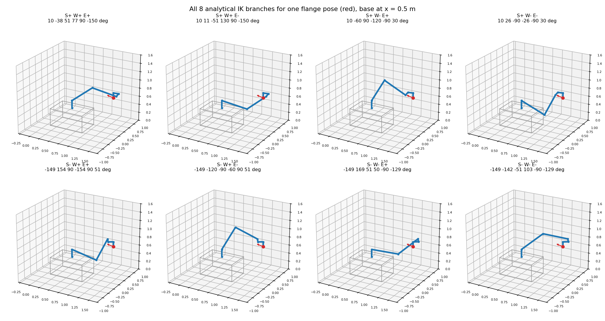

The same tool pose is reached by 8 physically different postures. The two shoulder sides differ by about 159° in
q1, and within each side the wrist flips and the elbow goes up or down.

#### 3.9 The base position selects the branches

Same world target, base slid along x (`results/step05_ik.md` section 5, and a finer sweep):

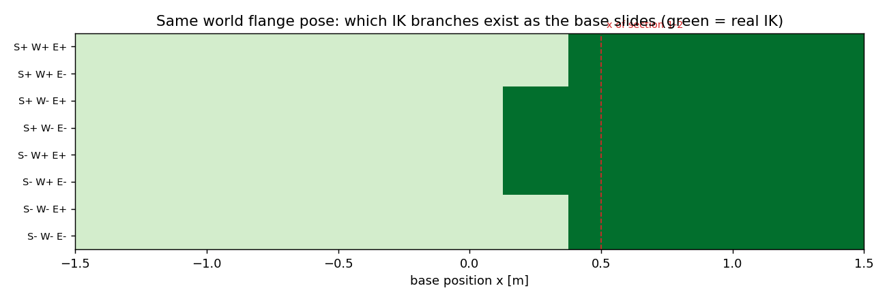

```text
x <  0.13 m          0 branches  (target out of reach)
0.13 <= x < 0.38 m   4 branches  S+ W- E±, S- W+ E±
x >= 0.38 m          8 branches
```

Branches come and go in elbow pairs. Fixing x does not just shift the arm; it decides which branches exist.
Sections 4 and 5 extend this from one pose to a grid of positions and to a path.

### 4. Reachable-position maps over discrete base positions
#### 4.1 Reachable-position maps, joint limits +/- pi

The maps show the geometric branch count: every joint angle is wrapped to (-pi, pi), so a configuration and its +/- 2 pi copie from UR12e are counted once. The UR12e's own limits (+/- 2 pi on all joints, +/- pi on the elbow) are never tighter than 180 deg, so they remove no geometric branch and the count needs no further filtering.  Any tighter limit would act as a filter on the same grid, lowering the count where a branch leaves the allowed interval.

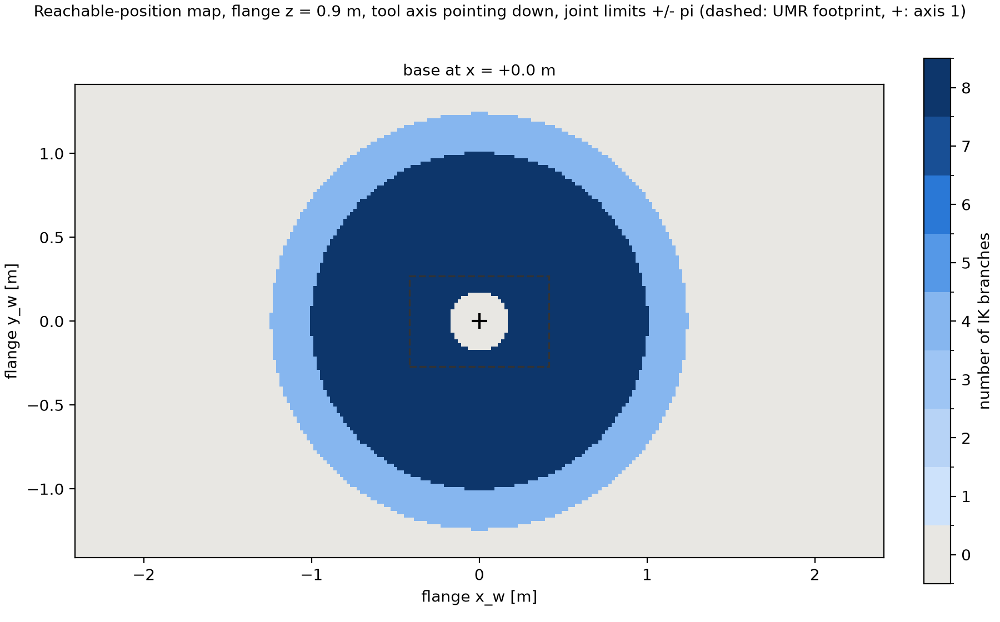
```text
flange orientation R (world), columns = flange axes:
[[ 0.  0.  1.]
 [ 0.  1.  0.]
 [-1.  0.  0.]]

flange height z = 0.9 m  (arm base at 0.42 m, shoulder axis at 0.6007 m)

grid: x_w in [-2.4, 2.4] m, y_w in [-1.4, 1.4] m, step 0.02 m, 241 x 141 = 33981 IK calls per map, 40 s for 3 maps
```
#### 4.2 Reachable-position maps with discrete base x
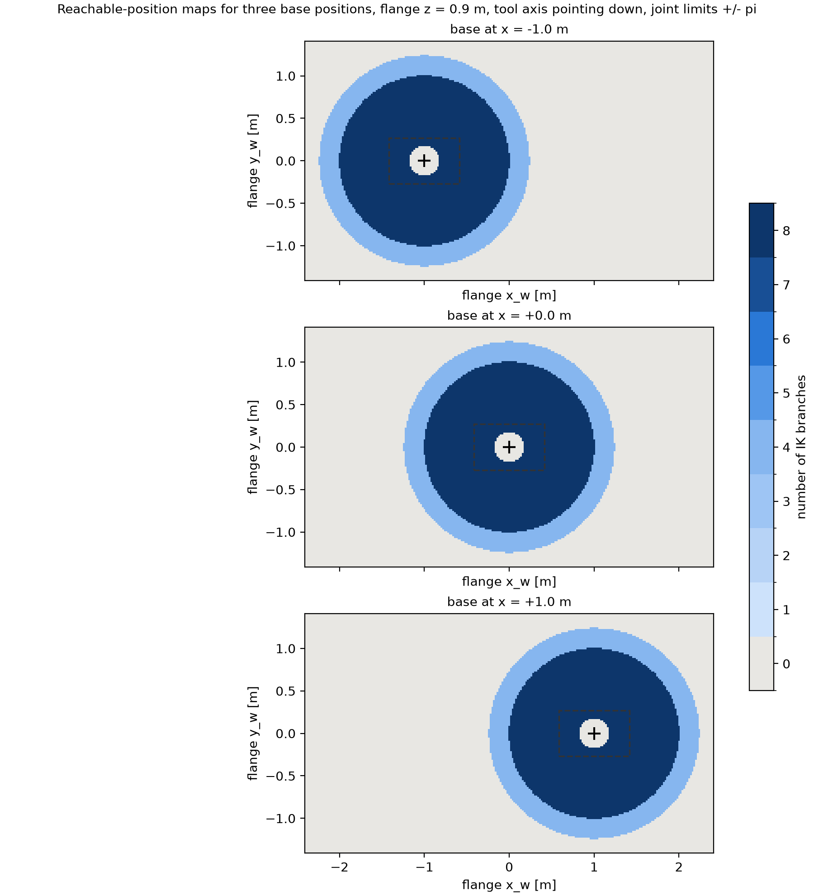

```text
base at x = -1.0 m: 0 IK: 22129 pts, 4 IK: 4176 pts, 8 IK: 7676 pts;  reachable radius from axis 1: 0.179 .. 1.241 m

base at x = +0.0 m: 0 IK: 22129 pts, 4 IK: 4176 pts, 8 IK: 7676 pts;  reachable radius from axis 1: 0.179 .. 1.241 m

base at x = +1.0 m: 0 IK: 22129 pts, 4 IK: 4176 pts, 8 IK: 7676 pts;  reachable radius from axis 1: 0.179 .. 1.241 m
```
reading: 
- the count is constant on regions bounded by the images of the three singular families:

    - Outer boundary: elbow family (arm stretched)---0 IK  
    - Inner hole of radius d4 = 0.174 m: shoulder family(O5 cannot come closer to axis 1 than the arm-plane offset)---0 IK  
    - Inside r = 1.0 m all 8 branches exist---8 IK
    - In the ring 1.0 .. 1.24 m only one wrist choice keeps O4 within the planar 2R reach---4 IK

- Moving the base translates the whole map: the slide adds reach only along x.

#### 4.3 Out of curiosity, Reachable-position maps with different flange orientation 
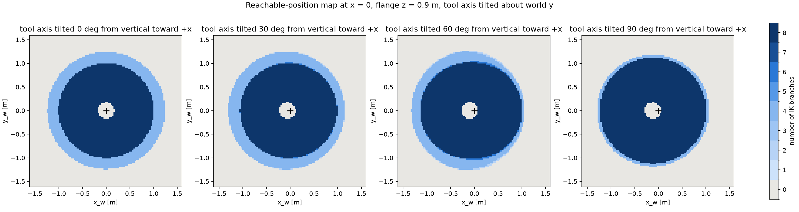

#### 4.4 Per-branch outcome classes, two flange orientations

Code: `drafts/maps_section4.py` (z = 0.9 m as in 4.1; output `drafts/maps_section4_output_z09.txt`). The IK and
the Jacobian are vectorised; the singular values agree with `scripts/jacobian_p6r.py` to 1.8e-15.

Each branch gets one of four outcomes per grid cell: feasible / no real IK / joint limit / singular
(sigma_min(J_red) < 0.05). The two orientations are:

```text
tool down        flange x = -Z world   R = [[0,0,1],[0,1,0],[-1,0,0]]   (as in 4.1)
tool horizontal  flange x = +Y world   R = [[0,-1,0],[1,0,0],[0,0,1]]   (facing the task side)
```

(In our chain the end frame is the ROS `flange` frame, whose x axis points out of the tool.)

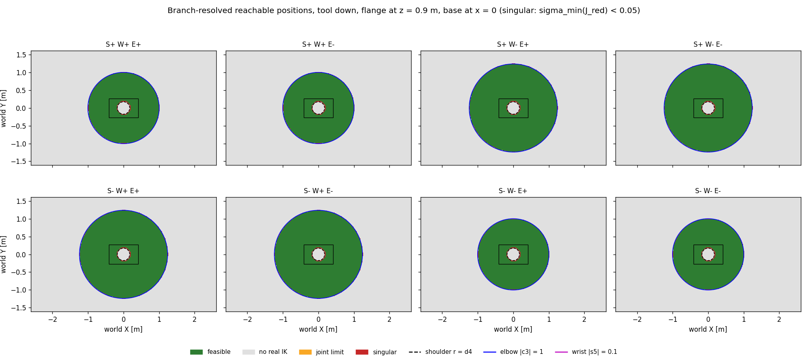
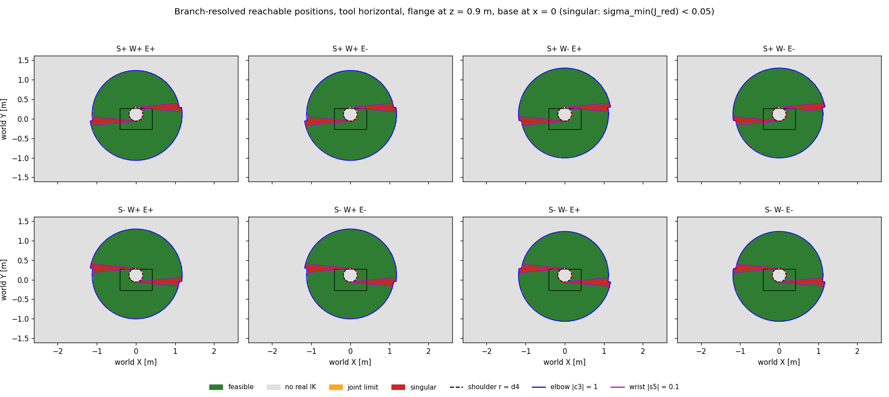

```text
area per class at x = 0 [m^2]      feasible  no real IK  joint limit  singular
tool down        S+W+E±, S-W-E±       3.01      13.74        0.00       0.06
                 S+W-E±, S-W+E±       4.67      12.07        0.00       0.07
tool horizontal  every branch         3.81      12.73        0.00       0.26-0.27
```

- **Tool down:** each branch map is an annulus. The inner hole is the shoulder family (r < d4) and the outer edge
  the elbow family (|cos q3| = 1). There is **no wrist singularity**: the tool axis is vertical and n is
  horizontal, so cos q5 = 0 and q5 = ±90° everywhere. The two reach classes differ by about 2·d5, because with
  q5 = ±90° the wrist link points away from or toward axis 1. This is the 4-branch ring of 4.2.
- **Tool horizontal:** the wrist family appears as two thin wedges along ±X, where the tool axis (+Y) is
  parallel to axes 2-3-4, i.e. where the arm plane runs along world X. The singular area is about 4× larger.
- **Joint-limit class:** empty in every map. With ±π limits and wrapped angles no root can leave the limits
  (see 3.6).

#### 4.5 World overlay on a task region

Task region: a 3 m strip beside the path, x ∈ [-1.5, 1.5] m, y ∈ [0.5, 0.9] m.

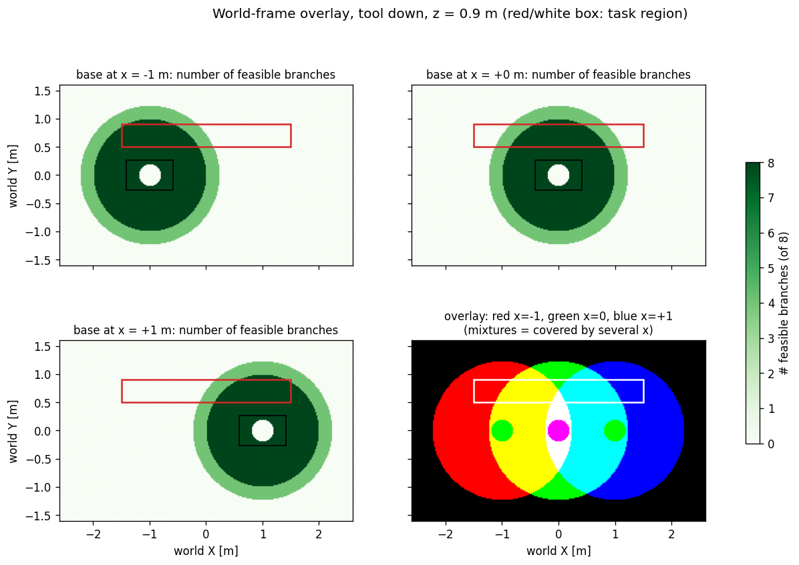

```text
covered by >= 1 feasible branch     tool down   tool horizontal
base at x = -1 m                       50.8 %          51.0 %
base at x =  0 m                       67.5 %          67.9 %
base at x = +1 m                       50.1 %          50.3 %
union of the three                    100.0 %         100.0 %
only one x works on                    34.3 %          33.5 %
```

No single base position covers the strip. The three together do, but a third of the strip is covered by **one
x only**. There the base position is forced, and that is where a path has to move the base (section 5).

#### 4.6 Which singular cells the slide rescues (J_red vs J on the maps)

Each singular cell is assigned to the det J_red factor of 2.2 that is closest to 0 (the factor with the smallest
normalised value), and we check whether the whole body is regular there (sigma_min(J) ≥ 0.05):

```text
                tool down                      tool horizontal
shoulder     416 cells, rescued 93.3 %       438 cells, rescued 90.0 %
elbow        960 cells, rescued 88.3 %       992 cells, rescued 95.6 %
wrist          0 cells                      3960 cells, rescued 12.5 %
```

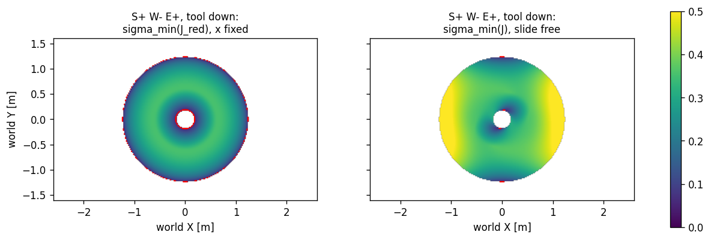
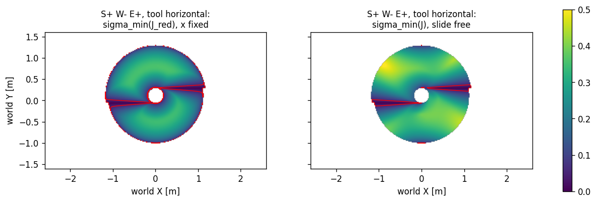

This is the map-level version of the type A / type B result of 2.3:
- The **elbow** boundary loses a radial translation. The slide supplies it along ±X (bright lobes) but not along
  ±Y, where the radial direction is perpendicular to the slide.
- The **wrist** family mostly loses a rotation, which a prismatic joint cannot supply, so only 12.5 % of those
  cells are rescued.

The singular class is a thin band around the critical curves whatever the threshold: 0.0 / 0.3 / 1.8 / 6.9 % of
the reachable cells for 0.01 / 0.02 / 0.05 / 0.10.

### 5. Cartesian path and the (s, x) redundancy plane

(the final chart will hit the a wall)

With x fixed the robot is a 6R arm with at most 8 IK branches. Letting x vary turns every branch into a one-parameter family of solutions. The redundancy is drawn as a
map with the path progress s on the horizontal axis and the redundant joint, here the base position x, on the vertical axis. Every dot is one analytical IK evaluation.

#### 5.1 Path

A closed rectangle in the horizontal plane, tool axis pointing down, longer than the arm can reach from one base position, so the base has to move:

```text
corners (x_w, y_w)   (-0.8, 0.25) -> (0.8, 0.25) -> (0.8, 0.85) -> (-0.8, 0.85) -> back     
flange height        z = 0.9 m
orientation          flange outward normal (axis 6) pointing down, flange z along +x_w
s                    arc length over the 4.4 m perimeter, 111 samples
x                    base position, -1.0 .. 1.0 m, step 0.05 m (41 positions)
```

#### 5.2 Classification of one dot

For each (s, x) the analytical IK of the arm is run with the base at x. A branch gets a green dot when it has a root and the fixed-x arm is regular, sigma_min(J_red) >= 0.03; otherwise grey (no root, or the root is singular). Joint limits are +/- pi, so no root is lost to limits. On this path the singular classes stay empty: the tool-down orientation keeps q5 at +/- 90 deg, far from the wrist family, and the rectangle stays
outside the shoulder hole of radius d4. The only family touched is the elbow, at the edge of the reach band, where the root disappears at the same place.

#### 5.3 Map

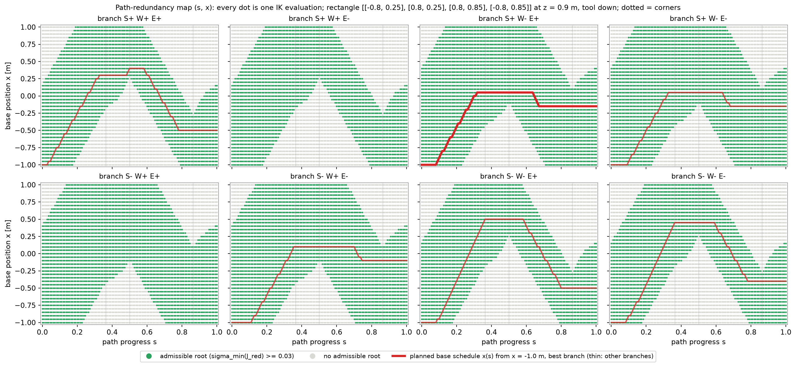

One panel per branch. The green band follows the x coordinate of the tool along the rectangle: it rises on the first long side and falls on the return. From the start position x(0) = -1 m no horizontal line stays green, so the base must move; a parked base executes the path only inside a narrow corridor, x ∈ [-0.10, 0.10] m on three branches (5.6).


#### 5.4 Base schedule x(s), analytical planning

Within one branch the green dots form a layered graph over s. Two dots in neighbouring layers are connected when the base moves at most 0.05 m and every joint moves at most 0.5 rad, measured on the unwrapped angles so that a jump across +/- pi is rejected. Dynamic programming returns the cheapest complete schedule from the fixed start x(0) = -1.0 m with

```text
cost = sum over steps of ( |dq|_2 [rad]  +  2 * |dx| [m] )
```

i.e. joint travel plus a penalty on base travel; it is a distance, not a time.

```text
branch     plan cost   x range of the schedule
S+ W+ E+      11.79    [-1.00, +0.40] m
S+ W+ E-       none    q4 crosses +/- pi along the path
S+ W- E+      10.31    [-1.00, +0.05] m      <- best
S+ W- E-      10.51    [-1.00, +0.05] m
S- W+ E+       none    q2 and q4 cross +/- pi along the path
S- W+ E-      11.04    [-1.00, +0.10] m
S- W- E+      12.97    [-1.00, +0.50] m
S- W- E-      12.76    [-1.00, +0.45] m

best branch S+ W- E+: base from x = -1.00 to -0.15 m, base travel 1.25 m,
joint travel per joint [deg] = [162, 214, 247, 81, 0, 162],
min sigma_min(J_red) along the schedule = 0.172
```

The red line in the figure is the schedule of the best branch (thin red: the other feasible branches). The
base climbs with the tool during the first long side, waits near x = 0 during the short side and the start
of the return, then steps back to -0.15 m.

#### 5.5 Findings

- The base position decides which branches exist at a given path point (the width and position of the
  green band differ per branch) and whether a continuous execution is possible at all: six of the eight
  branches admit a complete schedule, none admits a parked base.
- Two branches, S+ W+ E- and S- W+ E+, are mostly green yet have no schedule. Along the path one of their
  joints (q4, and q2 for the second) runs through 180 deg. Each dot is inside +/- pi, so the map shows no
  defect, but a path cannot cross the +/- pi seam. The joint-limit convention acts as a path constraint, not
  as a filter on the dots.
- The planner is fully analytical: every configuration on the red line is a closed-form IK root, the
  Jacobian enters only through the sigma_min check. A greedy planner that keeps the base at x = -1.0 m
  loses the pose at s = 0.23, when the tool leaves the arm's reach.

#### 5.6 Fixed-x baseline: one continuation per branch

With the base parked, each admissible root at s = 0 is followed along the path (step rule as in 5.4:
|dq| ≤ 0.5 rad per step on the wrapped angles, so a jump across ±π counts as reaching the joint limit).

```text
branch     | base parked at x = 0 m                          | base parked at x = -1 m
S+ W+ E+   |  44 % done, s = 0.45: no root (out of reach)    |  17 % done, s = 0.18: no root (out of reach)
S+ W+ E-   |   8 % done, s = 0.09: q4 reaches +-pi seam      |   5 % done, s = 0.05: q4 reaches +-pi seam
S+ W- E+   | completes                                       |  23 % done, s = 0.24: no root (out of reach)
S+ W- E-   | completes                                       |  23 % done, s = 0.24: no root (out of reach)
S- W+ E+   |   2 % done, s = 0.03: q4 reaches +-pi seam      |   2 % done, s = 0.03: q2 reaches +-pi seam
S- W+ E-   | completes                                       |  23 % done, s = 0.24: no root (out of reach)
S- W- E+   |  40 % done, s = 0.41: q2 reaches +-pi seam      |  15 % done, s = 0.15: q2 reaches +-pi seam
S- W- E-   |  44 % done, s = 0.45: no root (out of reach)    |  17 % done, s = 0.18: no root (out of reach)

label persistence on these runs: the nearest root has the same label in 100 % of 1164 steps
```

There are only two failure causes on this path: the tool leaves the reach band (elbow family, the root
disappears), or a joint reaches the ±π seam. No branch stops on a singularity, because tool-down keeps q5 at ±90°
and the rectangle stays outside the shoulder hole (see 5.2). Since no branches merge, the analytical labels
are also the continuation labels: the nearest root at the next step always has the same label.

#### 5.7 Greedy continuation vs branch-aware planning

The proposal's greedy planner chooses x **locally**. At every step it takes one admissible neighbour (same branch,
|dx| ≤ 0.05 m, |dq| ≤ 0.5 rad, the same constraints as the DP) and never looks ahead. We use two local rules:

- **greedy, min step cost**: the neighbour with the smallest |dq| + 2|dx|. This is the DP cost, minimised one step at a time.
- **greedy, max sigma_min**: the neighbour with the largest sigma_min(J_red), i.e. the safest-looking step.

All runs start at x(0) = -1 m on the given branch. The DP of 5.4 is reproduced exactly (costs agree within 0.005).

**At the step-07 base-speed bound (|dx/ds| ≤ 1.25):**

```text
branch     | branch-aware DP | greedy, min step cost | greedy, max sigma_min
S+ W+ E+   | cost 11.79      | completes, cost 13.03 | completes, cost 15.31
S+ W+ E-   | no schedule     | fails s=0.42, q4 seam | fails s=0.42, q4 seam
S+ W- E+   | cost 10.31      | completes, cost 15.02 | completes, cost 14.99
S+ W- E-   | cost 10.51      | completes, cost 15.00 | completes, cost 14.42
S- W+ E+   | no schedule     | fails s=0.39, q2 seam | fails s=0.39, q2 seam
S- W+ E-   | cost 11.04      | completes, cost 13.95 | completes, cost 15.70
S- W- E+   | cost 12.97      | completes, cost 14.56 | completes, cost 15.04
S- W- E-   | cost 12.76      | completes, cost 14.98 | completes, cost 16.08
```

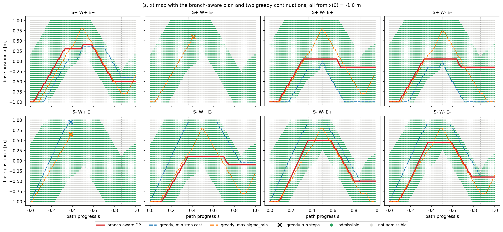

With a fast base, all three planners complete the same 6 branches. Greedy is 10–46 % more expensive, and the two
greedy rules fail differently:
- **min step cost** keeps the base still as long as it can, because base motion costs. It rides the lower edge
  of the green band, which is the reach boundary (elbow family). Its sigma_min(J_red) drops to **0.033**, just
  above the 0.03 threshold, against 0.172 for the DP.
- **max sigma_min** chases the middle of the band and moves the base **3.9 m**, against 1.25 m for the DP.

**Slower base.** The slope bound is the base speed relative to the tool speed. Tightening it separates the planners:

```text
base speed <= k x tool speed     1.25   0.94   0.62   0.50   0.42   0.31
branch-aware DP                   6/8    6/8    5/8    3/8    3/8    0/8
greedy, min step cost             6/8    6/8    3/8    3/8    0/8    0/8
greedy, max sigma_min             6/8    6/8    3/8    2/8    0/8    0/8
```
(complete executions out of 8 branches; the x grid step equals the base step in each column)

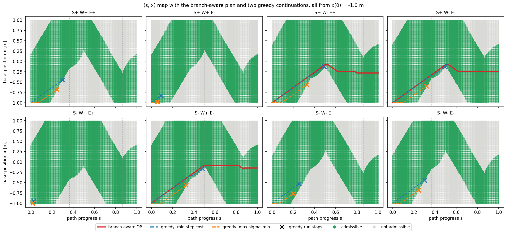

At k = 0.42 the DP still finds three schedules, and both greedy planners fail on every branch, each time for the
same reason: *"green band moved out of reach"*. The figure shows the mechanism. On the first long side the green
band climbs with the tool, and a slow base can only just keep up if it starts climbing **immediately** and keeps
to the upper part of the band, so that it passes **above** the tip of the grey wedge at s ≈ 0.5.
- **min step cost** follows almost the same line as the DP but hesitates for a step. It arrives a few
  centimetres too low at s = 0.49 and meets the tip of the wedge.
- **max sigma_min** first waits where the arm is best conditioned and is too late by s = 0.33.

No local rule can see the wedge coming. The DP sees the whole (s, x) plane and commits early.

#### 5.8 Execution profiles

Best DP branch (S+ W- E+) with its two greedy runs, step-07 base speed:

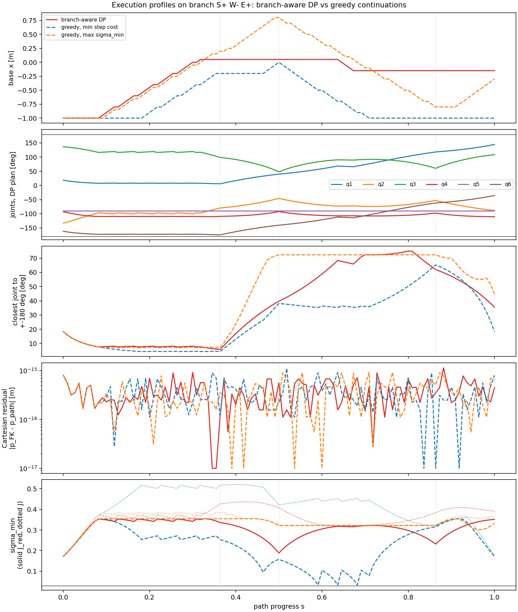

```text
run                    s reached  base travel  max |dx/ds|  min seam margin  max pos residual  min sig(J_red)  min sig(J)
branch-aware DP             1.00      1.25 m        1.25         5.7 deg          1.1e-15           0.172        0.173
greedy, min step cost       1.00      2.00 m        1.25         4.3 deg          1.1e-15           0.033        0.173
greedy, max sigma_min       1.00      3.90 m        1.25         7.0 deg          9.2e-16           0.172        0.173
```

- **Cartesian residual** ~1e-15 m everywhere. Every executed configuration is a closed-form IK root, re-checked
  through the independent URDF chain. Only the motion between samples is unchecked; the IK itself adds no error.
- **Joint-limit margin.** On the first long side q6 sits within 4–7° of -180° on every run. This branch is close to
  the seam that eliminated S+ W+ E- and S- W+ E+. With the real UR limits of ±2π the seam disappears, so the two
  "no schedule" branches could become feasible (not checked). The ±π convention is a design choice that shapes the result.
- **Singularity margin.** sigma_min(J) (dotted) stays ≥ 0.17 for every run, even where the greedy-cost run takes
  sigma_min(J_red) down to 0.033. The arm alone is close to the elbow singularity, but the whole body is not:
  the slide supplies the lost radial direction (type A, section 2.3).

#### 5.9 Findings (additions)

- A parked base executes the rectangle only inside a 20 cm corridor around x = 0, on three branches. From the
  start x(0) = -1 m the base has to move.
- Two things kill a branch on this path: leaving the reach band (elbow family) and the ±π seam. Singularities
  play no role, because tool-down removes the wrist family and the path avoids the shoulder hole.
- Greedy vs branch-aware: with a fast base, both complete the same branches, but greedy is 10–46 % more
  expensive and either rides the reach boundary or wanders. With a base slower than about 0.6× the tool speed,
  greedy fails where the DP succeeds. The reason is visible in the (s, x) map: the base must commit early to pass
  above a grey wedge, and no one-step rule can see the wedge.
