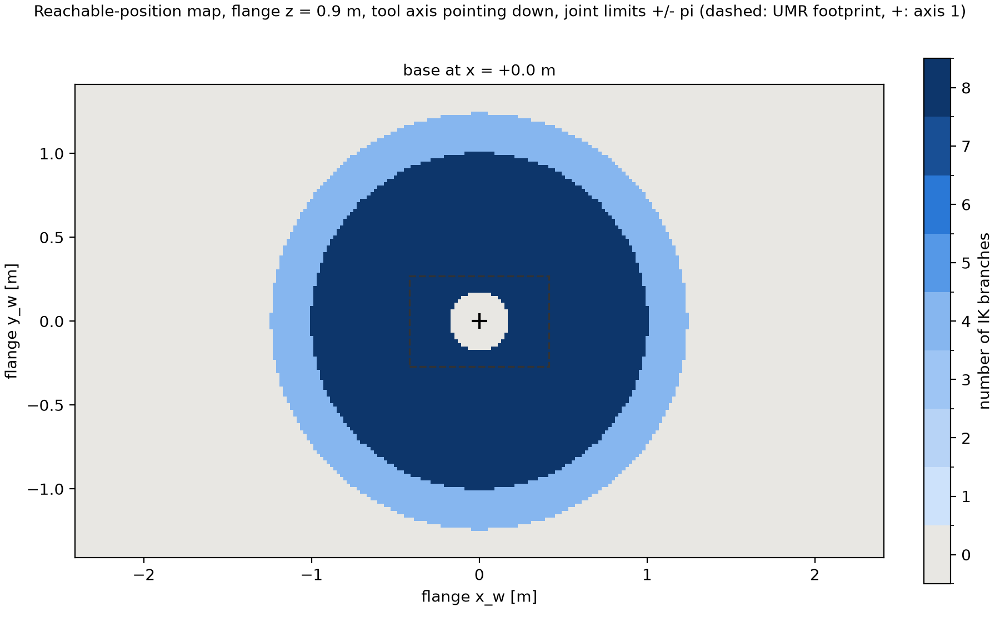
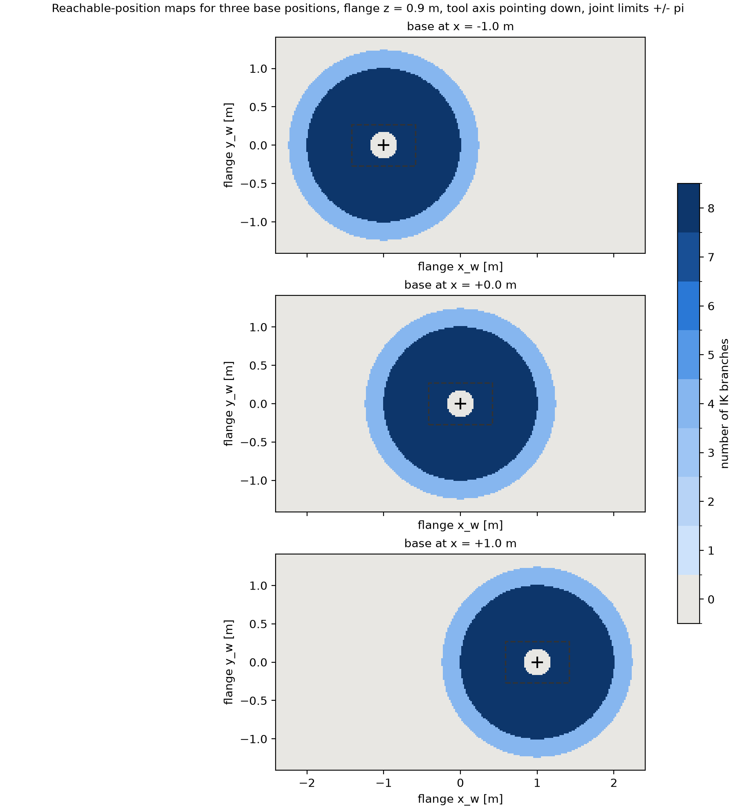

# Step 6: reachable-position maps at discrete base positions

Script: `scripts/step06_reach_map.py`





```text
=== reachable-position maps, joint limits +/- pi (geometric count) ===
flange orientation R (world), columns = flange axes:
[[ 0.  0.  1.]
 [ 0.  1.  0.]
 [-1.  0.  0.]]
  -> flange outward normal (URDF flange x = DH z6, the tool axis) pointing down; O5 is d6 straight above the flange
flange height z = 0.9 m  (arm base at 0.42 m, shoulder axis at 0.6007 m)
grid: x_w in [-2.4, 2.4] m, y_w in [-1.4, 1.4] m, step 0.02 m, 241 x 141 = 33981 IK calls per map, 40 s for 3 maps

base at x = -1.0 m: 0 IK: 22129 pts, 4 IK: 4176 pts, 8 IK: 7676 pts;  reachable radius from axis 1: 0.179 .. 1.241 m

base at x = +0.0 m: 0 IK: 22129 pts, 4 IK: 4176 pts, 8 IK: 7676 pts;  reachable radius from axis 1: 0.179 .. 1.241 m

base at x = +1.0 m: 0 IK: 22129 pts, 4 IK: 4176 pts, 8 IK: 7676 pts;  reachable radius from axis 1: 0.179 .. 1.241 m

map at x = +1 / -1 equals the map at x = 0 shifted by +1 / -1 m: True
figures: results/figures/reach_map_x0.png, results/figures/reach_maps_x.png

reading: the count is constant on regions bounded by the images of the three singular families.
         Outer boundary: elbow family (arm stretched).  Inner hole of radius d4 = 0.174 m: shoulder family
         (O5 cannot come closer to axis 1 than the arm-plane offset).  Inside r = 1.0 m all 8 branches
         exist; in the ring 1.0 .. 1.24 m only one wrist choice keeps O4 within the planar 2R reach (4).
         Moving the base translates the whole map: the slide adds reach only along x.
```
