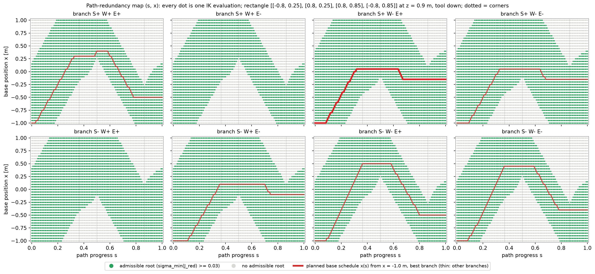

# Step 7: path-redundancy map (s, x) and base schedule

Script: `scripts/step07_sx_map.py`



```text
=== path-redundancy map (s, x) ===
path: closed rectangle through [[-0.8, 0.25], [0.8, 0.25], [0.8, 0.85], [-0.8, 0.85]] (x_w, y_w) at z = 0.9 m, tool axis down, perimeter 4.4 m, 111 samples
base: x in [-1.0, 1.0000000000000018] m, step 0.050 m, 41 positions;  IK + Jacobians at 4551 (s, x) points in 12 s
thresholds: sigma_min >= 0.03 admissible;  plan: start x = -1.0 m, |dx| <= 0.05 m/step, |dq| <= 0.5 rad/step (unwrapped), cost = |dq| + 2.0|dx|

branch     admissible chart-sing  body-sing  no root   legal at s=0 plan cost  x range of plan
S+ W+ E+        60.0%       0.0%       0.0%      40.0%             24     11.79  [-1.00, +0.40] m
S+ W+ E-        60.0%       0.0%       0.0%      40.0%             24      none  -
S+ W- E+        76.7%       0.0%       0.0%      23.2%             29     10.31  [-1.00, +0.05] m
S+ W- E-        76.7%       0.0%       0.0%      23.2%             29     10.51  [-1.00, +0.05] m
S- W+ E+        76.7%       0.0%       0.0%      23.2%             29      none  -
S- W+ E-        76.7%       0.0%       0.0%      23.2%             29     11.04  [-1.00, +0.10] m
S- W- E+        60.0%       0.0%       0.0%      40.0%             24     12.97  [-1.00, +0.50] m
S- W- E-        60.0%       0.0%       0.0%      40.0%             24     12.76  [-1.00, +0.45] m

branch S+ W+ E- has no complete schedule: joints ['q4'] cross the +/- pi seam along the path,
  which the +/- pi joint limits forbid.  The joint-limit effect appears as a path constraint, not in the map colours.

branch S- W+ E+ has no complete schedule: joints ['q2', 'q4'] cross the +/- pi seam along the path,
  which the +/- pi joint limits forbid.  The joint-limit effect appears as a path constraint, not in the map colours.

best branch S+ W- E+: cost 10.31, base from x = -1.000 to -0.150 m, base travel 1.25 m, joint travel per joint [deg] = [162. 214. 247.  81.   0. 162.]
  min sigma_min(J_red) along the plan = 0.172

figure: results\figures\sx_map.png

reading: each panel is one branch; a green dot means that branch holds the pose with the base at x and the
         fixed-x arm is regular.  Grey: no root, or root at a singular configuration.  A horizontal line is a
         parked base; the rectangle is longer than the arm reach, so no horizontal line stays green: the base must move.
```
