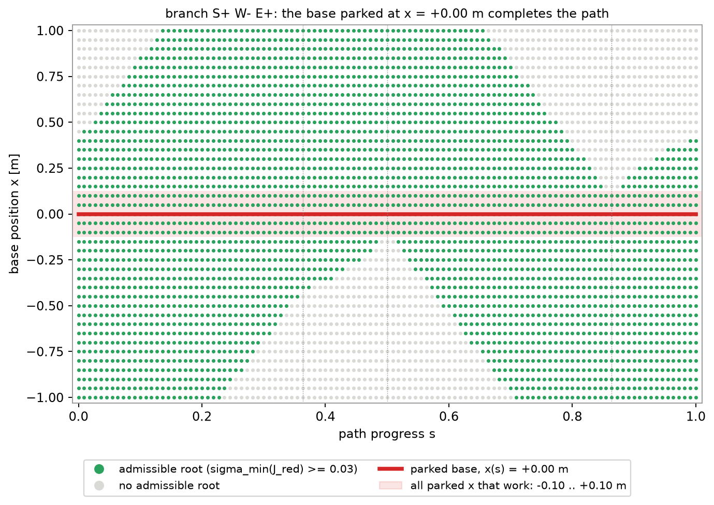

# Step 7B: (s, x) map with a parked base

Script: `scripts/step07b_sx_parked.py`



```text
=== (s, x) map of branch S+ W- E+ with a parked base ===
path: rectangle [[-0.8, 0.25], [0.8, 0.25], [0.8, 0.85], [-0.8, 0.85]] at z = 0.9 m, tool down; 111 path samples, x from -1.0 to 1.0 m in 0.05 m steps
parked base positions that complete the path (every dot green, joints continuous): x = -0.10 .. +0.10 m (5 rows)
drawn: x = +0.00 m
  base travel 0 m, joint travel |dq|_2 summed = 11.67 rad
  joint travel per joint [deg] = [291. 276. 303. 136.   0. 291.]
  joint ranges [deg]: q1 5..151, q2 -146..-41, q3 39..139, q4 -110..-83, q5 -90..-90, q6 -175..-29
  min sigma_min(J_red) along the path = 0.115 at s = 0.18
why it works: from x = +0.00 m the farthest corner is 1.167 m away, inside the 1.241 m reach of this wrist choice,
              and the nearest point of the path is 0.25 m away, outside the shoulder hole of radius 0.174 m.
figure: results\figures\sx_map_parked.png
```
