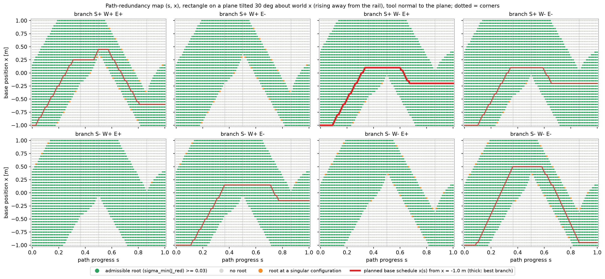

# Step 7C: (s, x) map, plane tilted 30 deg about x

Script: `scripts/step07c_sx_tilted.py`



```text
=== (s, x) map, rectangle on a plane tilted 30 deg about world x (rising away from the rail) ===
corners in the world [m]:
   (-0.800, +0.250, +0.900)
   (+0.800, +0.250, +0.900)
   (+0.800, +0.770, +1.200)
   (-0.800, +0.770, +1.200)
tool axis (flange outward normal) in the world = [ 0.     0.5   -0.866]   (normal to the plane, pointing into it)
grid: 111 path samples x 41 base positions, 11 s;  start x = -1.0 m, cost = |dq| + 2.0|dx|
|q5| over all roots: 60 .. 119 deg   (wrist family at 0 and 180)

branch     admissible  singular  no root   plan cost  x range of plan        parked x that work
S+ W+ E+        56.1%      0.5%    43.5%       12.83  [-1.00, +0.45] m       none
S+ W+ E-        56.1%      0.5%    43.5%        none  -                      none
S+ W- E+        75.6%      0.1%    24.3%       11.08  [-1.00, +0.10] m       +0.00 .. +0.05 m
S+ W- E-        75.6%      0.1%    24.3%       11.41  [-1.00, +0.10] m       +0.00 .. +0.05 m
S- W+ E+        75.6%      0.1%    24.3%        none  -                      none
S- W+ E-        75.6%      0.1%    24.3%       11.86  [-1.00, +0.15] m       -0.05 .. +0.00 m
S- W- E+        56.1%      0.5%    43.5%        none  -                      none
S- W- E-        56.1%      0.5%    43.5%       13.92  [-1.00, +0.50] m       none

branch S+ W+ E-: no schedule, joints ['q4'] cross the +/- pi seam along the path

branch S- W+ E+: no schedule, joints ['q2', 'q4'] cross the +/- pi seam along the path

branch S- W- E+: no schedule, joints ['q2'] cross the +/- pi seam along the path

best branch S+ W- E+: cost 11.08, base from x = -1.00 to -0.20 m, base travel 1.40 m
  joint travel per joint [deg] = [157. 205. 264. 103.  58. 153.]
  min sigma_min(J_red) along the plan = 0.108

singular roots (orange): 100 dots, of which whole-body singular: 0
figure: results\figures\sx_map_tilt_x30.png
```
