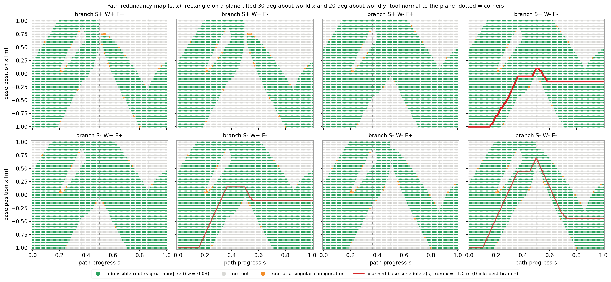

# Step 7C: (s, x) map, plane tilted 30 deg about world x and 20 deg about world y

Script: `scripts/step07c_sx_tilted.py`



```text
=== (s, x) map, rectangle on a plane tilted 30 deg about world x and 20 deg about world y ===
corners in the world [m]:
   (-0.752, +0.387, +0.663)
   (+0.752, +0.113, +1.137)
   (+0.752, +0.633, +1.437)
   (-0.752, +0.906, +0.963)
tool axis (flange outward normal) in the world = [ 0.342  0.47  -0.814]   (normal to the plane, pointing into it)
grid: 111 path samples x 41 base positions, 11 s;  start x = -1.0 m, cost = |dq| + 2.0|dx|
|q5| over all roots: 54 .. 126 deg   (wrist family at 0 and 180)

branch     admissible  singular  no root   plan cost  x range of plan        parked x that work
S+ W+ E+        52.2%      0.6%    47.2%        none  -                      none
S+ W+ E-        52.1%      0.7%    47.2%        none  -                      none
S+ W- E+        73.6%      0.4%    26.0%        none  -                      +0.00 .. +0.00 m
S+ W- E-        73.7%      0.4%    26.0%       11.75  [-1.00, +0.10] m       +0.00 .. +0.00 m
S- W+ E+        73.3%      0.4%    26.3%        none  -                      none
S- W+ E-        73.3%      0.4%    26.3%       11.92  [-1.00, +0.15] m       +0.00 .. +0.00 m
S- W- E+        53.2%      0.6%    46.2%        none  -                      none
S- W- E-        53.2%      0.6%    46.2%       15.42  [-1.00, +0.70] m       none

branch S+ W+ E+: no schedule, the admissible region is not connected from the start

branch S+ W+ E-: no schedule, joints ['q4'] cross the +/- pi seam along the path

branch S+ W- E+: no schedule, joints ['q4', 'q6'] cross the +/- pi seam along the path

branch S- W+ E+: no schedule, joints ['q2', 'q4'] cross the +/- pi seam along the path

branch S- W- E+: no schedule, joints ['q2', 'q6'] cross the +/- pi seam along the path

best branch S+ W- E-: cost 11.75, base from x = -1.00 to -0.15 m, base travel 1.35 m
  joint travel per joint [deg] = [189. 160. 287. 195.  86. 182.]
  min sigma_min(J_red) along the plan = 0.145

singular roots (orange): 185 dots, of which whole-body singular: 8
figure: results\figures\sx_map_tilt_x30y20.png
```
