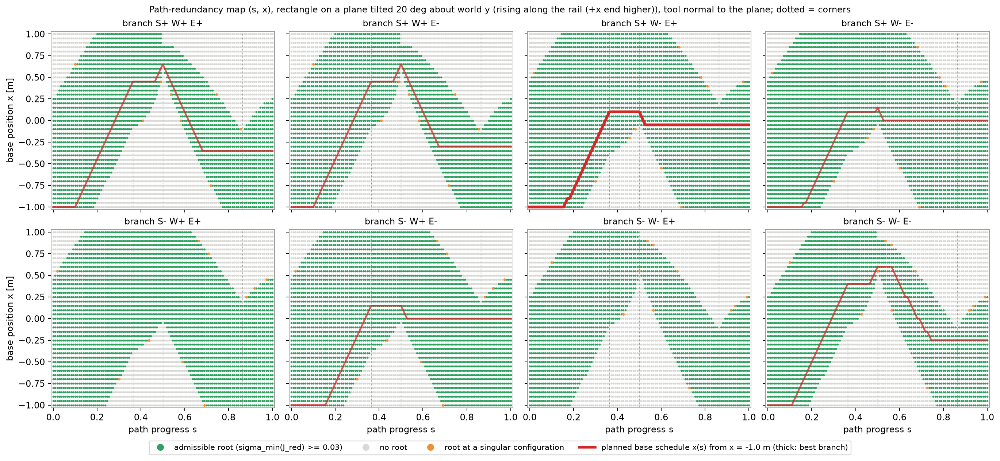

# Step 7C: (s, x) map, plane tilted 20 deg about y

Script: `scripts/step07c_sx_tilted.py`



```text
=== (s, x) map, rectangle on a plane tilted 20 deg about world y (rising along the rail (+x end higher)) ===
corners in the world [m]:
   (-0.752, +0.250, +0.626)
   (+0.752, +0.250, +1.174)
   (+0.752, +0.850, +1.174)
   (-0.752, +0.850, +0.626)
tool axis (flange outward normal) in the world = [ 0.342  0.    -0.94 ]   (normal to the plane, pointing into it)
grid: 111 path samples x 41 base positions, 11 s;  start x = -1.0 m, cost = |dq| + 2.0|dx|
|q5| over all roots: 70 .. 110 deg   (wrist family at 0 and 180)

branch     admissible  singular  no root   plan cost  x range of plan        parked x that work
S+ W+ E+        58.7%      0.2%    41.1%       13.91  [-1.00, +0.65] m       none
S+ W+ E-        58.7%      0.2%    41.1%       13.85  [-1.00, +0.65] m       none
S+ W- E+        77.1%      0.2%    22.7%       10.83  [-1.00, +0.10] m       +0.00 .. +0.15 m
S+ W- E-        77.1%      0.2%    22.7%       10.99  [-1.00, +0.15] m       +0.00 .. +0.15 m
S- W+ E+        76.9%      0.2%    22.9%        none  -                      none
S- W+ E-        76.9%      0.2%    22.9%       11.38  [-1.00, +0.15] m       +0.00 .. +0.15 m
S- W- E+        59.3%      0.2%    40.5%        none  -                      none
S- W- E-        59.3%      0.2%    40.5%       14.17  [-1.00, +0.60] m       none

branch S- W+ E+: no schedule, joints ['q2', 'q4'] cross the +/- pi seam along the path

branch S- W- E+: no schedule, joints ['q2'] cross the +/- pi seam along the path

best branch S+ W- E+: cost 10.83, base from x = -1.00 to -0.05 m, base travel 1.25 m
  joint travel per joint [deg] = [159. 192. 275. 136.  33. 161.]
  min sigma_min(J_red) along the plan = 0.125

singular roots (orange): 78 dots, of which whole-body singular: 0
figure: results\figures\sx_map_tilt_y20.png
```
